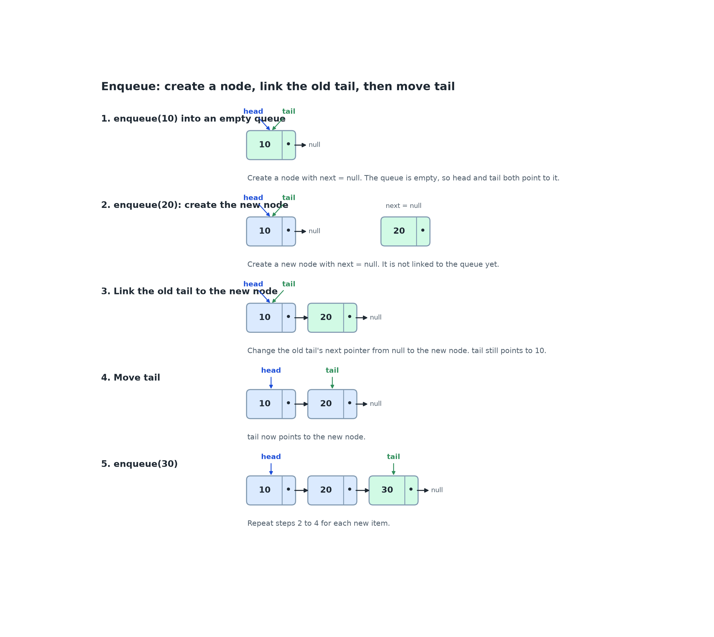
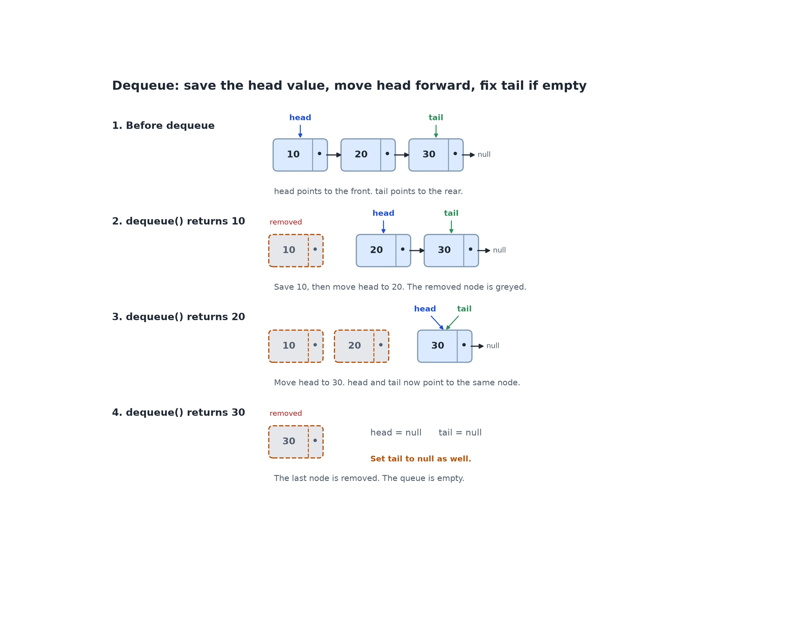

# Markdown Content v1.0

**Team 404: HINF** · Algorithms, Data Structures & Connectionist AI

This version defines arrays and linked lists, compares their operation costs, and implements a queue as a linked list.

## Contents

- [Arrays and Linked Lists](#11-arrays-and-linked-lists)
- [Queues and Stacks](#12-queues-and-stacks)
- [References](#references)

## 1.1 Arrays and Linked Lists

### Learning outcomes

- Define an array and a linked list.
- Compute the address of an array element from its index.
- Explain how access, search, insertion and deletion work in each structure.
- Select an appropriate structure for a given set of operations.

### Data structure

A **data structure** is a collection of data values, the relationships among them, and the operations that can be performed on them. It determines how data is laid out in memory and which operations are efficient.

### Array

**Definition.** An array is a contiguous block of memory that stores a fixed number of elements of the same data type, with each element accessible by its index.

Properties:

- **Contiguous allocation.** Elements occupy consecutive memory cells.
- **Homogeneous elements.** Every element has the same type and size.
- **Random access.** The address of element `i` is calculated directly:

```
address(i) = base address + i × element size
```

Indexes start at 0. If an array starts at address 1000 and each element occupies 4 bytes, element 3 is at `1000 + 3 × 4 = 1012`.

### Static and dynamic arrays

**Static array.** An array with a fixed size determined at compile time. The size cannot be changed during runtime.

**Dynamic array.** An array whose size can be changed during runtime. When full, it allocates a larger block of memory and copies the existing elements into it.

A dynamic array tracks two quantities:

- **Size**: the number of elements currently stored.
- **Capacity**: the number of elements the allocated block can hold.

When an append would exceed the capacity, the array allocates a larger block, usually twice the current capacity, copies the existing elements, and then writes the new element.

#### Example: growth by doubling

| Operation | Size | Capacity | Elements                      | Work                         |
| --------- | ---- | -------- | ----------------------------- | ---------------------------- |
| append 10 | 1    | 2        | `10, _`                       | write 10                     |
| append 20 | 2    | 2        | `10, 20`                      | write 20                     |
| append 30 | 3    | 4        | `10, 20, 30, _`               | allocate 4, copy 2, write 30 |
| append 40 | 4    | 4        | `10, 20, 30, 40`              | write 40                     |
| append 50 | 5    | 8        | `10, 20, 30, 40, 50, _, _, _` | allocate 8, copy 4, write 50 |


_Solid cells hold elements. Dashed cells are allocated but unused. A resize allocates a new block and copies every existing element._

### Linked list

**Definition.** A linked list is a linear collection of nodes, each containing a data field and a pointer to the next node. Nodes are allocated independently and need not occupy contiguous memory.

Properties:

- The first node is the **head**. The last node's pointer is `null`.
- Elements are reached by following pointers from the head, so access by position is sequential.
- A **singly linked list** stores one pointer per node. A **doubly linked list** stores pointers to both the next and previous nodes. A **circular linked list** connects the last node back to the head.

**Operations and how to perform them:**

| Operation                          | How it is done                                                                                                             |
| ---------------------------------- | -------------------------------------------------------------------------------------------------------------------------- |
| Access the element at position k   | Start at the head and follow the next pointer k times, then return the data field of that node.                            |
| Search for a value                 | Start at the head and compare each node's data with the value until it matches or the list ends.                           |
| Insert at the head                 | Create a node. Set its next pointer to the current head, then set head to the new node.                                    |
| Insert after a known node          | Create a node. Set its next pointer to the known node's next node, then set the known node's next pointer to the new node. |
| Insert at position k               | Traverse to the node at position k - 1, then insert the new node after it.                                                 |
| Delete the head                    | Set head to the current head's next pointer.                                                                               |
| Delete the node after a known node | Set the known node's next pointer to the node after the one being deleted.                                                 |
| Delete the node at position k      | Traverse to the node at position k - 1, then delete the node after it.                                                     |

### Worked example: insert 15 at index 3

**Array.** The array has one free slot. Inserting at index 3 moves the elements at indexes 3, 4 and 5 one position right, then writes 15 into index 3.


_The three elements after the insertion point shift right. The new element fills index 3._

**Linked list.** The new node goes after the node containing 30. Two pointers change: the new node points to 40, then 30 points to the new node.


_Step 1 links the new node to the rest of the list. Step 2 links 30 to the new node. No other node moves._

The order matters. If 30 pointed to 15 first, the only reference to 40 would be lost.

### Visual

> How the data structures are stored out in memory.


_The array occupies consecutive addresses that differ by the element size. The linked list nodes are non-contiguous, and their logical order is defined only by the pointers._

### Activity: choose a structure for a music playlist

You are building a music playlist app. Users can jump to a track by its position number, add a song at the end, and occasionally insert a song in the middle after dragging it. The number of songs is not known in advance.

1. Choose an array or a linked list for the playlist. Justify the choice using how often each operation happens, not just the operation names.
2. Describe one practical problem the other structure would cause in this app.
3. The app must let a user jump instantly to track 500 in a playlist of 10,000 songs. Which structure is more practical, and why?

**Expected outcome:** a dynamic array is the practical choice. Jumping to a numbered track is direct, and most playback is sequential, so the occasional middle insertion is acceptable even though later songs must shift. The array also grows automatically in most languages. A linked list is practical when songs are inserted or removed at known positions very often and users navigate one track at a time. Jumping to track 500 would require walking through the list, and every node stores an extra pointer. For the instant jump requirement, the array is clearly better.

### Check your understanding

**Q1 (True/False).** In an array of 1,000,000 elements, reading element 999,999 takes about the same time as reading element 0.

**Q2 (True/False).** Binary search can be performed efficiently on a sorted singly linked list.

**Q3 (Multiple choice).** An array of 4-byte integers starts at address 2000. What is the address of element 5?

A. 2005 B. 2020 C. 2024 D. 2016

**Q4 (Multiple choice).** Which operation takes a small, fixed number of steps for a linked list but requires moving many elements in an array?

A. Access by index B. Insertion at the head C. Search for a value D. Finding the maximum element

**Q5 (Problem).** The array `[4, 8, 15, 16, 23, 42]` has capacity for one more element. Show the shifts required to insert 10 at index 2, and state the number of elements moved.

**Q6 (Problem).** For the linked list `10 -> 20 -> 30 -> 40`, describe the pointer assignments required to insert 25 between 20 and 30. Explain how the node containing 20 is found.

### Answers

**A1.** True. The address is calculated with one formula, so the algorithm can reach any index directly, without walking through earlier elements.

**A2.** False. Binary search needs to jump straight to the middle element. A linked list has no direct jump, so the algorithm must walk from the head to the middle one node at a time. The halving advantage is lost.

**A3.** B. `2000 + 5 × 4 = 2020`.

**A4.** B. Inserting at the head changes one pointer. An array must move every existing element one slot to the right.

**A5.** Shift 42 from index 5 to 6, 23 from 4 to 5, 16 from 3 to 4, and 15 from 2 to 3, then write 10 at index 2. Result: `[4, 8, 10, 15, 16, 23, 42]`. Four elements move.

**A6.** Allocate a node containing 25. Set its next pointer to the node containing 30. Set the next pointer of the node containing 20 to the new node. To find 20, start at the head and follow the pointers one node at a time until you reach it.

## 1.2 Queues and Stacks

### Learning outcomes

- Define stack and queue as abstract data types.
- Distinguish LIFO from FIFO ordering.
- State the operations of each structure.
- Implement a queue with a linked list.

### Abstract data type

An **abstract data type** is a conceptual model of a data type defined by the operations it supports and the behaviour of those operations, without dictating their implementation. A stack and a queue are ADTs. Either can be implemented with an array or a linked list.

### Stack

**Definition.** A stack is an ADT in which insertion and deletion occur at one end, called the **top**, following **LIFO** (last in, first out) order.

| Operation      | Effect                                        |
| -------------- | --------------------------------------------- |
| **push(x)**    | Insert x at the top                           |
| **pop()**      | Remove and return the top element             |
| **peek()**     | Return the top element without removing it    |
| **is_empty()** | Return whether the stack contains no elements |

A stack can be implemented with an array and a top index, or with a linked list and operations at the head. Popping from an empty stack is an error, called **stack underflow**.

### Queue

**Definition.** A queue is an ADT in which insertion occurs at one end, the **rear**, and deletion occurs at the other end, the **front**, following **FIFO** (first in, first out) order.

| Operation      | Effect                                        |
| -------------- | --------------------------------------------- |
| **enqueue(x)** | Insert x at the rear                          |
| **dequeue()**  | Remove and return the front element           |
| **peek()**     | Return the front element without removing it  |
| **is_empty()** | Return whether the queue contains no elements |

An array stores its elements in consecutive slots, with the front element at index 0. Removing it leaves an empty slot, so every remaining element must move one position left to keep the array contiguous. For example, removing A from `[A, B, C, D]` requires moving B, C and D, giving `[B, C, D, _]`.

A linked list does not shift anything. The front element is the head node, so `dequeue` changes one pointer: head now points to the second node.

### Queue implementation with a linked list

Each **node** stores a value and a pointer to the next node. The queue maintains two pointers:

- **head**: the front node, which is removed by `dequeue`.
- **tail**: the rear node, after which new nodes are inserted by `enqueue`.

#### Enqueue

1. Create a node for the new value. Its next pointer is null.
2. If the queue is empty, set both head and tail to the new node.
3. Otherwise, change the current tail's next pointer from null to the new node, then set tail to the new node.


_Steps 2 to 4: create a node with next = null, link the old tail to it, then move tail. Step 5 repeats the same three steps._

#### Dequeue

1. If the queue is empty, report an error.
2. Save the value in the head node.
3. Move head to the next node.
4. If head is now null, the queue is empty, so set tail to null as well.
5. Return the saved value.


_The head node is detached each time. When the last node is removed, both head and tail become null._

The last step matters. Without it, tail would still point to the removed node, and the next enqueue would link a new node after a node that is no longer in the queue.

### Activity: implement and trace a queue

Implement a queue with a linked list and trace the following operations:

`enqueue(A)`, `enqueue(B)`, `dequeue()`, `enqueue(C)`.

1. Draw the list after each operation and mark head and tail.
2. State the value returned by `dequeue()`.
3. State the final contents and the head and tail references.

**Expected outcome:** `dequeue()` returns A. The queue then contains `B -> C`, with head at B and tail at C. Each operation changes only a few pointers.

### Check your understanding

**Q1 (True/False).** A queue removes the element that has been present for the longest time.

**Q2 (True/False).** A linked-list queue needs a tail pointer to add an element without walking through the list.

**Q3 (Multiple choice).** Starting from an empty queue: enqueue A, enqueue B, dequeue, enqueue C, enqueue D, dequeue. Which element is at the front?

A or B or C or D

**Q4 (Multiple choice).** Which operations can be completed by looking only at the head or tail of a linked-list queue?

A. enqueue B. dequeue C. peek D. all of them

**Q5 (Trace).** Starting from an empty queue: enqueue 5, enqueue 8, dequeue, enqueue 2, dequeue, dequeue. List the returned values and the final state.

**Q6 (Problem).** After dequeue removes the final node from a linked-list queue, what must happen to the tail pointer, and why?

**Q7 (Analysis).** A queue must hold an unknown number of elements and remove the front element without shifting the rest. Compare a dynamic array and a linked list as implementations.

### Answers

**A1.** True. A queue follows FIFO order, so the oldest element is removed first.

**A2.** True. Without a tail pointer, enqueue must walk from the head to the final node.

**A3.** C. After A and B, dequeue removes A. Enqueuing C and D produces `B -> C -> D`. Dequeue removes B, leaving C at the front.

**A4.** D. Enqueue, dequeue and peek all modify or read only the head or tail pointer.

**A5.** Return values: 5, 8, 2. Final state: empty, with head and tail set to `null`.

**A6.** Tail must be set to `null`. Otherwise it references a removed node, and the next enqueue links a new node after it, producing an incorrect queue.

**A7.** A dynamic array adds at the end quickly and allows direct access by position, but removing from the front shifts every remaining element unless a front index or circular buffer is used. A linked list removes the front by moving one pointer and grows one node at a time, but every node stores an extra pointer and reaching a position requires walking through the list.

## References

- Tsoding. "Insane Shadow Data Trick in C." YouTube. https://youtu.be/gtk3RZHwJUA?t=225
- Caleb Curry. "Arrays vs Linked Lists - Data Structures and Algorithms." YouTube. https://www.youtube.com/watch?v=dMy2hq9OUMc
- CS Dojo. "Introduction to Stacks and Queues (Data Structures & Algorithms #12)." YouTube. https://www.youtube.com/watch?v=A3ZUpyrnCbM
- GeeksforGeeks. "Queue - Linked List Implementation." https://www.geeksforgeeks.org/dsa/queue-linked-list-implementation/
- VisuAlgo. "Linked List (Single, Doubly), Stack, Queue, Deque." https://visualgo.net/en/list
