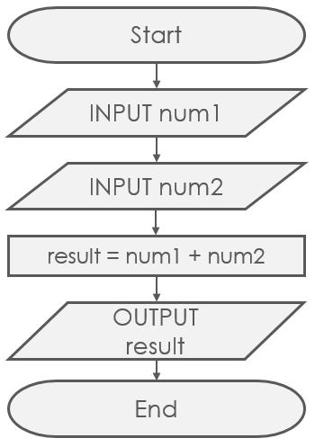

# 1.1 What Is an Algorithm?

> **Status:** drafted · **Owner:** Felix · **Reviewer:** Elinna

> v0.1 research draft · AI-assisted (Claude Code, 2026-10-18.) · Not yet verified by the team

> v0.2 modified at 10/22/2026 by Felix. Note = Covered important points. Searching for other information worth adding.

## Why this matters

Every time a map app finds a route, a search engine ranks pages, or your phone unlocks with your face, a computer is following an algorithm. Computers are fast but have no common sense. They do exactly what the steps say, nothing more. Learning to write clear steps is the first skill in computer science. It is also the idea that connectionist AI later turns upside down (see [3.1](../part3-connectionist-ai/3.1-rules-to-learning.md)).

## Learning outcomes

- Define an algorithm and list its five properties.
- Explain the difference between an algorithm and a program.
- Read and write simple pseudocode using sequence, selection and repetition.
- Read a flowchart and trace an algorithm on a small input.

## Before you start

None.

## Core ideas

- An algorithm is a finite list of clear steps that solves a problem.
- A program is one algorithm written in a particular programming language.
- Pseudocode lets us describe steps without worrying about a language's rules.

### An algorithm is a precise recipe

An **algorithm** is a finite sequence of clear, step-by-step instructions **created in right order** that solves a problem or completes a task. A cooking recipe is a familiar example: ingredients go in, steps are followed in order, and a dish comes out. An example if you do it in wrong order is when you dress up during cold weather. if you put on your coat/jacket before your shirt, it will be weird.

Algorithms also tell a computer how to process inputs such as data to produce an output, can be a decision, prediction, or sorted list. Some algorithms are simple and fixed, while others “learn” patterns from data, as in machine learning.

Not every list of steps is an algorithm. Computer scientists (following Knuth, 1997) expect five properties:

| Property | Meaning | Recipe example | What breaks it |
|---|---|---|---|
| **Input** | Zero or more values given at the start | Flour, eggs, milk | — |
| **Output** | At least one result | A cake | Steps that produce nothing |
| **Finiteness** | It always stops after a finite number of steps | "Bake for 30 minutes" | "Stir until perfect" may never end |
| **Definiteness** | Every instruction must be clear, precise and exactly one meaning | "Add 5 g of salt" | "Add salt to taste" |
| **Effectiveness** | Every step can actually be carried out | "Crack an egg" | "Crack an egg without touching it" |

### Algorithm vs program

A **program** is an algorithm written in a specific **programming language** (Python, C, Java…) so that a computer can run it. One algorithm can become many programs, in the same way that one recipe can be written in Chinese, English or French. 

In simple term:
- Algorithm = The **plan**. It tells you what steps to follow.
- Program = The coded **instructions**. It tells a computer how to perform those steps.

| | Algorithm | Program |
|---|---|---|
| Written in | Plain language, pseudocode or a flowchart | A programming language |
| Needs a computer? | No. A person can follow it. | Yes, to run it |
| Example | "Check each item; remember the largest" | `max_val = max(numbers)` in Python |

Example: Adding two numbers

Step 1 = Write in algorithm
1. Get two number
2. Add them together
3. Display the number.

Step 2 = Turn it into a program (C program in this demo)
```c
#include <stdio.h>

int main()
{
    int a = 5;
    int b = 3;
    int sum = a + b;

    printf("%d\n", sum);

    return 0;
}
```
# Representing Algorithm
Algorithm can be written or shown in different ways, depending on how we want people or computers to understand it. Think of an algorithm as a set of instructions for solving a problem. We can express those instructions using several methods.

Different way to express and algorithm includes =
- Natural Language = Writing instructions using everyday human language. The problem with this is it's ambigous and easily misunderstood
- Pseudocode = Writing instructions in a structured way that resembles programming code, but does not follow the exact rules of a particular programming language. This allows your to follow the logic before writing the actual code

    Example in C =
    ```c
    INPUT A, B
    SUM = A + B
    OUTPUT SUM
    ```
- Programing Language = Writing instructions using a language such as C, Python, or Java so that a computer can execute them.

    Exmaple in C =
    ```c
    #include <stdio.h>
    int main()
    {
	int sum = 5+3;
	printf("%d", sum);
    }
    // The computer executes the instructions and displays 8
    ```
## Turing machine
A Turing machine is a mathematical model of a computer. There are many possible representations and Turing machine programs can be expressed as a sequence of machine tables. Algorithm can be represented in different ways and at different levels of detail depending on how much information we want to show.

Algorithm representations can also be classified into three accepted levels of Turing machine description:
1. High-description level
    Explains **what the algorithm does**, without explaining exactly how the machine works internally. Think of this as explaining the purpose of a machine to someone who wants to know what it does.
    
    Example: "The machine takes two numbers, adds them together, and displays the result."

2. Implementation description
    Explains **generally** how the machine carries out the task, but does not specify every exact instruction or internal state.

    Example = "The machine reads the first number, remembers it, reads the second number, calculates their sum, and writes the answer." 

    This explains the machine's working process without listing every technical detail.

3. Formal description
    Gives the exact instructions and rules the machine follows, including its states and transitions.

    Example: "A precise table specifies what the machine does in each state, what it reads, what it writes, and where it moves next."
    
    This is like having the complete technical blueprint of the machine.

#### Main Idea of 3 levels
|Level|Main question|Analogy
|--|--|--|
High-level|What does it do?|A summary
Implementation|How does it generally work?|An explanation of the process
Formal|What are the exact rules?|A detailed technical blueprint

## Flowchart
Showing an algorithm using shapes and arrows to represent steps and their order.

It has four primary symbols:
- Arrows\
Showing program flow. Arrows show the direction of the steps. They tell us what happens next.
- Rectangles\
Represents an action or operation, such as calculating a sum or assigning a value to a variable.
- Diamonds\
Represents a question or condition. The answer usually determines which path the algorithm follows.
- Dots\
In some flowchart notations, a dot joins multiple flow lines into a shared connection. It helps show how paths connect.

Sub-structures can "nest" in rectangles, but only if a single exit occurs from the superstructure. It helps people see how a process flows from beginning to end.



### Three building blocks

Every algorithm, however complex, can be built from just three kinds of step (a result known as the Böhm–Jacopini theorem, 1966):

1. **Sequence**: do steps one after another.
2. **Selection**: choose between steps using a condition (`if … then … else`).
3. **Repetition** (a **loop**): repeat steps while a condition holds, or once for each item in a list.

```
sequence:      selection:              repetition:
  step A         if x > largest:         for each x in numbers:
  step B             largest ← x             (do something with x)
```

## Worked example

**Problem:** find the largest number in `[7, 3, 9, 2]`.

**Idea:** remember the largest value seen so far. Look at each remaining item once, and replace the remembered value whenever a bigger one appears.

**Pseudocode:**

```
FIND-MAX(numbers)
    largest ← numbers[0]
    for each x in numbers, starting from the second item:
        if x > largest:
            largest ← x
    output largest
```

**Trace** (follow the steps by hand, writing down every value):

| Step | x | Is x > largest? | largest after this step |
|---|---|---|---|
| Start | — | — | 7 |
| 1 | 3 | 3 > 7? No | 7 |
| 2 | 9 | 9 > 7? Yes | 9 |
| 3 | 2 | 2 > 9? No | 9 |
| End | | | **Output 9** |

The algorithm made **3 comparisons** for 4 items. For a list of n items it always makes n − 1 comparisons. Counting steps like this is the start of measuring efficiency ([1.2](1.2-big-o.md)).

The example uses all three building blocks: sequence (start, then loop, then output), selection (`if x > largest`) and repetition (`for each`).

**Try it (optional, Python 3):**

```python
def find_max(numbers):
    largest = numbers[0]
    for x in numbers[1:]:
        if x > largest:
            largest = x
    return largest

print(find_max([7, 3, 9, 2]))     # 9
print(find_max([-5, -2, -9]))     # -2
```

## Visual


*Follow the loop: every item passes through the "x > largest?" diamond exactly once, and the algorithm stops when no items are left.*

## Common misconceptions

- "An algorithm is code." → Code is one way to write an algorithm down. The algorithm is the idea, and a person with pencil and paper can follow it.
- "Any list of instructions is an algorithm." → Only if every step is definite and the process always finishes. "Stir until it looks right" fails both tests.
- "Start with `largest ← 0` to be safe." → This gives the wrong answer for a list of all negative numbers (it outputs 0). Start with the first item instead.
- "If it works on one example, it is correct." → Test edge cases too: a list with one item, all-equal items, negative numbers.

## Check your understanding

**Q1 (True/False).** A program and an algorithm are the same thing.

**Q2 (True/False).** "Keep adding 1 to x until x is negative", starting from x = 0, is a valid algorithm.

**Q3 (Multiple choice).** Which property does the instruction "add a pinch of salt" break?
A. Input  B. Finiteness  C. Definiteness  D. Output

**Q4 (Multiple choice).** In the pseudocode `if x > largest: largest ← x`, which building block is used?
A. Sequence  B. Selection  C. Repetition  D. Recursion

**Q5 (Trace).** Trace FIND-MAX on `[4, 8, 8, 1, 10]`. Write down the value of `largest` after each comparison. How many comparisons are made?

**Q6 (Problem solving).** Write pseudocode that counts how many even numbers are in a list. Test it on `[4, 7, 10, 3, 8]`. (Hint: a number is even if dividing by 2 leaves remainder 0. Write this as `x mod 2 = 0`.)

**Q7 (Problem solving).** A classmate writes FIND-MAX with `largest ← 0` as the first line. Give an input where it gives the wrong answer, and explain how to fix it.

## Answers

**A1.** False. An algorithm is the idea (the steps). A program is that algorithm written in a particular programming language.

**A2.** False. Starting at 0 and adding 1 gives 1, 2, 3, … and x never becomes negative. It breaks **finiteness**.

**A3.** C. "A pinch" means different amounts to different people, so the step is not **definite**.

**A4.** B. Selection: the step runs only when the condition is true.

**A5.** largest starts at 4. Compare 8 (yes → 8), 8 (8 > 8? no → 8), 1 (no → 8), 10 (yes → 10). Output **10** after **4 comparisons** (n − 1 for n = 5). Equal values do not replace `largest`, because the test is `>`, not `≥`.

**A6.**
```
COUNT-EVENS(numbers)
    count ← 0
    for each x in numbers:
        if x mod 2 = 0:
            count ← count + 1
    output count
```
On `[4, 7, 10, 3, 8]`: 4 ✓, 7 ✗, 10 ✓, 3 ✗, 8 ✓ → output **3**.

**A7.** `[-5, -2, -9]`: no item is greater than 0, so it outputs 0, which is not even in the list. The correct answer is −2. Fix: start with `largest ← numbers[0]`.

## Connections

- Counting the comparisons in FIND-MAX leads directly into [1.2 Big-O](1.2-big-o.md).
- Lists are stored as arrays: [2.1 Arrays and linked lists](../part2-data-structures/2.1-arrays-linked-lists.md).
- In [3.1](../part3-connectionist-ai/3.1-rules-to-learning.md) the roles flip: instead of a person writing the steps, a neural network learns its behaviour from examples. Training itself, though, is still an algorithm.

## Production notes

- **Slides:** animate the find-max flowchart, highlighting the current box while a pointer moves along `[7, 3, 9, 2]`.
- **Video:** "Be the computer" (≤ 2 min). Follow an ambiguous recipe literally (comic failure), then rewrite it so it meets the five properties.

## References

- Knuth, D. E. (1997). *The Art of Computer Programming, Vol. 1: Fundamental Algorithms* (3rd ed.), §1.1 "Algorithms". Addison-Wesley. (Source of the five properties.)
- Böhm, C., & Jacopini, G. (1966). Flow diagrams, Turing machines and languages with only two formation rules. *Communications of the ACM*, 9(5), 366–371.
- Bhargava, A. (2024). *Grokking Algorithms* (2nd ed.), Ch. 1. Manning.
- Harvard CS50x, Week 0 (Scratch) and Week 3 (Algorithms). https://cs50.harvard.edu/x/
