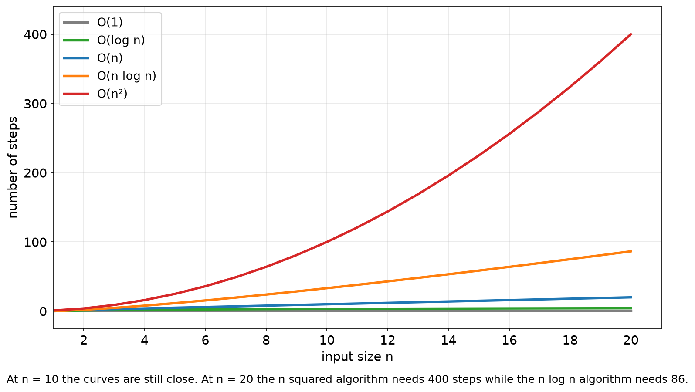

# 1.2 Measuring Efficiency: Big-O

## Learning outcomes

- Count the steps an algorithm takes for an input of size n.
- Recognise O(1), O(log n), O(n), O(n log n) and O(n²) from those counts.
- Decide which of two algorithms is faster for a large input.

## Why we count steps

*This section answers one question: how do we compare two algorithms without running them?*

Two algorithms that solve the same problem can take very different amounts of time. Timing them is unreliable, because the result depends on the computer, the programming language and the particular input. A slow algorithm on a fast machine can beat a fast algorithm on a slow one.

So we count the operations instead of the seconds. That number depends only on the algorithm and on how much data it is given.

**Input size (n).** The number of items the algorithm has to deal with. For a list of scores, n is the number of scores. For a text, n is the number of characters.

**Step.** One basic operation that costs the same every time: a comparison, a copy, an addition. Counting steps is approximate by design, which is exactly why it is portable.

## Worked example: find the largest score

Given a list of n scores, find the largest.

1. Read the first score and keep it as the best so far. That is one step.
2. Move to the next score and compare it with the best. That is one comparison.
3. If it is larger than the best, it becomes the best. That is one copy.
4. Repeat steps 2 and 3 until the list ends.

Trace it on the list 7, 3, 9, 4, 2.

| Visit | Score | Comparison | Best after |
| --- | --- | --- | --- |
| 1 | 7 | first value, kept | 7 |
| 2 | 3 | 3 < 7, keep 7 | 7 |
| 3 | 9 | 9 > 7, replace | 9 |
| 4 | 4 | 4 < 9, keep 9 | 9 |
| 5 | 2 | 2 < 9, keep 9 | 9 |

Five scores needed five visits: one read and four comparisons. Do it with a thousand scores and you need a thousand visits, so the number of steps grows in step with n.

**Rule.** When the step count grows in proportion to n, the algorithm is **O(n)**.

## Worked example: read only the first score

A function that prints the first score does one read and stops, whether the list holds ten scores or ten million.

**Rule.** When the step count does not change as n grows, the algorithm is **O(1)**, called constant time.

## Worked example: compare every pair

Suppose a teacher wants to know whether any two students in a class share a score. A simple method compares each student with every other student, and the pairs are compared once each.

With four students the pairs are these six.

| First student | Compared with | Pairs so far |
| --- | --- | --- |
| 1 | 2, 3, 4 | 3 |
| 2 | 3, 4 | 2 |
| 3 | 4 | 1 |
| 4 | nobody left | 0 |

Student 1 is compared with 3 others, student 2 with the 2 who have not already been compared, student 3 with 1, and student 4 with nobody. The total is 3 + 2 + 1 = 6 pairs.

Now the same count for any n. The first student is compared with n − 1 others, the second with n − 2, and the pattern continues down to 1.

`(n − 1) + (n − 2) + ... + 1 = n(n − 1) / 2 = (n² − n) / 2`

| n | Sum | Pairs compared |
| --- | --- | --- |
| 4 | 3 + 2 + 1 | 6 |
| 10 | 9 + 8 + ... + 1 | 45 |
| 1,000 | 999 + 998 + ... + 1 | 499,500 |
| 1,000,000 | 999,999 + ... + 1 | 499,999,500,000 |

The formula simplifies in two steps, and both steps are why the answer is written with a bare n².

- **Drop the −n.** At n = 1,000 the exact count is 499,500 and n²/2 is 500,000. The n term is the same size as n, while the n² term is 1,000 times larger, so as n grows it stops mattering.
- **Drop the /2.** A constant multiplier never changes the shape of the curve, only its height, and Big-O ignores height.

So (n² − n)/2 becomes n²/2, then **O(n²)**.

**Rule.** Doubling the number of students roughly multiplies the work by four, so the algorithm is **O(n²)**.

## Reading Big-O notation

Big-O keeps the fastest-growing term and drops everything else, because the smaller terms stop mattering as n grows.

- 3n + 5 becomes **O(n)**. At n = 1,000 the expression is 3,005 and n is 1,000, both "a few thousand".
- n²/2 + n becomes **O(n²)**. At n = 1,000, the squared term is 500,000 and the linear term is 1,000, which is noise.

The notation answers one question: as the input grows, what shape does the cost follow?

## The five shapes you will meet

| Growth | Steps at n = 10 | Steps at n = 1,000 | Steps at n = 1,000,000 | Where it appears |
| --- | --- | --- | --- | --- |
| O(1) | 1 | 1 | 1 | read an array item by index |
| O(log n) | 4 | 10 | 20 | binary search ([1.3](1.3-searching.md)) |
| O(n) | 10 | 1,000 | 1,000,000 | linear search, find the largest |
| O(n log n) | 33 | 10,000 | 20,000,000 | merge sort ([1.4](1.4-sorting.md)) |
| O(n²) | 100 | 1,000,000 | 1,000,000,000,000 | compare every pair |

*Steps against input size. At n = 10 the curves are still close. At n = 20 the squared algorithm needs 400 steps and the n log n algorithm needs 86.*

## What the shapes mean in seconds

Assume the computer performs 100 million steps per second, which is a reasonable desktop figure.

| Growth | Steps at n = 1,000,000 | Time |
| --- | --- | --- |
| O(n) | 1,000,000 | 0.01 s |
| O(n log n) | 20,000,000 | 0.2 s |
| O(n²) | 1,000,000,000,000 | about 2.8 hours |

The same program, the same computer, a factor of fifty thousand in time. The difference was decided by the shape of the algorithm, not by the machine.

This is also why a slow algorithm is often acceptable on small data: at n = 20, an O(n²) algorithm does about 400 steps, which nobody notices.

## Which case is being measured

An algorithm can take different numbers of steps on different inputs of the same size. Linear search finds its target in one comparison if it is first, and n comparisons if it is last or missing.

By default Big-O means the **worst case**, because that is the promise you can rely on. To be precise, name the case: linear search is O(1) best case and O(n) worst case.

## Activity

Here are five operations. Give the Big-O of each, then rank them from fastest to slowest for a list of a million items.

1. Read the last item of the list.
2. Print every item in the list.
3. Guess a number from 1 to 1,000,000 by halving the range each time.
4. Sort the list with insertion sort.
5. Merge two sorted lists whose sizes add up to a million.

**Expected outcome:** O(1), O(n), O(log n), O(n²) and O(n), so the ranking is 1, then 3, then 2 and 5 together, then 4. Insertion sort is the only one that becomes unusable at a million items.

## Check your understanding

**Q1.** An algorithm takes 5n + 20 steps. What is its Big-O?

**Q2.** An algorithm takes n² + 100n steps. What is its Big-O?

**Q3.** Which grows faster as n increases, O(n log n) or O(n²)?

A. O(n log n) B. O(n²) C. they grow at the same rate

**Q4.** A list has 1,000,000 items. Roughly how many comparisons does binary search need in the worst case?

A. 20 B. 1,000 C. 1,000,000

**Q5.** Why is an O(n²) algorithm sometimes the right choice?

## Answers

**A1.** O(n). The 5 and the 20 are constants and are dropped.

**A2.** O(n²). The squared term outgrows the linear one.

**A3.** B. At n = 1,000, n log n is 10,000 while n² is 1,000,000.

**A4.** A. About log₂ 1,000,000, which is 20.

**A5.** When n is small. At n = 20 an n² algorithm does about 400 steps, which is instant, and it is usually simpler to write correctly.

## Connections

- The check counts of both searches are worked out in [1.3](1.3-searching.md).
- Merge sort is the first n log n algorithm in the module ([1.4](1.4-sorting.md)).
- A hash table trades order for O(1) average lookup ([2.3](../part2-data-structures/2.3-hash-tables.md)).

## References

- Bhargava, A. (2024). *Grokking Algorithms* (2nd ed.), chapter 1. Manning.
- Cormen, T. H., Leiserson, C. E., Rivest, R. L., & Stein, C. (2022). *Introduction to Algorithms* (4th ed.), chapter 3. MIT Press.
- Harvard CS50x, week 3. https://cs50.harvard.edu/x/
