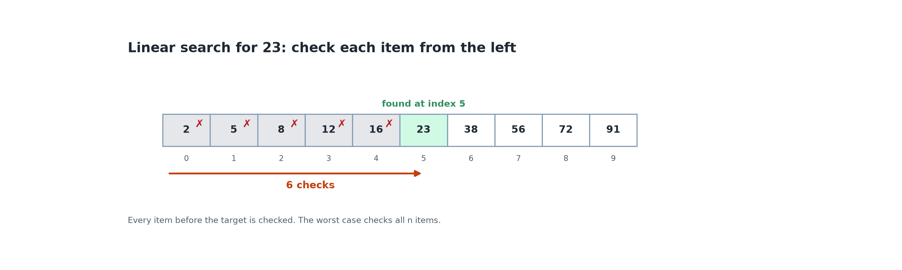

# 1.3 Searching: Linear and Binary Search

## Learning outcomes

- Trace linear search and binary search on a list.
- Explain why binary search requires a sorted list.
- Choose the right search method for a situation and justify the choice.

## The search problem

**Searching** means finding the position of a **target** value in a list, or reporting that it is not there. Positions start at 0, so the first item has index 0.

## Linear search

**Linear search** checks items from the start, one by one, until it finds the target or reaches the end.

*The search checks indexes 0 to 5 before it finds 23. The worst case checks every item.*

It works on any list, sorted or not. Best case: 1 check. Worst case: n checks, when the target is last or missing. The cost grows with the list size.

