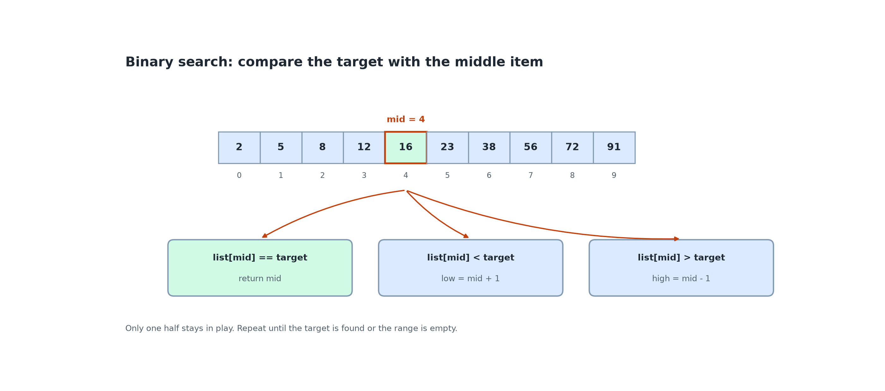
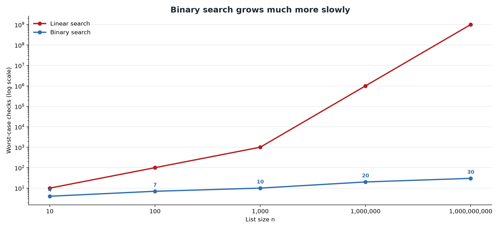
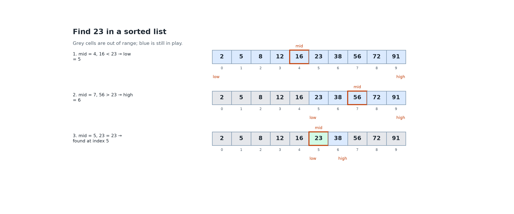
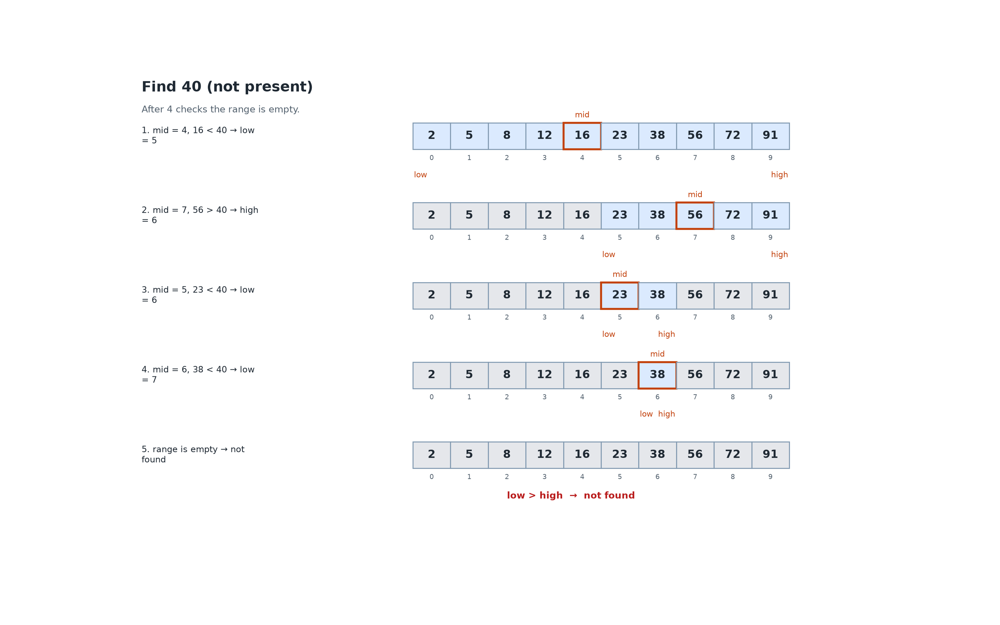
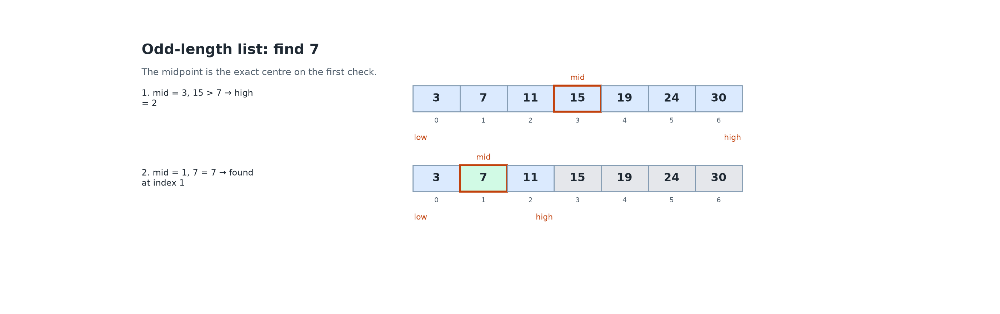
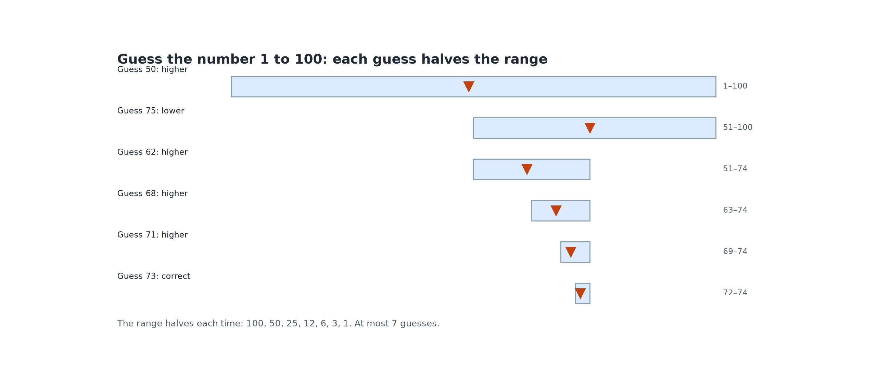
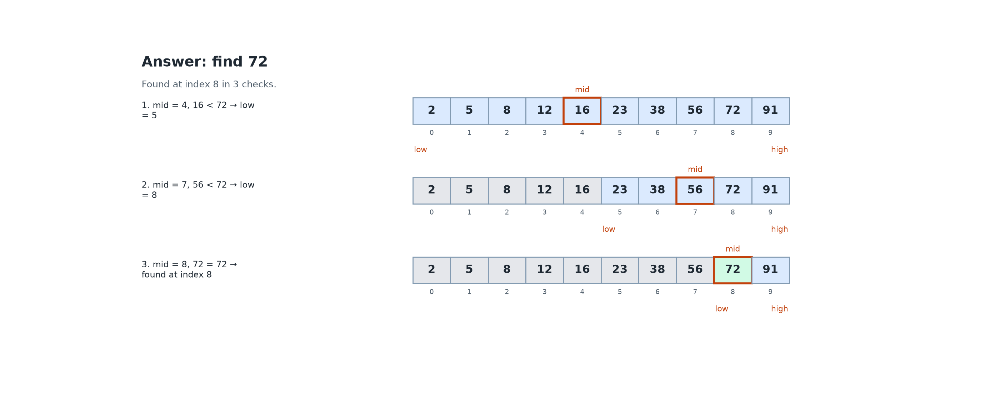
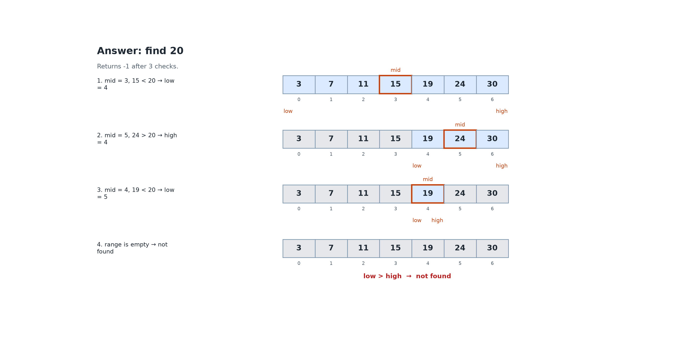

# 1.3 Searching: Linear and Binary Search

## Learning outcomes

- Trace linear search and binary search on a list.
- Explain why binary search requires a sorted list.
- Choose the right search method for a situation and justify the choice.

## The search problem

**Searching** means finding the position of a **target** value in a list, or reporting that it is not there. Positions start at 0, so the first item has index 0.

## Linear search

**Linear search** checks items from the start, one by one, until it finds the target or reaches the end.

*The search checks indexes 0 to 5 before it finds 23. The worst case checks every item.*

It works on any list, sorted or not. Best case: 1 check. Worst case: n checks, when the target is last or missing. The cost grows with the list size.

## Binary search

If the list is **sorted**, we can discard half the items at each step. Check the middle item. If it is equal, we are done. If it is smaller, the target can only be in the right half. If it is larger, the target can only be in the left half.

*One middle check removes one half. The search repeats on the half that can still contain the target.*

Two indexes, **low** and **high**, mark the part still in play. The midpoint is `mid = (low + high) / 2`, rounded down.

When `low` passes `high`, the range is empty and the target is not in the list.

## Why the list must be sorted

Binary search uses the order of the list. In `[9, 4, 7, 1]`, knowing that the middle value is smaller than the target says nothing about where the target lies. Discarding a half could throw the target away.

## How many checks?

Each check halves the range: n, n/2, n/4, ..., 1. The number of halvings is log₂ n. Counting the final check, the worst case is **⌊log₂ n⌋ + 1** checks. This grows much more slowly than a linear search.

*Linear search grows with n. Binary search grows by one check each time n doubles.*

Doubling the list adds one more binary check.

## Worked example

Sorted list of 10 items: `2, 5, 8, 12, 16, 23, 38, 56, 72, 91`.

### Find 23

*The active range shrinks from 0–9 to 5–6, then finds 23 at index 5 in 3 checks.*

### Find 40 (not present)

*After 4 checks the range is empty, so 40 is not in the list.*

### Odd length: find 7

List `[3, 7, 11, 15, 19, 24, 30]`.

*The first midpoint is the exact centre. The second check finds 7 at index 1.*

## Activity: guess my number

Work in pairs. One person picks a number from 1 to 100. The other guesses and is told "higher", "lower" or "correct".

1. Play three rounds with any strategy. Record the number of guesses.
2. Play three rounds using the midpoint of the remaining range, starting at 50.
3. Explain why this strategy never needs more than 7 guesses.

*Each guess halves the remaining range. The figure shows one round for the secret number 73.*

**Expected outcome:** each guess halves the range: 100, 50, 25, 12, 6, 3, 1. Since 2⁷ = 128, 7 guesses are always enough.

## Check your understanding

**Q1 (True/False).** Binary search can be used directly on `[9, 4, 7, 1]`.

**Q2 (True/False).** Doubling the size of a sorted list adds about one check to the worst case of binary search.

**Q3 (Multiple choice).** What is the maximum number of checks binary search needs for a sorted list of 1,000 items?

A. 500 B. 100 C. 10 D. 1,000

**Q4 (Trace).** Trace binary search for 72 in `[2, 5, 8, 12, 16, 23, 38, 56, 72, 91]`.

**Q5 (Trace).** Trace binary search for 20 in `[3, 7, 11, 15, 19, 24, 30]`. What is returned, and after how many checks?

**Q6 (Problem).** A sorted database grows from 1,000,000 to 2,000,000 records. How many checks does binary search need in the worst case before and after?

## Answers

**A1.** False. The list is not sorted, so the middle value does not tell us which half contains the target.

**A2.** True. Each check halves the range, so twice as many items need one more halving.

**A3.** C. ⌊log₂ 1,000⌋ + 1 = 9 + 1 = 10, and 2¹⁰ = 1,024.

**A4.**

*72 is found at index 8 in 3 checks.*

**A5.**

*The range becomes empty, so the search returns -1 after 3 checks.*

**A6.** Before: ⌊log₂ 1,000,000⌋ + 1 = 20. After: ⌊log₂ 2,000,000⌋ + 1 = 21. One extra check for one million extra records.

## Connections

- Binary search needs sorted data, so sorting ([1.4](1.4-sorting.md)) matters.
- Binary search needs direct access to the middle item, which arrays provide ([2.1](../part2-data-structures/2.1-arrays-linked-lists.md)).

## References

- Khan Academy. Binary search. https://www.khanacademy.org/computing/computer-science/algorithms/binary-search/v/binary-search
- Harvard CS50x, Week 3. https://cs50.harvard.edu/x/
