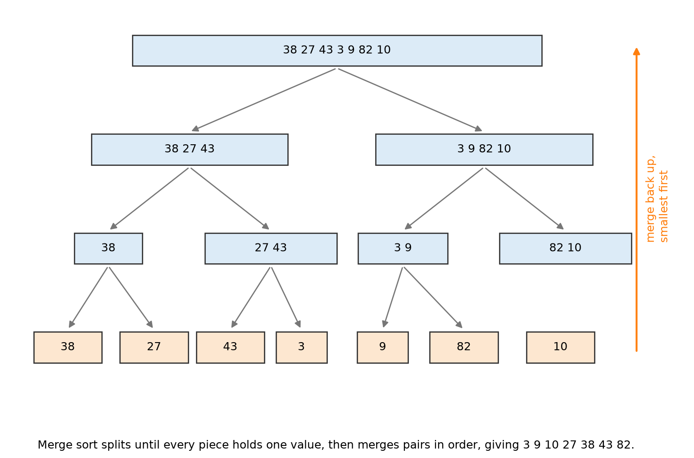

# 1.4 Sorting

## Learning outcomes

- Trace insertion sort and merge sort on a short list.
- Explain divide and conquer using merge sort.
- Compare an O(n²) sort with an O(n log n) sort.

## Why sorting is worth the cost

*This section answers one question: how do we put a list in order, and what does it cost?*

A **sorted** list has every item in order, smallest first. Sorting is done as a preliminary step, because sorted data can be searched with binary search in log n checks instead of n ([1.3](1.3-searching.md)), can be deduplicated by comparing neighbours, and can be printed in a useful order.

The sorting itself costs something. Two methods are covered here, one simple and slow, one clever and fast, and the difference shows exactly why algorithm choice matters.

## Insertion sort, traced

The method is how people sort a hand of cards. Hold the first card. Take the next card, and slide it left past every larger card until it sits in the right place. Repeat until the cards run out.

**Worked example.** Sort 7, 3, 9, 4, 2.

1. The first card, 7, is a sorted hand of one.
2. Take 3. It is smaller than 7, so slide it left. Hand: 3, 7.
3. Take 9. It is larger than 7, so it stays. Hand: 3, 7, 9.
4. Take 4. Pass 9, pass 7, stop at 3. Hand: 3, 4, 7, 9.
5. Take 2. Pass 9, 7, 4, 3. Hand: 2, 3, 4, 7, 9.

| Pass | Card taken | Comparisons | Hand after |
| --- | --- | --- | --- |
| 1 | 3 | 3 with 7 | 3, 7 |
| 2 | 9 | 9 with 7 | 3, 7, 9 |
| 3 | 4 | 4 with 9, 7, 3 | 3, 4, 7, 9 |
| 4 | 2 | 2 with 9, 7, 4, 3 | 2, 3, 4, 7, 9 |

Nine comparisons to sort five values. Each pass compares one more time than the last, so n values need about n²/2 comparisons.

**Rule.** Insertion sort is **O(n²)**.

**Where it is still a good choice.** On a list that is already nearly in order, each card moves only a step, and the work drops towards n. It also uses no extra memory and is short enough to write from memory.

## Merge sort, traced

Merge sort uses **divide and conquer**: split the problem into smaller pieces, solve each piece, then combine the results.

1. Split the list into two halves.
2. Sort each half by the same method, splitting again.
3. Merge the two sorted halves by repeatedly taking the smaller of the two front items.

Splitting stops when a piece holds one value, because one value is sorted already.

*Seven values split into single pieces, then merged back in order. The final merge is 3, 9, 10, 27, 38, 43, 82.*

**Worked example: merge two sorted halves.** Merge 27, 38, 43 with 3, 9, 10, 82.

1. Compare 27 with 3. Take 3. Output: 3.
2. Compare 27 with 9. Take 9. Output: 3, 9.
3. Compare 27 with 10. Take 10. Output: 3, 9, 10.
4. Compare 27 with 82. Take 27. Output: 3, 9, 10, 27.
5. Compare 38 with 82. Take 38. Output: 3, 9, 10, 27, 38.
6. Compare 43 with 82. Take 43. Output: 3, 9, 10, 27, 38, 43.
7. One list is empty, so the rest of the other is copied out: 82.

Six comparisons, then the leftover. Each item is compared about once per level, and there are about log₂ n levels of splitting.

**Rule.** Merge sort is **O(n log n)**. It needs a second array to merge into, so it uses extra memory.

The splitting and merging are easier to follow when you can see them move. The visualisation linked in the activity below animates exactly this process on a list you can choose.

## The two costs side by side

| n | Insertion sort, worst case (about n²/2) | Merge sort (about n log n) |
| --- | --- | --- |
| 10 | 50 | 33 |
| 1,000 | 500,000 | 10,000 |
| 1,000,000 | 500,000,000,000 | 20,000,000 |

At ten items the two are close. At a million, one has finished before the other has started.

## Choosing between them

- **Under about fifty items, or a list already nearly sorted:** insertion sort. It is simpler and needs no extra memory.
- **Large lists in unknown order:** merge sort. The extra array is a fair price for the speed.

## Activity

### Part 1: insertion sort by hand

Sort these eight numbers with insertion sort and count every comparison: 5, 2, 9, 1, 7, 3, 8, 4.

**Expected outcome:** the passes take 1, 1, 3, 2, 4, 2 and 5 comparisons, 18 in total. The worst case for eight items is 28, so this list saves a few because several cards were already larger than their neighbours.

### Part 2: merge sort in an animation

Open the OpenDSA merge sort visualisation at https://opendsa-server.cs.vt.edu/embed/mergesortAV and work through it in four steps.

1. **Watch once.** Run the animation to the end at normal speed and describe the overall shape in one sentence.
2. **Stop at one merge.** Pause at a merge step and write down which two pieces are being joined and what the joined piece contains.
3. **Count.** Count the merges needed to complete the list, and the number of levels the list is split into. Compare both with the seven-value trace above.
4. **Try your own values.** If the page accepts input, enter 38, 27, 43, 3, 9, 82, 10 and check the final order against the worked example.

**Expected outcome:** for seven values the list splits into three levels and needs six merges, since a tree with seven leaves has six joins. The last merge joins 27, 38, 43 with 3, 9, 10, 82 to give 3, 9, 10, 27, 38, 43, 82. Watching the animation should match the trace table, step for step.

## Check your understanding

**Q1.** After the third pass of insertion sort on 7, 3, 9, 4, 2, what is the hand?

**Q2.** In merge sort, what is the smallest piece the list is split into, and why does splitting stop there?

**Q3.** A list of 1,000 values is sorted by insertion sort. Roughly how many comparisons in the worst case?

A. 1,000 B. 10,000 C. 500,000 D. 20,000,000

**Q4.** Which of the two sorts needs extra memory while it runs, and why?

**Q5.** Why does an already sorted list speed up insertion sort but not merge sort?

## Answers

**A1.** 3, 4, 7, 9, 2. The first four values are sorted and 2 has not been placed yet.

**A2.** A single value, because a piece of length one is already sorted and needs no further work.

**A3.** C. About n²/2, which is 500,000.

**A4.** Merge sort, because merging copies the two halves into a new array.

**A5.** Insertion sort moves each card only a little when the list is nearly in order, so a sorted list takes about n comparisons. Merge sort splits and merges anyway, running the same log n levels, so it gains nothing.

## Connections

- Binary search needs sorted input ([1.3](1.3-searching.md)).
- Merge sort is the clearest example of divide and conquer ([1.6](1.6-design-strategies.md)).
- Its log n levels come from the O(log n) in [1.2](1.2-big-o.md).

## References

- Bhargava, A. (2024). *Grokking Algorithms* (2nd ed.), chapter 4. Manning.
- Cormen, T. H., Leiserson, C. E., Rivest, R. L., & Stein, C. (2022). *Introduction to Algorithms* (4th ed.), chapter 2. MIT Press.
- OpenDSA. "Mergesort Visualization." https://opendsa-server.cs.vt.edu/embed/mergesortAV
- Harvard CS50x, week 3. https://cs50.harvard.edu/x/
