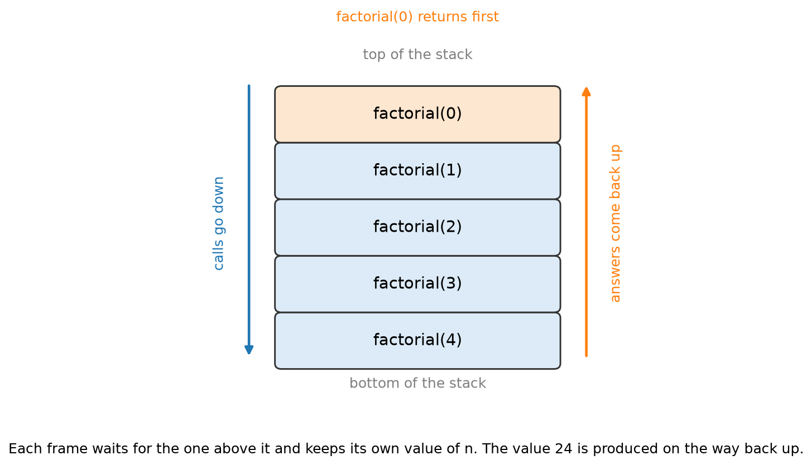

# 1.5 Recursion

## Learning outcomes

- Identify the base case and the recursive case in a function.
- Trace a recursive call all the way down and back up.
- Explain what the call stack holds and when it overflows.

## A function that uses itself

*This section answers one question: how can a function solve a problem by calling itself?*

Start with a problem that contains a smaller copy of itself.

`5!`, read "five factorial", is 5 × 4 × 3 × 2 × 1. But it is also 5 × `4!`. And `4!` is 4 × `3!`, and so on down to `0!`, which is 1 by definition.

That is the whole idea. **Recursion** is a function that solves a problem by calling itself on a smaller version of the same problem.

Every recursive function has two parts, and both are required.

**Base case.** The smallest version of the problem, answered directly without another call. Here it is `factorial(0) = 1`. Without it, the calls would never stop.

**Recursive case.** The rule that shrinks the problem and calls the function again. Here it is `factorial(n) = n × factorial(n − 1)`.

Most recursive problems have the same shape: a list is one item followed by a shorter list, a folder holds folders, and a tree holds subtrees. Fibonacci, merge sort and folder sizes all reduce to a smaller version of themselves.

## Worked example: factorial(4)

The rule has two cases. In words: the factorial of 0 is 1, and for any n above 0 it is n times the factorial of n − 1.

Here it is in Python, which is what the traces below follow.

```python
def factorial(n):
    if n == 0:                    # base case
        return 1
    return n * factorial(n - 1)   # recursive case
```

The `if` at the top is the case that stops the chain. Remove it and the function calls itself forever.

Trace factorial(4).

1. factorial(4) needs factorial(3). It cannot finish, so it stops and waits.
2. factorial(3) needs factorial(2). It stops and waits.
3. factorial(2) needs factorial(1). It stops and waits.
4. factorial(1) needs factorial(0). It stops and waits.
5. factorial(0) is the base case. It returns 1 immediately.
6. The waiting now unwinds, one row at a time:
   - factorial(1) returns 1 × 1 = 1
   - factorial(2) returns 2 × 1 = 2
   - factorial(3) returns 3 × 2 = 6
   - factorial(4) returns 4 × 6 = 24

| Call | Waits for | Returns |
| --- | --- | --- |
| factorial(4) | factorial(3) | 4 × 6 = 24 |
| factorial(3) | factorial(2) | 3 × 2 = 6 |
| factorial(2) | factorial(1) | 2 × 1 = 2 |
| factorial(1) | factorial(0) | 1 × 1 = 1 |
| factorial(0) | nothing | 1 |

Read the table in both directions. Downwards, every call stops and waits. Upwards, every call multiplies and returns.

Two things follow. The answer is computed on the way back up, not on the way down, and every row has its own private value of n, which is why no call overwrites another.

## What the call stack holds

The waiting calls sit in memory in the order they were made, with the newest on top. That structure is a **call stack**.


*Five frames stacked. factorial(0) is on top and returns first, then each frame below it finishes in turn.*

| Position | Frame | Holds |
| --- | --- | --- |
| top | factorial(0) | nothing more to do |
|  | factorial(1) | n = 1, waiting for 1 to multiply |
|  | factorial(2) | n = 2, waiting for 1 to multiply |
|  | factorial(3) | n = 3, waiting for 2 to multiply |
| bottom | factorial(4) | n = 4, waiting for 6 to multiply |

The last call to start is the first to finish. That is last in, first out, the same behaviour as the stack structure in [2.2](../part2-data-structures/2.2-stacks-queues.md).

**Stack overflow.** If the base case is missing, or the recursive case never reaches it, every call waits for another call that also waits. The stack grows until memory runs out, and the program fails with a **stack overflow**. Python makes this limit concrete: by default it raises `RecursionError` after about 1,000 nested calls, which is why the million-item example below would fail there.

A common bug is a recursive case that does not shrink the problem. `factorial(n) = n × factorial(n)` reaches no base case, even though the base case exists.

## How many calls

Each value from n down to 0 is called once, so factorial(n) makes n + 1 calls, and the stack grows to n + 1 frames.

| n | Calls | Deepest stack |
| --- | --- | --- |
| 4 | 5 | 5 frames |
| 100 | 101 | 101 frames |
| 1,000,000 | 1,000,001 | 1,000,001 frames, which will overflow |

Recursion therefore costs memory in proportion to the depth. A loop computing the same factorial uses a handful of variables and no stack of waiting calls.

## Worked example: summing a list

Summing a list has the same shape. In words: the sum of an empty list is 0, and the sum of any other list is its first item plus the sum of the rest.

```python
def total(items):
    if not items:                       # base case
        return 0
    return items[0] + total(items[1:])  # recursive case
```

The name `total` is used rather than `sum` so that it does not overwrite Python's built-in `sum` function.

Trace `total([1, 2, 3])`.

| Call | Waits for | Returns |
| --- | --- | --- |
| total([1, 2, 3]) | total([2, 3]) | 1 + 5 = 6 |
| total([2, 3]) | total([3]) | 2 + 3 = 5 |
| total([3]) | total([]) | 3 + 0 = 3 |
| total([]) | nothing | 0 |

The base case is the empty list, not a one-item list. The empty list is the smallest version of "sum this list", and its answer is obvious without any further thinking.

A list of n items makes n + 1 calls, the same count as factorial.

## Recursion or a loop

Every recursive function can be rewritten as a loop.

|  | Recursion | Loop |
| --- | --- | --- |
| Memory | one frame per call, so O(n) for depth n | a few variables, O(1) |
| Risk | stack overflow on deep input | none |
| Reads like | the definition of the problem | the step-by-step procedure |

Recursion earns its place when the problem is naturally nested: a tree has two subtrees, merge sort has two halves ([1.4](1.4-sorting.md)), and a folder's size includes the sizes of its subfolders. Write the recursion when it matches how you would describe the problem out loud, and a loop when memory or speed matters more.

## Activity

Write the recursive rule for summing a list, then trace `total([4, 7, 2])`. How many calls are made in total, including the empty list?

**Expected outcome:** total([4, 7, 2]) waits for total([7, 2]), which waits for total([2]), which waits for total([]). The base case returns 0, then the returns are 2, then 9, then 13. Four calls: three for the items and one for the empty list, matching n + 1 for n = 3.

## Check your understanding

**Q1.** In the factorial rule, which line is the base case, and why does it count as one?

**Q2.** What happens if the base case is missing?

**Q3.** Trace factorial(3). How many calls are made, and what is returned?

**Q4.** Why do the answers come back in reverse order?

**Q5.** A list of 1,000 items is summed recursively. How many calls are made, and what does that suggest about using recursion here?

## Answers

**A1.** `factorial(0) = 1`, because it returns a value without calling itself again.

**A2.** The calls never stop. Each waits for another, the stack grows, and the program fails with a stack overflow.

**A3.** Four calls: factorial(3), factorial(2), factorial(1) and factorial(0). It returns 1, then 1, then 2, then 6.

**A4.** A call cannot finish before the call it made has finished, so the call that started last is the first to return.

**A5.** 1,001 calls, one per item plus the empty list, and 1,001 frames on the stack. A loop would use one variable, so for a flat list a loop is the better choice.

## Connections

- The call stack is the stack structure of [2.2](../part2-data-structures/2.2-stacks-queues.md).
- Merge sort is a recursive algorithm ([1.4](1.4-sorting.md)).
- Memoisation, in [1.6](1.6-design-strategies.md), removes the repeated calls that recursion can cause.

## References

- Bhargava, A. (2024). *Grokking Algorithms* (2nd ed.), chapter 3. Manning.
- Harvard CS50x, week 3. https://cs50.harvard.edu/x/
