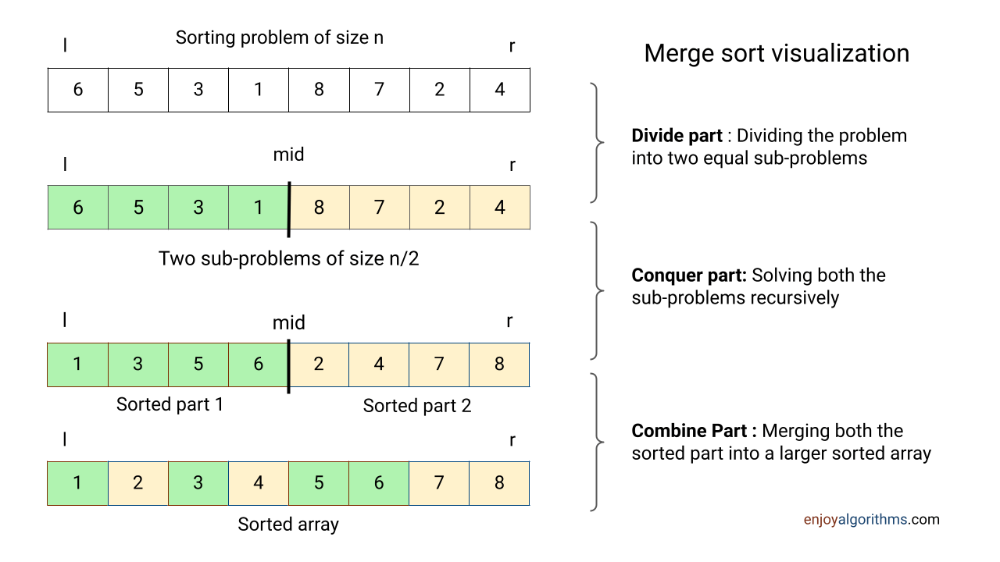

# 1.6 Algorithm Design Strategies

## Learning outcomes

- Name four design strategies and match each to a real problem.
- Show with an example why a greedy choice can fail.
- Explain what memoisation saves.

## The problem: load the van

_This section answers one question: when a new problem arrives, what kind of algorithm should you look for?_

A courier has one van and three parcels waiting. The van carries 10 kg. Each parcel earns a delivery fee, and the courier wants the highest fee the van can take.

| Parcel | Weight | Fee | Fee per kg |
| ------ | ------ | --- | ---------- |
| P1     | 6 kg   | 31  | 5.17       |
| P2     | 5 kg   | 25  | 5.00       |
| P3     | 5 kg   | 25  | 5.00       |

The same problem can be attacked four ways, and the four answers are not equally good.

| Strategy                | Idea                                     | Answer for this van               | Guarantee                            |
| ----------------------- | ---------------------------------------- | --------------------------------- | ------------------------------------ |
| **Brute force**         | try every combination                    | 50, from P2 and P3                | always correct, slow                 |
| **Greedy**              | take the best-looking item now           | 31, from P1 alone                 | fast, can be wrong                   |
| **Dynamic programming** | solve each capacity once and remember it | 50, from P2 and P3                | always correct, systematic           |
| **Divide and conquer**  | split the problem and solve each part    | not used here, used for the route | correct if the parts are independent |

Divide and conquer does not fit loading, because the parcels cannot be split into independent halves. It appears later in the section on the courier's route, where it does fit.

## Strategy 1: brute force

Try every combination of parcels and keep the best one that fits.

| Combination  | Weight | Fits in 10 kg? | Fee |
| ------------ | ------ | -------------- | --- |
| none         | 0      | yes            | 0   |
| P1           | 6      | yes            | 31  |
| P2           | 5      | yes            | 25  |
| P3           | 5      | yes            | 25  |
| P1 + P2      | 11     | no             | —   |
| P1 + P3      | 11     | no             | —   |
| P2 + P3      | 10     | yes            | 50  |
| P1 + P2 + P3 | 16     | no             | —   |

The best is P2 + P3, at 50.

**Rule.** Brute force is always correct, because every possibility is examined. Its cost is the number of combinations, which is 2ⁿ for n parcels.

| Parcels | Combinations  |
| ------- | ------------- |
| 3       | 8             |
| 10      | 1,024         |
| 20      | 1,048,576     |
| 30      | 1,073,741,824 |

Three parcels is fine. A real van load is not.

## Strategy 2: greedy

Take the parcel that looks best per kilogram, then repeat with what space is left.

1. P1 earns 5.17 per kg, P2 and P3 earn 5.00. Take P1, which uses 6 kg.
2. 4 kg remain. Neither P2 nor P3 fits.
3. Stop. Total fee: 31.

| Approach      | Parcels | Fee |
| ------------- | ------- | --- |
| Greedy        | P1      | 31  |
| Best possible | P2 + P3 | 50  |

Greedy lost 19, and the reason is visible: P1 looked better per kilogram, but taking it left a gap no parcel could fill. Greedy never reconsiders, so it cannot trade a good first step for a better total.

**When greedy is right.** Some problems do have the property that a locally best step leads to a globally best answer. Paying an amount with coins of 1, 5, 10 and 25 is one: the largest coin that fits is always safe, which is why cashiers work this way. That property has to be checked, and it is not obvious from the problem.

## Strategy 3: dynamic programming

The two earlier strategies both fall short on the van.

- Brute force lists every combination. Three parcels give 8 combinations, which is easy, but twenty parcels give 1,048,576.
- Greedy answers instantly and lost 19 on this van.

Dynamic programming gets the right answer without listing combinations, by writing down answers to small versions of the question and reusing them.

### Write the small answers down

The question is always the same: **with these parcels available and this much space, what is the best fee?**

Start with the easiest version. Only P1 is available, and it weighs 6 kg for 31.

| Space available       | 0   | 1   | 2   | 3   | 4   | 5   | 6   | 7   | 8   | 9   | 10  |
| --------------------- | --- | --- | --- | --- | --- | --- | --- | --- | --- | --- | --- |
| best fee with P1 only | 0   | 0   | 0   | 0   | 0   | 0   | 31  | 31  | 31  | 31  | 31  |

With 5 kg or less the parcel does not fit, so the answer is 0. With 6 kg or more it fits, and the answer is 31. Nothing to decide yet.

### Add P2, one space at a time

Now P2 is also available: 5 kg for 25. For each amount of space there are two possibilities, and only two.

- **Skip P2.** The answer is whatever it already was, read from the row above.
- **Take P2.** It earns 25, leaves 5 kg less space, and that leftover space can still hold P1. The best answer for the leftover is already in the row above.

Take 6 kg as an example. Skipping P2 gives 31. Taking P2 gives 25, plus the best answer for the 1 kg left over, which is 0. So 31 wins, and the cell stays 31. The two parcels do not fit together.

| Space available      | 0   | 1   | 2   | 3   | 4   | 5   | 6   | 7   | 8   | 9   | 10  |
| -------------------- | --- | --- | --- | --- | --- | --- | --- | --- | --- | --- | --- |
| best fee with P1, P2 | 0   | 0   | 0   | 0   | 0   | 25  | 31  | 31  | 31  | 31  | 31  |

At 5 kg, skipping gives 0 and taking gives 25, so P2 wins. At 6 kg and above, P1 alone is better.

### Add P3

P3 is also 5 kg for 25. Look at the full 10 kg.

- **Skip P3.** The answer stays 31, which is P1.
- **Take P3.** It earns 25 and leaves 5 kg. What is the best answer for 5 kg with P1 and P2 available? The row above answers that: 25, which is P2.
- So taking P3 gives 25 + 25 = 50, and 50 beats 31.

| Space available             | 0   | 1   | 2   | 3   | 4   | 5   | 6   | 7   | 8   | 9   | 10     |
| --------------------------- | --- | --- | --- | --- | --- | --- | --- | --- | --- | --- | ------ |
| best fee, all three parcels | 0   | 0   | 0   | 0   | 0   | 25  | 31  | 31  | 31  | 31  | **50** |

The 25 that P3 adds to is P2, read from the row above. That is the whole method: a bigger answer is built from an answer that was already written down.

### Why this is worth the effort

Each row is one parcel, and each cell is one comparison of skip against take. The van table has 4 rows and 11 columns, which is 44 numbers, and the work per cell does not change as parcels are added.

| Parcels | Brute force combinations | Table cells |
| ------- | ------------------------ | ----------- |
| 3       | 8                        | 44          |
| 10      | 1,024                    | 121         |
| 20      | 1,048,576                | 231         |
| 30      | 1,073,741,824            | 341         |

For three parcels the table is more work than listing the combinations, and brute force would be the sensible choice. From about ten parcels onward the table is far smaller, and at thirty it is the difference between a moment and a century.

Writing answers down so they are never worked out twice is called **memoisation**. Building the table from the smallest case upward is one way to do it.

## Strategy 4: divide and conquer

The van is loaded. Now the parcels need to be weighed, and the heaviest one decides which trolley is used. Finding it is the example that shows how this strategy works.

**Divide and conquer** means three steps, in this order:

1. **Divide** the problem into two or more smaller parts.
2. **Solve** each part, using the same method if the part is still too big.
3. **Combine** the answers into one answer for the whole.

*The three steps on a list of eight values. Divide splits the list, conquer sorts each half, and combine merges the halves back into one sorted list.*

### Worked example: the heaviest parcel

Eight parcels weigh 4, 9, 2, 7, 5, 8, 1 and 6 kg.

1. **Divide.** Split the eight into two groups of four: (4, 9, 2, 7) and (5, 8, 1, 6).
2. **Divide again.** Each group of four becomes two pairs: (4, 9), (2, 7), (5, 8), (1, 6).
3. **Stop.** A pair is small enough to answer directly. Compare the two weights and keep the heavier.
4. **Combine.** The heavier of two answers becomes the answer for the group they came from.
5. Repeat until one answer remains for the whole list.

| Level             | Groups                     | Answers                         |
| ----------------- | -------------------------- | ------------------------------- |
| 3, single parcels | 4, 9, 2, 7, 5, 8, 1, 6     | each parcel is its own heaviest |
| 2, pairs          | (4,9), (2,7), (5,8), (1,6) | 9, 7, 8, 6                      |
| 1, groups of four | (9,7), (8,6)               | 9, 8                            |
| 0, whole list     | (9,8)                      | 9                               |

Seven comparisons in total, and three levels of splitting, which is log₂ 8.

**The rule.** Splitting halves the problem each time, so there are log₂ n levels. The total cost is the work done per level multiplied by the number of levels.

Whether that is fast depends entirely on the combine step:

- **Heaviest parcel:** combining two answers is one comparison, and each level has half the comparisons of the one above, so the total is n − 1. The same as a simple loop. The strategy gives no speed-up here, only a different shape.
- **Merge sort** ([1.4](1.4-sorting.md)): combining two sorted halves costs n comparisons per level, so the total is n log n, which beats the n² of insertion sort.
- **Binary search** ([1.3](1.3-searching.md)): only one half is kept and the other is discarded, so the work halves at every level and the total is log n.

**Why it fails on the van.** The parcels cannot be split into independent halves. Two halves compete for the same 10 kg, so solving each half well does not solve the whole. Divide and conquer needs parts that can be answered without reference to each other, which is why sorting and searching fit and loading does not.

## Choosing a strategy

1. **Is the input small?** Brute force. It is always correct and easiest to trust.
2. **Does a local choice provably lead to the best answer?** Greedy. It is the fastest option when it applies.
3. **Can the problem be split into independent parts?** Divide and conquer.
4. **Do the subproblems repeat?** Dynamic programming, since repetition is what memoisation removes.

## Activity

A van carries 10 kg again, with four parcels: P1 6 kg earning 31, P2 5 kg earning 25, P3 4 kg earning 20, P4 4 kg earning 20.

1. What does greedy take first, and what is its total?
2. What is the best possible total?
3. Which strategy would you use to be sure, and why?

**Expected outcome:** greedy takes P1 at 5.17 per kg, leaving 4 kg, then takes one 4 kg parcel, for 51. The best possible is also P1 + P3 at 51, so greedy happens to be right this time. That is the trap: one correct example does not make a strategy correct, and only brute force or the table proves it.

## Check your understanding

**Q1.** Why does greedy pick P1 in the three-parcel van?

**Q2.** Greedy earned 31 and the best answer is 50. What did greedy fail to consider?

**Q3.** What does each cell in the dynamic programming table record?

**Q4.** Which strategy always gives the correct answer but can be too slow?

A. brute force B. greedy C. divide and conquer

**Q5.** Why is divide and conquer used for sorting the route but not for loading the van?

## Answers

**A1.** It has the highest fee per kilogram, 5.17 against 5.00, and greedy looks no further than that.

**A2.** That taking P1 would leave 4 kg unusable. Greedy never reconsiders a choice once made.

**A3.** The best fee obtainable with the parcels considered so far and that exact capacity.

**A4.** A. Brute force examines every possibility, so it cannot miss the best one.

**A5.** The parcels cannot be split into independent halves, since they compete for the same 10 kg. The route can be split into a list of stops that are sorted independently and then merged.

## Connections

- Divide and conquer is used by binary search ([1.3](1.3-searching.md)) and merge sort ([1.4](1.4-sorting.md)).
- Memoisation removes repeated work from recursion ([1.5](1.5-recursion.md)).
- The combination counts grow exponentially, which is what Big-O compares ([1.2](1.2-big-o.md)).

## References

- Bhargava, A. (2024). _Grokking Algorithms_ (2nd ed.), chapters 4 and 9. Manning.
- GeeksforGeeks. "0/1 Knapsack Problem." https://www.geeksforgeeks.org/0-1-knapsack-problem-dp-10/
- Cormen, T. H., Leiserson, C. E., Rivest, R. L., & Stein, C. (2022). _Introduction to Algorithms_ (4th ed.), chapters 15 and 16. MIT Press.
