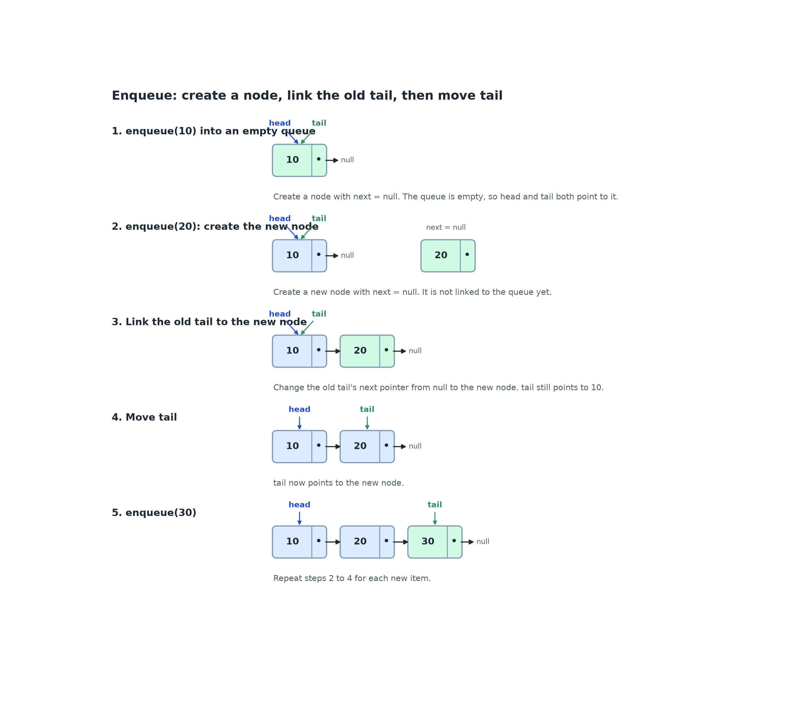
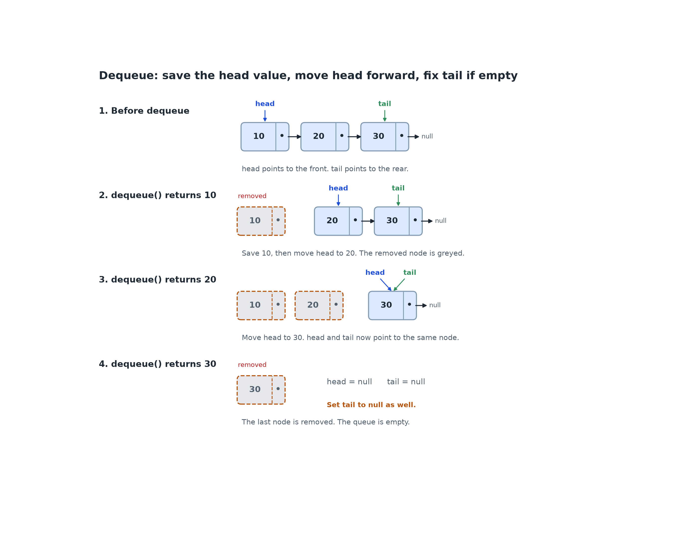

# 2.2 Stacks and Queues

## Learning outcomes

- Define stack and queue as abstract data types.
- Distinguish LIFO from FIFO ordering.
- State the operations of each structure.
- Implement a queue with a linked list.

## Abstract data type

An **abstract data type** is a conceptual model of a data type defined by the operations it supports and the behaviour of those operations, without dictating their implementation. A stack and a queue are ADTs. Either can be implemented with an array or a linked list.

## Stack

**Definition.** A stack is an ADT in which insertion and deletion occur at one end, called the **top**, following **LIFO** (last in, first out) order.

| Operation      | Effect                                        |
| -------------- | --------------------------------------------- |
| **push(x)**    | Insert x at the top                           |
| **pop()**      | Remove and return the top element             |
| **peek()**     | Return the top element without removing it    |
| **is_empty()** | Return whether the stack contains no elements |

A stack can be implemented with an array and a top index, or with a linked list and operations at the head. Popping from an empty stack is an error, called **stack underflow**.

Examples are the undo button and the browser back button, where the most recent action is the first one reversed.

## Queue

**Definition.** A queue is an ADT in which insertion occurs at one end, the **rear**, and deletion occurs at the other end, the **front**, following **FIFO** (first in, first out) order.

| Operation      | Effect                                        |
| -------------- | --------------------------------------------- |
| **enqueue(x)** | Insert x at the rear                          |
| **dequeue()**  | Remove and return the front element           |
| **peek()**     | Return the front element without removing it  |
| **is_empty()** | Return whether the queue contains no elements |

Examples are a printer queue and a ticket line, where the first to arrive is the first to be served.

An array stores its elements in consecutive slots, with the front element at index 0. Removing it leaves an empty slot, so every remaining element must move one position left to keep the array contiguous. For example, removing A from `[A, B, C, D]` requires moving B, C and D, giving `[B, C, D, _]`.

A linked list does not shift anything. The front element is the head node, so `dequeue` changes one pointer: head now points to the second node.

## Queue implementation with a linked list

Each **node** stores a value and a pointer to the next node. The queue maintains two pointers:

- **head**: the front node, which is removed by `dequeue`.
- **tail**: the rear node, after which new nodes are inserted by `enqueue`.

### Enqueue

1. Create a node for the new value. Its next pointer is null.
2. If the queue is empty, set both head and tail to the new node.
3. Otherwise, change the current tail's next pointer from null to the new node, then set tail to the new node.

_Steps 2 to 4: create a node with next = null, link the old tail to it, then move tail. Step 5 repeats the same three steps._

### Dequeue

1. If the queue is empty, report an error.
2. Save the value in the head node.
3. Move head to the next node.
4. If head is now null, the queue is empty, so set tail to null as well.
5. Return the saved value.

_The head node is detached each time. When the last node is removed, both head and tail become null._

The last step matters. Without it, tail would still point to the removed node, and the next enqueue would link a new node after a node that is no longer in the queue.

## Activity: implement and trace a queue

Implement a queue with a linked list and trace the following operations:

`enqueue(A)`, `enqueue(B)`, `dequeue()`, `enqueue(C)`.

1. Draw the list after each operation and mark head and tail.
2. State the value returned by `dequeue()`.
3. State the final contents and the head and tail references.

**Expected outcome:** `dequeue()` returns A. The queue then contains `B -> C`, with head at B and tail at C. Each operation changes only a few pointers.

## Check your understanding

**Q1 (True/False).** A queue removes the element that has been present for the longest time.

**Q2 (True/False).** A linked-list queue needs a tail pointer to add an element without walking through the list.

**Q3 (Multiple choice).** Starting from an empty queue: enqueue A, enqueue B, dequeue, enqueue C, enqueue D, dequeue. Which element is at the front?

A. A B. B C. C D. D

**Q4 (Multiple choice).** Which operations can be completed by looking only at the head or tail of a linked-list queue?

A. enqueue B. dequeue C. peek D. all of them

**Q5 (Trace).** Starting from an empty queue: enqueue 5, enqueue 8, dequeue, enqueue 2, dequeue, dequeue. List the returned values and the final state.

**Q6 (Problem).** After dequeue removes the final node from a linked-list queue, what must happen to the tail pointer, and why?

**Q7 (Analysis).** A queue must hold an unknown number of elements and remove the front element without shifting the rest. Compare a dynamic array and a linked list as implementations.

## Answers

**A1.** True. A queue follows FIFO order, so the oldest element is removed first.

**A2.** True. Without a tail pointer, enqueue must walk from the head to the final node.

**A3.** C. After A and B, dequeue removes A. Enqueuing C and D produces `B -> C -> D`. Dequeue removes B, leaving C at the front.

**A4.** D. Enqueue, dequeue and peek all modify or read only the head or tail pointer.

**A5.** Return values: 5, 8, 2. Final state: empty, with head and tail set to `null`.

**A6.** Tail must be set to `null`. Otherwise it references a removed node, and the next enqueue links a new node after it, producing an incorrect queue.

**A7.** A dynamic array adds at the end quickly and allows direct access by position, but removing from the front shifts every remaining element unless a front index or circular buffer is used. A linked list removes the front by moving one pointer and grows one node at a time, but every node stores an extra pointer and reaching a position requires walking through the list.

## Connections

- Both structures are built on the arrays and nodes of [2.1](2.1-arrays-linked-lists.md).
- A queue appears in graph traversal ([2.5](2.5-graphs.md)).
- A stack appears in recursion, where the call stack records unfinished work ([1.5](../part1-algorithms/1.5-recursion.md)).

## References

- CS Dojo. "Introduction to Stacks and Queues (Data Structures & Algorithms #12)." YouTube. https://www.youtube.com/watch?v=A3ZUpyrnCbM
- GeeksforGeeks. "Queue - Linked List Implementation." https://www.geeksforgeeks.org/dsa/queue-linked-list-implementation/
- VisuAlgo. "Linked List (Single, Doubly), Stack, Queue, Deque." https://visualgo.net/en/list
