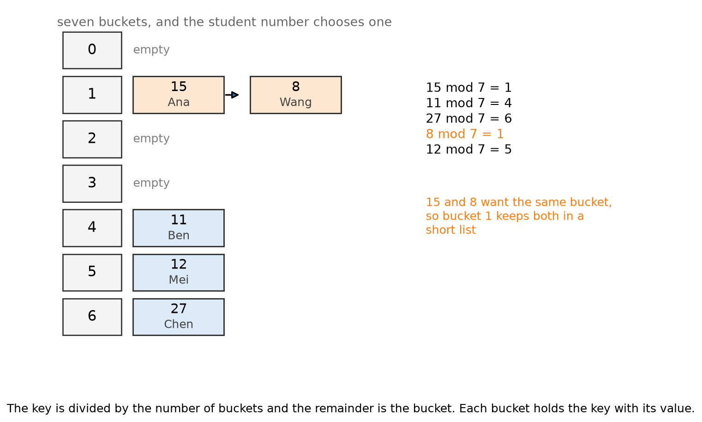
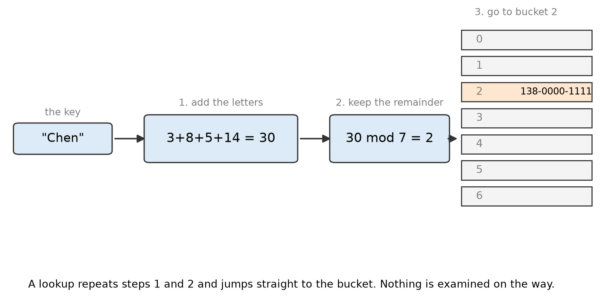
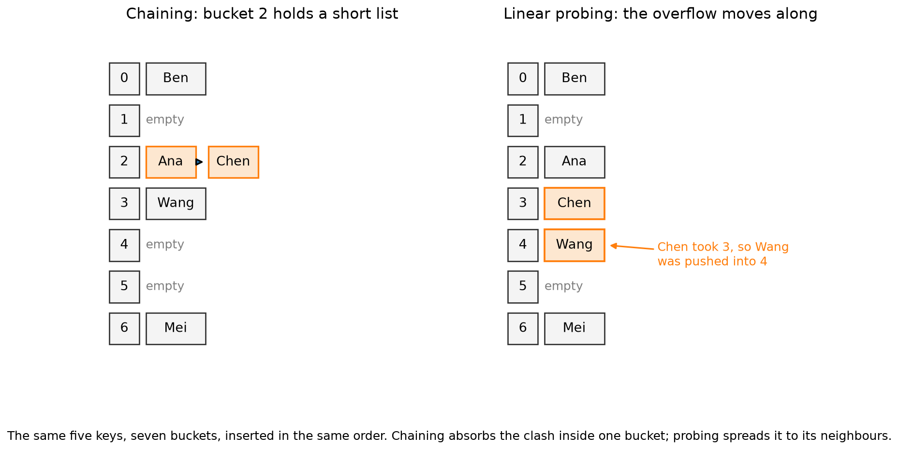

# 2.3 Hash Tables

## Learning outcomes

- Explain how a hash function turns a key into a bucket number.
- Retrieve a value from a hash table and explain why it is fast.
- Describe a collision and how chaining handles one.
- Say when a hash table is the wrong choice.

## Buckets are array slots

A hash table starts as an array of empty slots, and each slot is called a **bucket**. The difference from an ordinary array is that you do not pick a slot by position. The **key** picks it.

Say the keys are student numbers and the values are names.

| Key | Value |
| --- | --- |
| 15 | Ana |
| 11 | Ben |
| 27 | Chen |
| 8 | Wang |
| 12 | Mei |

The rule is a remainder. Divide the key by the number of buckets, here 7, and keep what is left over.

*The student number is divided by 7, and the remainder is the bucket. Each bucket stores the number together with the name.*

A rule that turns a key into a bucket number is a **hash function**, and the remainder operation it uses is called **mod**. Since 15 = 2 × 7 + 1, we write `15 mod 7 = 1`. The result is always between 0 and 6, so it always names a real bucket.

## Retrieving a value

To get a value back, repeat the same arithmetic on the same key.

1. Compute the bucket number from the key.
2. Open that bucket.
3. Compare the stored keys with the key you want, until one matches.
4. Return the value stored beside it.

Retrieve the name of student 8.

| Step | Action | Result |
| --- | --- | --- |
| 1 | `8 mod 7` | bucket 1 |
| 2 | open bucket 1 | holds 15 Ana and 8 Wang |
| 3 | compare 15 with 8 | no match |
| 4 | compare 8 with 8 | match |
| 5 | return the value beside 8 | Wang |

Four other students are stored, and none of them was compared. That is the whole point of the structure.

**Asking for a key that is not there** works the same way. Retrieve student 3: `3 mod 7 = 3`, bucket 3 is empty, so there is no such student. One remainder and one empty bucket, no comparisons at all.

Missing keys are not an error case. A username checker asks whether a name is taken, and the usual answer is no. A cache asks whether it already holds a page, and usually it does not. A lookup that returns nothing is a normal, fast answer.

The cost of a lookup is the arithmetic plus the length of one chain. It does not grow with the number of keys in the other buckets.

## When the key is a word

Keys are often names rather than numbers, so the hash first turns the letters into numbers. Letter a is worth 1, b is 2, and so on, the values are added, and the sum is taken mod 7.

| Key | Letters | Sum | mod 7 | Bucket |
| --- | --- | --- | --- | --- |
| Chen | 3 + 8 + 5 + 14 | 30 | 2 | 2 |
| Mei | 13 + 5 + 9 | 27 | 6 | 6 |
| Ben | 2 + 5 + 14 | 21 | 0 | 0 |

*The name becomes a number, the number picks a bucket, and the bucket holds the phone number beside the name.*

| Key | Value |
| --- | --- |
| Chen | 138-0000-1111 |
| Mei | 139-0000-2222 |
| Ben | 137-0000-3333 |

A lookup for Chen computes 30 mod 7 = 2, opens bucket 2, and compares the names stored there against Chen. The names are compared, not the sums.

## What makes a hash function good

- **Deterministic:** the same key must give the same bucket, or the value could never be found again.
- **Fast:** the arithmetic should cost almost nothing.
- **Even:** keys should spread across the buckets, not pile into a few.

## Anagrams always collide

| Key | Letters | Sum | Bucket |
| --- | --- | --- | --- |
| Amy | 1 + 13 + 25 | 39 | 4 |
| May | 13 + 1 + 25 | 39 | 4 |

Addition ignores order, so any two anagrams land together. Real hash functions also use each letter's position, which separates them.

## Collisions

A **collision** is two different keys landing in one bucket. Above, 15 and 8 both give bucket 1.

Collisions cannot be prevented. More keys than buckets makes them certain, and they happen often even with room to spare. There are two ways to live with them.

- **Chaining:** each bucket keeps a short list, so bucket 1 holds 15 Ana and then 8 Wang.
- **Linear probing:** each bucket keeps one key, so 8 takes the next free slot, bucket 2.

*The same five keys, seven buckets, same insertion order. Chaining keeps the clash inside bucket 2. Probing pushes Chen to 3, and then Wang, which collided with nobody, has to move to 4. Spreading like this is called clustering.*

## Worked example: five names, seven buckets

Insert Ana, Ben, Chen, Wang and Mei with the letter-sum hash.

| Name | Letters | Sum | mod 7 | Bucket |
| --- | --- | --- | --- | --- |
| Ana | 1 + 14 + 1 | 16 | 2 | 2 |
| Ben | 2 + 5 + 14 | 21 | 0 | 0 |
| Chen | 3 + 8 + 5 + 14 | 30 | 2 | 2 |
| Wang | 23 + 1 + 14 + 7 | 45 | 3 | 3 |
| Mei | 13 + 5 + 9 | 27 | 6 | 6 |

Ana and Chen both land in bucket 2, so bucket 2 holds the chain Ana → Chen.

**Look up Chen.** The hash gives bucket 2. Compare the key with Ana, which is not a match, then with Chen, which is. Two comparisons, one bucket.

**Look up Tom.** 20 + 15 + 13 = 48, and 48 mod 7 = 6. Bucket 6 holds Mei, and the chain ends. Tom is absent after one comparison, again in one bucket.

## How full is the table

The **load factor** is the number of keys divided by the number of buckets. Here it is 5 ÷ 7, about 0.71.

While the load factor stays below about 1, each bucket's chain holds roughly one item, and a lookup costs one hash plus a check of a short list. That is **O(1) on average**.

A badly chosen hash function, or plain bad luck, can still send every key to one bucket. That bucket becomes a list of n items, and lookup falls to O(n). Real hash tables avoid this by **resizing**: when the load factor gets too high, they allocate a larger array, often double the size, and re-insert every key.

## When not to use one

Hash tables answer "is this key here, and what is its value?" extremely fast, and they are poor at anything that depends on order.

- Listing the keys in sorted order needs a separate sort.
- Finding the smallest key means scanning every bucket.
- Range questions such as "all students scoring between 80 and 90" cannot use the hash at all.

For those tasks, a sorted array or a [binary search tree](2.4-trees.md) is the right structure.

## Activity

Insert Li, Kai, Tom, Sara, Leo and Zhao into an empty 7-bucket table using the same hash and chaining. Show each sum, its bucket, and the final table. Mark every pair that collides.

**Expected outcome:** the buckets are Li and Kai in 0, Zhao in 1, Sara and Leo in 4, and Tom in 6. Two collisions: Li with Kai, and Sara with Leo. The load factor is 6 ÷ 7.

## Check your understanding

**Q1 (True/False).** If two keys produce the same hash value, the table cannot store both.

**Q2 (True/False).** A hash function must return the same bucket every time it is given the same key.

**Q3 (Multiple choice).** What is 45 mod 7?

A. 6 B. 3 C. 5 D. 0

**Q4 (Multiple choice).** Which task is a hash table least suited to?

A. Checking whether a username is taken B. Counting how often each word appears C. Printing all students sorted by score D. Finding a product by its barcode

**Q5 (Problem).** A table has 6 keys in 7 buckets. Six more keys arrive. What is the new load factor, and what should the table do about it?

**Q6 (Explain).** Why do "Amy" and "May" always collide under the letter-sum hash? Suggest a change that would separate them.

## Answers

**A1.** False. With chaining both keys go in the same bucket's list. With linear probing the second key moves to the next free bucket.

**A2.** True. If the bucket could change, a lookup would search the wrong place and never find the item.

**A3.** B. 45 = 6 × 7 + 3.

**A4.** C. A hash table keeps no order, so printing by score requires sorting everything separately. The other three are exact-key lookups.

**A5.** 12 ÷ 7 is about 1.71, so chains now hold nearly two keys on average and lookups slow down. The table should resize, creating a bigger array with more buckets and re-inserting every key.

**A6.** Addition gives the same total in any order, so A + M + Y and M + A + Y both reach 39. Making the position matter, for example multiplying each letter by its position in the word, separates them.

## Connections

- The bucket array is the array of [2.1](2.1-arrays-linked-lists.md), and the hash function supplies its index.
- Chaining builds chains out of linked lists ([2.1](2.1-arrays-linked-lists.md)).
- Compare the costs in [1.3](../part1-algorithms/1.3-searching.md): O(n) linear search, O(log n) binary search, O(1) average hashing.

## References

- Harvard CS50x, week 5, Data Structures. https://cs50.harvard.edu/x/2024/notes/5/
- GeeksforGeeks. "Hash Table Data Structure." https://www.geeksforgeeks.org/dsa/hash-table-data-structure/
- Cormen, T. H., Leiserson, C. E., Rivest, R. L., & Stein, C. (2022). _Introduction to Algorithms_ (4th ed.), chapter 11. MIT Press.
- Bhargava, A. (2024). _Grokking Algorithms_ (2nd ed.), chapter 5. Manning.
- VisuAlgo, hash table visualisation. https://visualgo.net/en/hashtable
