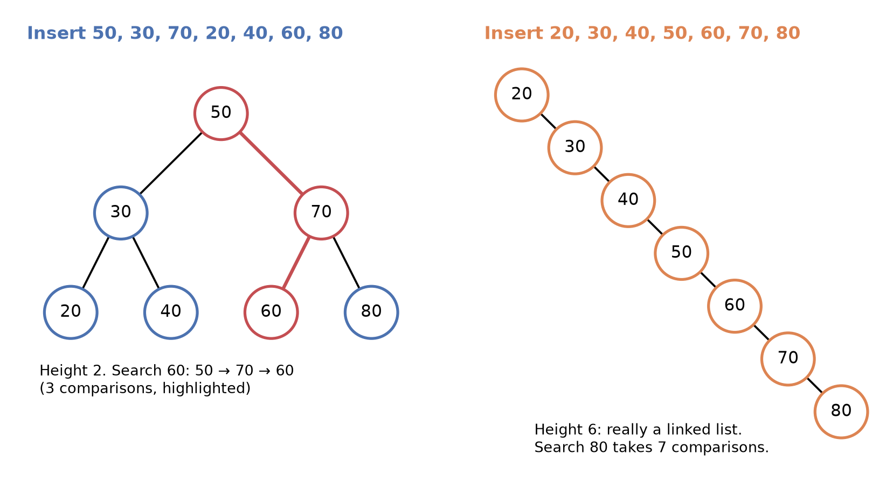
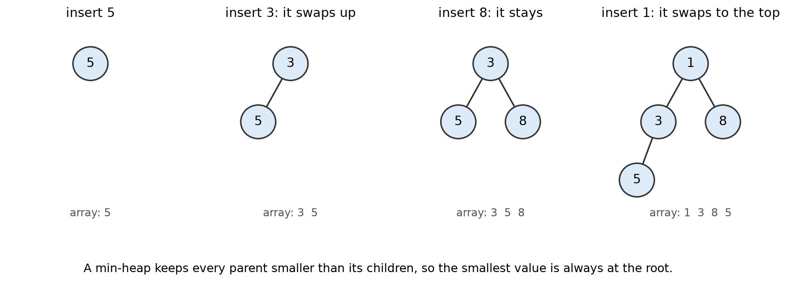

# 2.4 Trees, Binary Search Trees and Heaps

## Learning outcomes

- Use the basic tree terms: root, parent, child, leaf, height.
- Insert into and search a binary search tree.
- Explain why the shape of a tree decides how fast it is.
- Describe a heap and what a priority queue uses it for.

## A tree of seven numbers

```
          50
        /    \
      30      70
     /  \    /  \
   20   40  60   80
```

Each circle is a **node** and each line is a link. The tree is drawn upside down, with the first node at the top.

| Term | Meaning | In this tree |
| --- | --- | --- |
| **Root** | The top node, with no parent | 50 |
| **Parent and child** | A node directly above or below another | 30 is the parent of 20 and 40 |
| **Leaf** | A node with no children | 20, 40, 60 and 80 |
| **Depth** | Links from the root down to the node | 40 sits at depth 2 |
| **Height** | Links on the longest path from the root to a leaf | 2 |

A tree with one node has height 0.

A **binary tree** gives every node at most two children, called the **left child** and the **right child**.

## The search rule

A **binary search tree**, or **BST**, follows one rule at every node:

> Everything in the **left** subtree is **smaller** than the node. Everything in the **right** subtree is **larger**.

This topic assumes all values are different. The rule turns a search into a run of left or right decisions.

Search for 60 in the tree above.

| Step | At node | Compare | Move |
| --- | --- | --- | --- |
| 1 | 50 | 60 is larger | right |
| 2 | 70 | 60 is smaller | left |
| 3 | 60 | equal | found |

Three comparisons, not seven. Each step throws away a whole subtree, exactly as each step of binary search throws away half a sorted list ([1.3](../part1-algorithms/1.3-searching.md)).

Search for 35, which is not in the tree.

| Step | At node | Compare | Move |
| --- | --- | --- | --- |
| 1 | 50 | 35 is smaller | left |
| 2 | 30 | 35 is larger | right |
| 3 | 40 | 35 is smaller | left, and empty |

Three comparisons and the value is absent. An empty child is the end of the search.

## Inserting

To insert a value, search for it. The empty spot where the search stops is where it belongs, so hang it there as a leaf.

Inserting 50, 30, 70, 20, 40, 60 and 80 in that order:

| Insert | Comparisons | Placed as |
| --- | --- | --- |
| 50 | tree is empty | root |
| 30 | 30 < 50, left is empty | left child of 50 |
| 70 | 70 > 50, right is empty | right child of 50 |
| 20 | 20 < 50 to 30, 20 < 30, left is empty | left child of 30 |
| 40 | 40 < 50 to 30, 40 > 30, right is empty | right child of 30 |
| 60 | 60 > 50 to 70, 60 < 70, left is empty | left child of 70 |
| 80 | 80 > 50 to 70, 80 > 70, right is empty | right child of 70 |

That produces exactly the tree at the top of this section. Note what did not happen: no existing value moved. Inserting into a sorted array shifts everything after the insertion point ([2.1](2.1-arrays-linked-lists.md)).

## The shape decides the speed

Search and insertion each follow one path from the root down, so their cost is the height of the tree.

- A **balanced** tree keeps the levels full, so n values fit in a height of about log₂ n. A million values fit in 19 levels, which means at most 19 comparisons.
- A **degenerate** tree has one child per node, so it is really a chain. Its height is n − 1, and search becomes O(n), no better than a linked list.

The shape depends only on the order of insertion, and inserting values that are already sorted produces the worst case.


*The same seven values in two insertion orders. On the left, height 2, and search 60 takes three comparisons. On the right every value is larger than the one before, so the tree is a chain of height 6, and search 80 takes seven comparisons.*

Self-balancing trees, such as AVL and red-black trees, rearrange themselves after each insertion to prevent this. They are outside this module, but they are why databases can rely on trees.

## Sorted output for free

A **traversal** visits every node once. An **in-order traversal** visits the left subtree, then the node, then the right subtree.

On the tree above it gives 20, 30, 40, 50, 60, 70 and 80, which is sorted. A hash table cannot do that ([2.3](2.3-hash-tables.md)), so when order matters, a tree is the better structure.

## Heaps and priority queues

An emergency room does not treat patients in arrival order, which is a queue ([2.2](2.2-stacks-queues.md)). It treats the most urgent first. A **priority queue** always gives back the most important item, and the usual way to build one is a **heap**.

A **min-heap** is a binary tree with two rules:

- **Heap property.** Every parent is smaller than its children, so the smallest value is always at the root.
- **Shape.** Every level is full except possibly the last, which fills from left to right.

Unlike a BST, a heap makes no promise about left being smaller than right. It only promises that the minimum is on top.

- **Insert** puts the new value in the next free spot at the bottom, then swaps it upward while it is smaller than its parent.
- **Remove the minimum** takes the root and moves the last value into it, then swaps downward with the smaller child until the heap property holds again.


*Inserting 5, then 3, then 8, then 1. A smaller value climbs until its parent is smaller than it, so the minimum is always the root.*

Inserting 5, 3, 8 and 1:

| Insert | What happens | Heap |
| --- | --- | --- |
| 5 | the heap is empty | `5` |
| 3 | 3 is smaller than its parent, so it swaps up | `3, 5` |
| 8 | 8 is larger than 3, so it stays | `3, 5, 8` |
| 1 | 1 swaps up past 5 and then past 3 | `1, 3, 8, 5` |

Removing the minimum returns 1. The last value, 5, moves to the root and swaps down with 3, leaving `3, 5, 8`.

Both operations follow a single path, so both cost O(log n). Reading the minimum costs O(1), because it is always the root. Operating systems schedule tasks this way, and route planners use a heap to pick the nearest unexplored place.

## Activity

Insert the same seven values in sorted order, 20, 30, 40, 50, 60, 70 and 80, and describe the tree you get. Then say how many comparisons a search for 80 needs.

**Expected outcome:** every new value is larger than everything already in the tree, so each one becomes the right child of the previous node. The result is a chain of height 6, and searching for 80 needs seven comparisons. Sorted input produces the worst case.

## Check your understanding

**Q1 (True/False).** In a BST, every value in the left subtree of a node is smaller than that node.

**Q2 (True/False).** A heap keeps its values sorted, so the second smallest is always in the second position.

**Q3 (Multiple choice).** A balanced BST holds 1,000 values. Roughly how many comparisons does a search need in the worst case?

A. 10 B. 100 C. 500 D. 1,000

**Q4 (Multiple choice).** Which task is a heap designed for?

A. Listing all values in sorted order B. Looking up a value by its exact key C. Always removing the smallest item next D. Storing values so that left is smaller than right

**Q5 (Problem).** Insert 8, 4, 12, 2 and 6 into an empty BST in that order. Draw the tree and state its height.

**Q6 (Problem).** Insert 4, 2, 7 and 1 into an empty min-heap. Give the heap after each insertion, then say what removing the minimum returns.

## Answers

**A1.** True. That is the BST rule, and it holds at every node, not only at the root.

**A2.** False. A heap only guarantees the minimum is at the root. The order of the rest is not sorted.

**A3.** A. A balanced tree of 1,000 values has height about 10, since 2¹⁰ = 1,024.

**A4.** C. A heap gives fast access to the smallest or highest priority item, which is what a priority queue needs.

**A5.** 8 is the root, 4 goes left, 12 goes right, 2 goes left of 4, and 6 goes right of 4. The height is 2.

**A6.** After 4: `4`. After 2: `2, 4`, because 2 swaps up. After 7: `2, 4, 7`. After 1: `1, 2, 7, 4`, because 1 swaps up past 4 and then past 2. Removing the minimum returns 1, and the heap becomes `2, 4, 7`.

## Connections

- Left and right children are reached by pointers, as in a linked list ([2.1](2.1-arrays-linked-lists.md)).
- A BST search is binary search on a tree ([1.3](../part1-algorithms/1.3-searching.md)).
- A priority queue is the ordered cousin of the queue ([2.2](2.2-stacks-queues.md)).
- Graphs, in [2.5](2.5-graphs.md), relax the tree rules completely.

## References

- Cormen, T. H., Leiserson, C. E., Rivest, R. L., & Stein, C. (2022). _Introduction to Algorithms_ (4th ed.), chapters 12 and 6. MIT Press.
- Bhargava, A. (2024). _Grokking Algorithms_ (2nd ed.), chapters 6 and 10. Manning.
- VisuAlgo, binary search tree and heap visualisations. https://visualgo.net/en/bst
- Harvard CS50x, week 5. https://cs50.harvard.edu/x/
