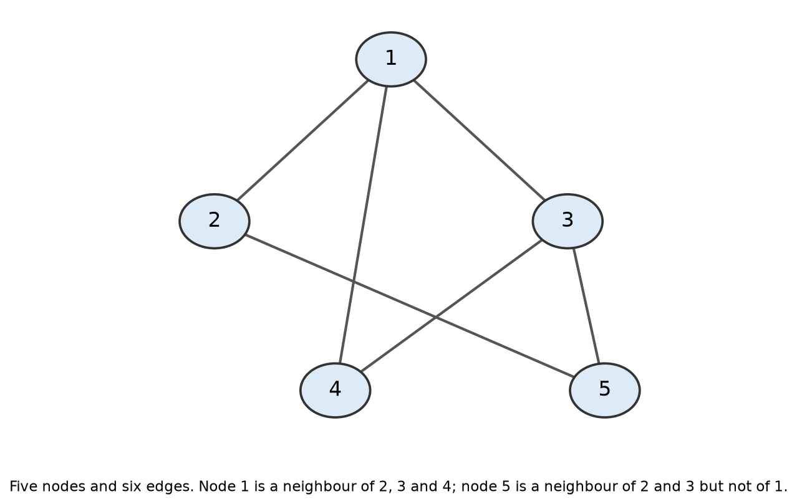
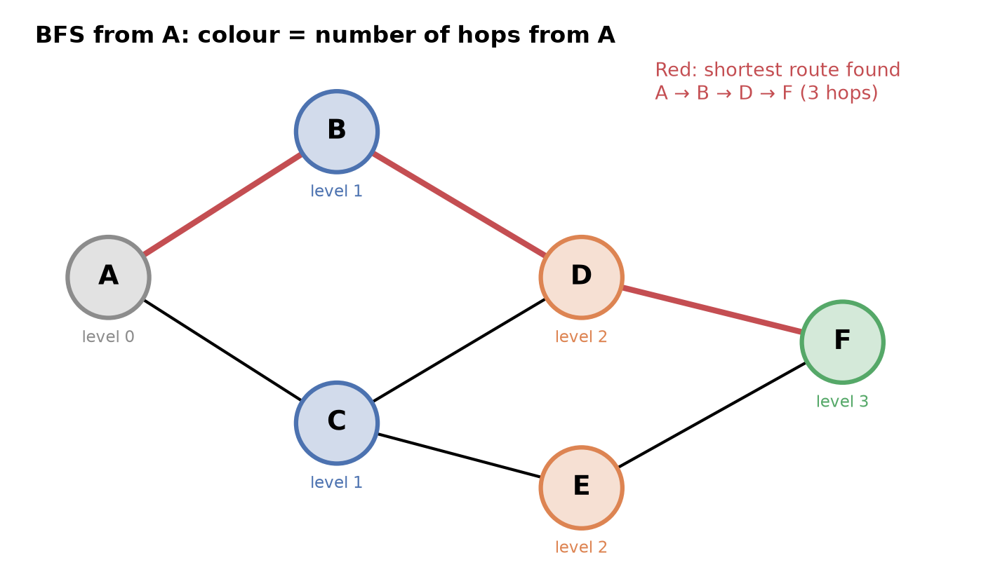

# 2.5 Graphs, BFS and DFS

## What will you do?

Your phone just died on a metro and you're at station A. Your friend is waiting at station F, and now you have no navigation app on your phone to tell you the shortest route to go, so the only help is the map on the wall with dots and lines. Do you pick a route at random, or is there a method that guarantees the fewest stops?
_

That little map is a graph. By the end of this module you will have two methods for exploring it: one that always finds the shortest route in stops, and one that can happily walk you the long way round without noticing.

## Why this matters

A metro map, a social network, the web's hyperlinks and the roads in a navigation app are all made of things and connections between things. That structure is a graph. You already use graph algorithms every day:
- Instagram's "People you may know" suggests friends of friends, the people exactly 2 hops away from you.
- A navigation app finds the route with the fewest stops or the least time.
- A search engine follows links from page to page to discover the web.
- Neural network is also a graph, with numbers on its connections.

## Learning outcomes

- Define a graph using nodes and edges and represent it with an adjacency list.
- Trace breadth-first search (BFS) with a queue to find the fewest hops between two nodes.
- Explain how depth-first search (DFS) differs from BFS and why DFS does not guarantee the shortest route.
- Describe a neural network as a weighted, directed graph.

## Key ideas

- A graph is a set of nodes connected by edges. Examples: maps, social networks.
- BFS explores level by level using a queue. DFS goes deep first using a stack.
- BFS finds the fewest hops. On a weighted graph (distances or times), the shortest path needs Dijkstra's algorithm (mentioned only, not traced).
- A neural network is a weighted, directed graph (3.3).

## Before you start

- [2.2 Stacks and queues](2.2-stacks-queues.md), for the queue BFS uses and the stack DFS uses
- [2.4 Trees](2.4-trees.md), since a tree is a special graph
- [1.2 Big-O](../part1-algorithms/1.2-big-o.md), for the cost of a search
- [1.5 Recursion](../part1-algorithms/1.5-recursion.md), since DFS is naturally recursive

## Core ideas

### Nodes, edges and kinds of graph

A graph is a data structure made up of:

- Nodes(Vertices): The points. It's used to store data.
- Edges: The connections between points.

Two nodes joined by an edge are **neighbours**.


*Five nodes and six edges. The vertex set is V = {1, 2, 3, 4, 5} and the edge set is E = {1-2, 1-3, 1-4, 2-5, 3-4, 3-5}. Each undirected edge is written once.*


These are some of the real-life examples of a Graph:

- Social-Media connections: Here, every user can be represented as a node and the nodes can be connected with each other with the help of some edge.
- Telephone network: In the case of telephone network various nodes or telephones are connected with each other with the help of wires i.e. edges.
- Finding routes: Finding the shortest path between two places is a classical example of a Graph. Here, the places are represented as nodes and the possible paths between the nodes are the edges between the nodes.

| Kind           | Meaning                              | Example                                               |
| -------------- | ------------------------------------ | ----------------------------------------------------- |
| **Undirected** | Edges work both ways                 | Metro lines, Facebook-style friendship                |
| **Directed**   | Each edge has a direction (an arrow) | Following someone on Weibo or Instagram, web links    |
| **Weighted**   | Each edge carries a number           | Road distances, ticket prices, neural-network weights |


A **path** is a sequence of nodes joined by edges. Its length in **hops** is the number of edges travelled. A [tree](2.4-trees.md) is a graph with no **cycles** (no way to leave a node and return to it without retracing steps).


### Storing a graph

An **adjacency list** is like a phone contacts list: each node keeps a list of its neighbours. It is usually a [hash table](2.3-hash-tables.md) mapping each node to a list:

```
A: B, C
B: A, D
C: A, D, E
D: B, C, F
E: C, F
F: D, E
```

An **adjacency matrix** is an n × n [2-D array](2.1-arrays-linked-lists.md) where entry [i][j] is 1 (or the edge's weight) if i connects to j. It checks a connection in O(1) but uses n² memory.


### Breadth-first search (BFS)

**BFS** explores outward in rings: first every node 1 hop away, then every node 2 hops away, and so on, like ripples spreading from a stone dropped in water. It uses a **queue** so that nodes discovered earlier (nearer) are explored first.

The queue keeps the order fair, like a canteen line: whoever was discovered first is explored first, so nearer nodes always go before farther ones.

```
BFS(start):
    mark start as seen; enqueue start
    while the queue is not empty:
        u ← dequeue
        for each neighbour v of u:
            if v not seen:
                mark v as seen; record parent[v] ← u; enqueue v
```

Because nodes are explored in order of distance, **the first time BFS reaches a node, it has found a path with the fewest hops**. Following the `parent` records backwards from the target gives that path.

Cost: every node is enqueued once and every edge is checked a constant number of times, so BFS is **O(V + E)** for V nodes and E edges.


*Visual (Figure 3): BFS levels on the metro map, with colours showing hops from A and the BFS route highlighted.*


### Depth-first search (DFS)

**DFS** goes as deep as possible along one route before backing up and trying another, like exploring a maze by always taking the first unexplored corridor and turning back only at dead ends.It uses a **stack**, either an explicit one or the call stack through [recursion](../part1-algorithms/1.5-recursion.md).The stack works like your browser's Back button. Every page you open is pushed on top, and Back pops the most recent one. DFS uses a stack in the same way, either an explicit one or the call stack through recursion


*Visual (Figure 6): shows the queue and the stack side by side, which is the main difference between BFS and DFS.*


DFS also visits every reachable node in O(V + E), and it is useful for detecting cycles, solving mazes and exploring all possibilities. But the route it happens to find to a node is **not necessarily the shortest**.


|                    | BFS                                      | DFS                                           |
| ------------------ | ---------------------------------------- | --------------------------------------------- |
| Helper structure   | Queue (FIFO)                             | Stack (LIFO) / recursion                      |
| Exploration order  | Level by level, nearest first            | One route as deep as possible, then backtrack |
| Finds fewest hops? | **Yes** (unweighted graphs)              | No                                            |
| Typical use        | Shortest routes, "degrees of separation" | Mazes, cycle detection, exploring all options |

### Weighted graphs: fewest hops ≠ shortest distance

BFS counts **hops** and ignores edge weights. On a weighted graph, the route with the fewest hops can be longer. Example: Home–School is 9 km by the direct road, while Home–Shop is 3 km and Shop–School is 4 km. BFS picks the direct road (1 hop, 9 km), but the true shortest route is Home → Shop → School (2 hops, **7 km**).


*Visual (Figure 4): the 9 km direct road versus the 3 km + 4 km route via Shop.*


**Dijkstra's algorithm** solves this. Like BFS it grows outward from the start, but it always explores next the node with the **smallest total distance so far**, using a [priority queue](2.4-trees.md#heaps-and-priority-queues) instead of a plain queue. Navigation apps use it or its faster variants. A full trace is beyond this module.

### A neural network is a graph


*Visual (Figure 7): shows a neural network as a directed, weighted graph*


In a neural network, each artificial neuron is a node and each connection is a **directed, weighted edge**: signals flow one way, from inputs towards outputs, and each edge's weight says how strongly one neuron influences the next. Computing the network's output means moving through this graph layer by layer, much like BFS moves level by level. Training adjusts the edge weights, working backwards through the same graph ([3.3](../part3-connectionist-ai/3.3-multilayer-networks.md), [3.4](../part3-connectionist-ai/3.4-learning.md)).

## Worked example

**Task:** on the metro map below, find the fewest hops from station A to station F using BFS. Neighbours are processed in alphabetical order.

**BFS trace**

| Step | Dequeue | New neighbours found (parent)     | Queue after |
| ---- | ------- | --------------------------------- | ----------- |
| 0    | —       | start at A (level 0)              | A           |
| 1    | A       | B (A), C (A), level 1             | B, C        |
| 2    | B       | D (B), level 2                    | C, D        |
| 3    | C       | E (C), level 2; D already seen    | D, E        |
| 4    | D       | F (D), level 3; B, C already seen | E, F        |
| 5    | E       | none (C, F seen)                  | F           |
| 6    | F       | none                              | _(empty)_   |


*F was reached at **level 3**, so the fewest hops is **3**. Following parents back: F ← D ← B ← A gives **A → B → D → F**. (A → C → D → F and A → C → E → F are also 3 hops. BFS returns whichever it meets first.)*


**DFS on the same map** (recursive, alphabetical neighbours) visits A, B, D, C, E, F. The route by which it first reaches F is **A → B → D → C → E → F: 5 hops**. DFS found F, but not by the shortest route.

**Try it in (C)**

```
#include <stdio.h>
int main() {
    char metro[6][6] = {
        {'B', 'C', '\0'},       // A
        {'A', 'D', '\0'},       // B
        {'A', 'D', 'E', '\0'},  // C
        {'B', 'C', 'F', '\0'},  // D
        {'C', 'F', '\0'},       // E
        {'D', 'E', '\0'}        // F
    };

    int visited[6] = {0};
    int parent[6];
    int queue[6];
    int front = 0, rear = 0;

    // Start from A (index 0)
    queue[rear++] = 0;
    visited[0] = 1;
    parent[0] = -1;

    // BFS
    while (front < rear) {
        int u = queue[front++];

        for (int i = 0; metro[u][i] != '\0'; i++) {
            int v = metro[u][i] - 'A';

            if (!visited[v]) {
                visited[v] = 1;
                parent[v] = u;
                queue[rear++] = v;
            }
        }
    }

    // Reconstruct path from A to F
    int path[6], length = 0;
    int node = 5;  // F

    while (node != -1) {
        path[length++] = node;
        node = parent[node];
    }

    printf("Shortest path: ");
    for (int i = length - 1; i >= 0; i--) {
        printf("%c", path[i] + 'A');
        if (i > 0) printf(" -> ");
    }

    printf("\n");
    return 0;
}
```

You will recieve the output:
Shortest path: A -> B -> D -> F

## Visual


*What to notice: colours show BFS levels, i.e. hops from A. F is on level 3, so no route can be shorter than 3 hops. The red route is the one BFS records.*

## Common misconceptions

- "BFS finds the fastest route on any map" → It finds the fewest _hops_. If edges have different lengths or times, use a weighted method such as Dijkstra's algorithm.
- "DFS is worse than BFS" → Neither is better overall; they answer different questions. DFS often uses less memory and suits mazes and cycle detection.
- "A graph is a chart or plot" → In computer science, a graph means nodes and edges, not an x–y chart.
- "Trees and graphs are unrelated" → A tree is a graph with no cycles; tree algorithms are special cases of graph algorithms.

## Learner activities (lets test what you've learned)

**Q1 (True/False).** BFS uses a stack to decide which node to explore next.

**Q2 (Multiple choice).** In the metro map, which stations are exactly 2 hops from A?
a) B and C b) D and E c) F only d) D, E and F

**Q3 (Problem).** Remove the edge D–F from the metro map. Use BFS from A to find the fewest hops to F and give the route.

**Q4 (Problem).** Write the adjacency list for a directed graph with edges P→Q, P→R, Q→R, R→S.

**Q5 (Explain).** Why is a neural network described as a _weighted, directed_ graph? Explain each word.

**Q6 (Problem).** Roads: A–B 1 km, B–C 1 km, C–D 1 km, A–D 5 km. Which route does BFS give from A to D? Which route is shortest in km?

**Q7 (Real world).** In a friend network, You is friends with Mia and Leo; Mia is friends with Zoe; Leo is friends with Zoe and Sam; Zoe is friends with Kai. Using BFS from You, who would an app suggest as "People you may know" (exactly 2 hops away)? How many hops to Kai?


## Answers:

**A1.** False. BFS uses a **queue**, so the nodes found earliest (the nearest) are explored first. DFS uses a stack.

**A2.** b) D and E. B and C are 1 hop away; D (via B or C) and E (via C) are 2 hops; F is 3.

**A3.** Without D–F, F's only neighbour is E. BFS levels: A (0); B, C (1); D, E (2); F (3, reached from E). Fewest hops = **3**, route **A → C → E → F**.

**A4.** P: Q, R · Q: R · R: S · S: (none). In a directed graph, each edge is listed only under the node it starts from.

**A5.** _Graph_: neurons are nodes and connections are edges. _Directed_: signals flow one way, from inputs to outputs. _Weighted_: each connection has a number (weight) that scales the signal; learning means adjusting these weights.

**A6.** BFS gives **A → D** (1 hop, but 5 km). The shortest distance is **A → B → C → D = 3 km** (3 hops). This is what Dijkstra's algorithm would find.

**A7.** Level 1: Mia, Leo. Level 2: Zoe and Sam, so the app suggests Zoe and Sam. Kai is at level 3 (You → Mia → Zoe → Kai), so 3 hops.

## Connections

- [2.2 Stacks and queues](2.2-stacks-queues.md): the queue makes BFS level-by-level; the stack makes DFS go deep.
- [2.1 Arrays](2.1-arrays-linked-lists.md): an adjacency matrix is a 2-D array, just like a neural network's weight matrix.
- [3.3 Multi-layer networks](../part3-connectionist-ai/3.3-multilayer-networks.md): the forward pass moves through a directed, weighted graph layer by layer.

## References

- Cormen, T. H., Leiserson, C. E., Rivest, R. L., & Stein, C. (2022). _Introduction to Algorithms_ (4th ed.). MIT Press. Chapter 20 (elementary graph algorithms: BFS, DFS).
- Bhargava, A. (2024). _Grokking Algorithms_ (2nd ed.). Manning. Chapter 6 (breadth-first search).
- VisuAlgo: Graph Traversal (DFS/BFS). https://visualgo.net/
- Goodfellow, I., Bengio, Y., & Courville, A. (2016). _Deep Learning_. MIT Press. Section 6.5 (computational graphs). https://www.deeplearningbook.org/
