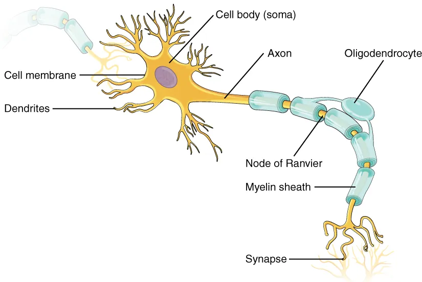
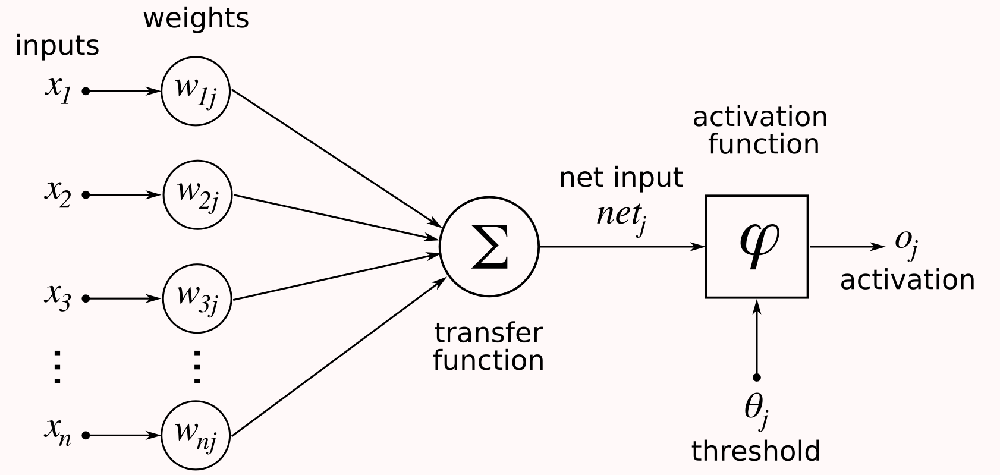
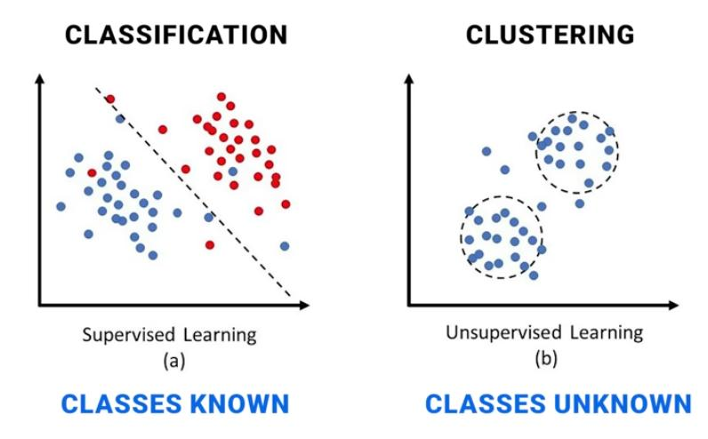
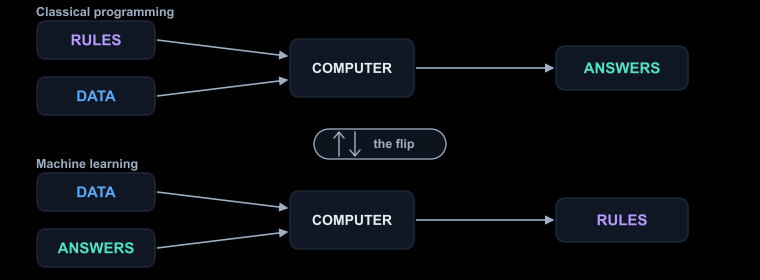

# 3.1 From Rules to Learning

> **Status:** drafted · **Owner:** Irada · **Reviewer:** Aylin
> v0.1 research draft · AI-assisted (Claude, 2026-10-27) · Not yet verified by the team
> v0.2 modified on 10/27/2026 by Irada. Note = Rewrote most of the content (definitions, tables, example, activity, quiz) and checked the facts against the listed sources. Still to do: figures, team review.

## Learning outcomes
By the end of this section learners should be able to:
- Explain the difference between symbolic AI and connectionist AI.
- Describe how a biological neuron inspired the artificial neuron.
- Define weights, training data, labels, supervised learning, and unsupervised learning.
- Calculate the output of one artificial neuron.
- Identify key milestones in the history of neural networks.

## Key ideas
- Symbolic AI: people write the rules. Connectionist AI: the system learns weights from examples.
- A neuron receives signals, combines them, and fires if the combined signal is strong enough.
- Short timeline: McCulloch–Pitts (1943), perceptron (1958), first 'AI winter', backpropagation (1986), deep learning (2012 onwards).
- Supervised learning uses labelled examples (emails marked spam / not spam). Unsupervised learning finds groups in unlabelled data (grouping customers by shopping habits).

## Two Ways to Build an AI System

### Symbolic AI

**Definition.** Symbolic AI is an approach that represents knowledge with symbols, facts and logical rules. In a rule-based system, a programmer writes the rules, and the computer applies them to the input.

Properties:

- Knowledge comes from people. The system is only as good as the rules it was given.
- Every decision can be traced back to a rule.
- The system does not learn new rules from examples unless a learning part is added.

| Advantages | Limitations |
|---|---|
| Rules can be read and understood by people. | Designers must think of every situation in advance. |
| Behaviour is predictable when rules and inputs are clear. | Rules may not cover every possible case. |
| Each rule can be tested, changed or removed on its own. | Hard tasks need many rules, which are difficult to maintain. |

### Connectionist AI

**Definition.** Connectionist AI is an approach that represents information through a network of connected units called artificial neurons. Instead of relying only on written rules, the model learns patterns from data.

Properties:

- Knowledge is stored in numbers, mainly the **weights** that connect the units.
- During **training**, a learning algorithm changes these numbers to improve the results.
- After training, the model makes predictions for new inputs.

| Advantages | Limitations |
|---|---|
| It can learn relationships between many features in the data. | It usually needs a good amount of relevant training data. |
| It can handle inputs that were not in the training data. | Wrong, missing or unrepresentative data gives unreliable results. |
| Developers do not need to write every decision as a rule. | Predictions are not always correct, and it is often hard to explain them. |

### Comparison

| | Symbolic (rule-based) AI | Connectionist AI |
|---|---|---|
| Where knowledge comes from | Written by people | Learned from data |
| Stored as | Facts and rules | Weights in a network |
| Easy to explain? | Yes, each rule can be read | Often difficult |
| Needs training data? | No | Usually yes |
| Suits | Clear, fixed tasks (password length check) | Messy tasks (images, speech, spam) |

> **Important:** Symbolic AI and connectionist AI are different approaches, but they are not mutually exclusive. Some AI systems combine explicit rules with machine-learning models.

## From Biological Neurons to Artificial Neurons

**Definition.** A biological neuron is a specialised cell in the nervous system that receives, processes and passes on signals. Its structure inspired the mathematical model called the artificial neuron.

The main structures of a typical biological neuron include:

| Part | Job | Counterpart in an artificial neuron |
|---|---|---|
| Dendrites | Receive signals from other cells | Inputs |
| Synapses | Connect one neuron to the next; their strength affects the signal | Weights |
| Cell body (soma) | Maintains the cell and combines the incoming signals | Weighted sum plus bias |
| Axon | Carries electrical signals away from the cell body. | Output |

<table>
  <tr>
    <th>Biological neuron</th>
    <th>Artificial neuron</th>
  </tr>
  <tr>
    <td align="center">
      
    </td>
    <td align="center">
      
    </td>
  </tr>
  <tr>
    <td align="center"><em>A biological neuron with its parts labelled.</em></td>
    <td align="center"><em>An artificial neuron with inputs, weights, a sum and an output.</em></td>
  </tr>
</table>

Biological neurons are living cells and are far more complex than this. An artificial neuron is a simplified maths model, not an exact copy.

### The artificial neuron

An artificial neuron works in four steps:

1. Receive numbers as **inputs** (x₁, x₂, …).
2. Multiply each input by its **weight** (w₁, w₂, …). A larger weight means that input matters more.
3. Add all the results together and add the **bias** (b). The bias is an extra adjustable number that shifts the total.
4. Pass the total through an **activation function**, which turns it into the output.

```
output = activation( w₁·x₁ + w₂·x₂ + … + b )
```

| Term | Meaning |
|---|---|
| Weight | How strongly one input affects the result |
| Bias | An extra number that shifts the total up or down |
| Activation function | A rule that turns the total into the neuron's output |

In this section the activation function is a simple rule: output 1 if the total is greater than 0, otherwise output 0. Other activation functions appear in topic 3.3.

When many neurons are connected in layers, the result is a **neural network**.

## How does a model learn?

**Definition.** Machine learning is a field of AI in which algorithms use data to find patterns and build models that make predictions or decisions. The model is then tested on data it has not seen before.

### Training data and labels

**Definition.** Training data is the information used to train a model. It can be numbers, text, images or other data. A **label** is the known correct answer attached to one example.

| Email (input) | Label (target) |
|---|---|
| "Free entry, you are a winner" | spam |
| "Team meeting notes for Friday" | not spam |

The information given to the model is the **input**. The answer it should predict is the **target**.

### Supervised learning

**Definition.** Supervised learning trains a model on labelled examples. The model makes a prediction, a learning algorithm compares it with the correct label, and the model's parameters are updated to reduce the error.

Common tasks:

- **Classification:** put an input in a category (for example - spam or not spam).
- **Regression:** predict a number (for example - the price of a house).

A model that works well on its training examples may still work badly on new data.

### Unsupervised learning

**Definition.** Unsupervised learning uses data without labels. The algorithm looks for patterns or similarities by itself. A common method is **clustering**, which groups similar data points.

Example: a shop groups its customers by similar buying habits without telling the computer any groups in advance. A person must then check whether the groups are useful.

### Comparison

| | Supervised learning | Unsupervised learning |
|---|---|---|
| Data | Labelled | Not labelled |
| Goal | Predict the correct answer | Find groups or patterns |
| Typical task | Classification, regression | Clustering |
| Example | Spam or not spam | Grouping customers |

<p align="center">
  
</p>

<table align="center">
  <tr>
    <th align="center">Supervised Learning</th>
    <th align="center">Unsupervised Learning</th>
  </tr>
  <tr>
    <td align="center">Labelled data is used to learn a boundary between classes.</td>
    <td align="center">Unlabelled data is grouped into clusters based on similarity.</td>
  </tr>
</table>

## A short history of neural networks

| Year | Milestone | Why it matters |
|---|---|---|
| 1943 | McCulloch–Pitts neuron | First mathematical model of a simple artificial neuron. |
| 1958 | Rosenblatt's perceptron | A neural model that could be trained for some classification tasks. |
| Late 1960s onwards | Reduced interest in neural networks | Limits of early models made many researchers lose interest. |
| 1986 | Backpropagation popularised | A practical way to train networks with several layers. |
| 2006 onwards | Renewed interest in deep learning | Better training methods and faster computers allowed deeper networks. |
| 2012 | AlexNet wins the ImageNet contest | Showed the strength of deep networks for large-scale image recognition. |

The history of AI has periods called **AI winters**, when enthusiasm, funding and research declined. The story of neural networks is connected to this, but a decline in neural-network research and an AI winter are not exactly the same thing.

Modern deep learning did not come from one breakthrough. It needed better algorithms, faster computers, more data and better network designs.

## Worked example: a spam filter

**Problem.** An email system must decide whether a message is spam.

### Approach 1: rule-based

A programmer writes a scoring rule:

- "free" in the message: add 1 point.
- "winner" in the message: add 2 points.
- More than 3 links: add 2 points.
- A score of 2 or more means spam.

| Email | Score | Result | Correct? |
|---|---|---|---|
| "Free entry, you are a winner" | 1 + 2 = 3 | spam | Yes |
| "Free to talk on Friday?" | 1 | not spam | Yes |
| "Claim your reward now" (new spam) | 0 | not spam | No |

The third email is spam, but it uses words that the rules do not mention. A person must notice this and write a new rule. Next week's spam will need another one.

### Approach 2: learning from examples

Instead of writing rules, we collect labelled emails and let the model find its own weights.

1. For each email, record simple inputs: `x₁` = contains "free", `x₂` = contains "winner", `x₃` = more than 3 links (1 = yes, 0 = no).
2. Start with a neuron that has weights and a bias.
3. Compare the neuron's output with each label. Wherever it is wrong, the learning algorithm changes the weights and bias.
4. Repeat over all examples until the mistakes are few.

Suppose training has produced these numbers: **w₁ = 1, w₂ = 2, w₃ = 2, b = −2**. The neuron outputs 1 (spam) if the total is greater than 0, otherwise 0.

`total = 1·x₁ + 2·x₂ + 2·x₃ − 2`

| Email | x₁ | x₂ | x₃ | Calculation | Total | Output |
|---|---|---|---|---|---|---|
| "Free entry, you are a winner" | 1 | 1 | 0 | 1 + 2 + 0 − 2 | 1 | 1 (spam) |
| "Free to talk on Friday?" | 1 | 0 | 0 | 1 + 0 + 0 − 2 | −1 | 0 (not spam) |
| "Winner! Offers: 5 links" | 0 | 1 | 1 | 0 + 2 + 2 − 2 | 2 | 1 (spam) |
| "Team meeting notes" | 0 | 0 | 0 | 0 + 0 + 0 − 2 | −2 | 0 (not spam) |

Nobody wrote the rule "winner is more suspicious than free". It comes from the weights, because w₂ is larger than w₁. If the neuron wrongly marked many normal emails with "free" as spam, training would lower w₁.

> **Important:** machine learning does not guarantee correct predictions. The result depends on the quality of the data, the training process and how well the model works on new emails.

## Visual - Rules versus learning

<p align="center">
  
</p>

<table align="center">
  <tr>
    <th align="center">RULE-BASED</th>
    <th align="center">LEARNING-BASED</th>
  </tr>
  <tr>
    <td align="center">Rules + Data → Answers</td>
    <td align="center">Data + Answers → Learned Rules (Weights)</td>
  </tr>
</table>

<p align="center">
  <em>Rule-based systems follow rules written by people. Learning-based systems learn patterns from examples.</em>
</p>

## Activity: rules or learning?

For each task, decide whether a rule-based system, a machine-learning system, or a combination could be suitable. Explain your choice using how clear the rules are and whether examples are available.

1. A calculator that adds two numbers.
2. An email filter that identifies new types of spam.
3. A system that checks that a password has at least eight characters.
4. An app that recognises cats in photographs.

**Expected outcome:**

1. Rule-based. Addition follows exact mathematical rules.
2. Machine learning. A model can learn from labelled spam and normal emails, and spam keeps changing.
3. Rule-based. The length can be checked with one explicit condition.
4. Machine learning. Rules for every cat, pose and lighting are almost impossible to write, but labelled photos are easy to collect.

Some tasks can use both. For example, an email filter can use fixed security rules together with a machine-learning model.

## Check your understanding

**Q1 (True/False).** In symbolic AI, the system finds its own rules from data.

**Q2 (True/False).** Unsupervised learning needs labelled examples.

**Q3 (Multiple choice).** Which part of a biological neuron receives signals from other cells?
A. Axon  B. Dendrites  C. Synapse  D. Cell body

**Q4 (Multiple choice).** In an artificial neuron, what does a weight do?
A. Stores the final answer  B. Decides how much an input matters  C. Groups the data  D. Labels the data

**Q5 (Calculation).** Use the spam neuron (w₁ = 1, w₂ = 2, w₃ = 2, b = −2). An email contains "free" and has more than 3 links, but not "winner". Calculate the total and the output.

**Q6 (Problem).** A shop has purchase data for 1,000 customers and no labels. It wants to find groups of similar customers. Is this supervised or unsupervised learning? What is the method called?

**Q7 (Analysis).** A spam model gets 99% of its training emails right but only 70% of new emails. What does this tell you about the model?

## Answers

**A1.** False. In symbolic AI, people write the rules. Learning from data is connectionist AI.

**A2.** False. Unsupervised learning uses data without labels. Supervised learning needs labels.

**A3.** B. Dendrites receive signals. The axon carries them away, and synapses are the connection points.

**A4.** B. A weight decides how strongly an input affects the result.

**A5.** x₁ = 1, x₂ = 0, x₃ = 1. Total = 1 + 0 + 2 − 2 = 1. The total is greater than 0, so the output is **1 (spam)**.

**A6.** Unsupervised learning, because the data has no labels. The method is clustering.

**A7.** The model fits the examples it has already seen but does not work well on new ones. It has not learned patterns that work in general, so it generalises badly. This is why models are tested on data not used in training (see 3.5).

## References

1. IBM Developer. *A Beginner's Guide to Artificial Intelligence and Machine Learning.*  
   https://developer.ibm.com/learningpaths/get-started-artificial-intelligence/ai-basics/ai-beginners-guide/

2. IBM. *What Is Machine Learning?*  
   https://www.ibm.com/think/topics/machine-learning

3. 3Blue1Brown. *But What Is a Neural Network?*  
   https://www.youtube.com/watch?v=aircAruvnKk

4. Learning from Data — AI/ML from the Ground Up. *“The Flip.”* Explains the difference between classical programming and machine learning.  
   https://sean.theinformed.org/aiml/learning-from-data.html
