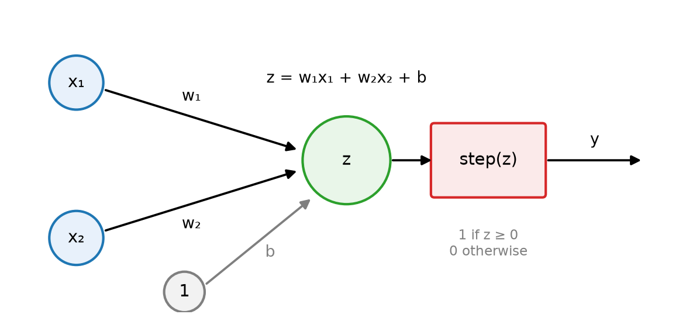
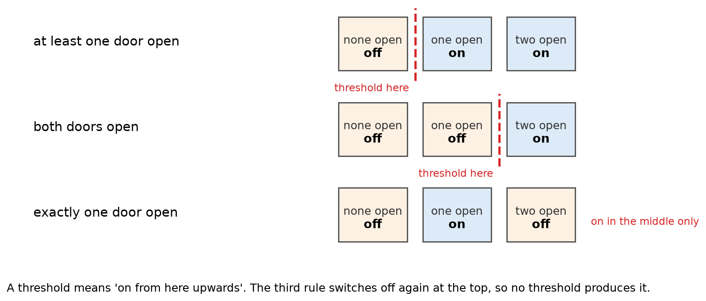

# 3.2 The Perceptron

A **perceptron** is the simplest artificial neuron. It weighs some evidence, adds it up, compares the total with a threshold, and switches on or off. This section builds one for a car warning light.

## Learning outcomes

- Work out a perceptron's answer from its weights and bias.
- Explain what the weights and the bias do.
- Explain why one perceptron cannot produce a rule like "exactly one".
- Say what training changes.

## What you need

- On and off are written as 1 and 0.
- The count is a plain sum: here it can only come out as 0, 1 or 2.
- A threshold is a comparison such as "at least 0". Negative numbers count as off.

## A door light

The car warns the driver when a door is open. There are two doors, driver and passenger, and each one is either closed (0) or open (1).

The neuron weighs each door. Give both doors a weight of 1, and start the count at −0.5. That starting number is the **bias**.

| Driver door | Passenger door | Count | Light |
| --- | --- | --- | --- |
| closed (0) | closed (0) | 0 + 0 − 0.5 = −0.5 | off |
| closed (0) | open (1) | 0 + 1 − 0.5 = 0.5 | on |
| open (1) | closed (0) | 1 + 0 − 0.5 = 0.5 | on |
| open (1) | open (1) | 1 + 1 − 0.5 = 1.5 | on |

The rule is one line: **switch on if the count is zero or more.** Otherwise stay off.

*The two inputs are the two door switches, each with its own weight. The bias is added, then the light switches on or off.*

## What the weights and the bias do

The weights say how much each piece of evidence counts. The bias says how much evidence is needed before the answer flips.

The bias is not decoration. With a bias of 0, two closed doors would give a count of 0, and 0 counts as on, so the light would glow with the car locked. A bias of −0.5 keeps that case below zero.

The bias also decides how many doors must be open. Keep the weights at 1 and 1, and change the bias from −0.5 to −1.5. Now one open door gives −0.5 and only two open doors reach the threshold, so the same neuron now means "both doors open".

## The rule it cannot make

Now ask for a different light: one that comes on when **exactly one** door is open, and stays off when both are open. That rule is called **XOR**.

The count for two doors can only be 0, 1 or 2, so write down what the light should do at each total.

*The first two rules switch on at some total and stay on. The third switches on and then off again, which no threshold can do.*

A neuron answers yes from some total upwards and stays yes above it. That produces the first two rows of the picture. It cannot produce the third, because the light there switches off again at the highest total.

Put in plain words: the light needs two conditions at once, at least one door open and not both. One neuron makes one comparison, so it cannot hold two conditions. One neuron is not enough, and [3.3](3.3-multilayer-networks.md) shows what is.

## How it learns

So far the weights were chosen by hand. They can also be found by **training**.

A **training example** is an input together with the correct answer, called the target. Training compares the answer with the target and adjusts the weights when they differ. If the answer was off and the target was on, the evidence that was present gets heavier. If the answer was on and the target was off, that evidence gets lighter. The size of the change is the **learning rate**, a small number chosen by whoever trains the model.

A spam filter is closer to real use, and it shows why training matters. Its evidence is words, and every word starts with some weight. An email arrives with "free" in the subject, the filter says not spam, and the person marks it spam. The word "free" was present, so its weight goes up a little. After thousands of emails, words like "free" and "winner" carry heavy weights, and words that never appear in spam carry light or negative ones. Nobody wrote those weights. The corrections produced them.

## Activity

Choose weights and a bias so the light comes on only when both doors are open. Then say what happens to the closed-door case if you set the bias to 0.

**Expected outcome:** weights 1 and 1 with bias −1.5, since only a total of 2 then reaches the threshold. With a bias of 0 the closed-door case gives a count of 0, which counts as on, so the light glows with both doors shut. The bias has to be negative for the quiet case to stay off.

## Check your understanding

**Q1.** With weights 1 and 1 and bias −0.5, does the light come on when only the passenger door is open?

**Q2.** What changes if the bias goes from −0.5 to −1.5?

**Q3.** Why can no single threshold produce the "exactly one door" rule?

**Q4.** A spam filter says not spam, the person marks the email as spam, and the email contains the word "free". What happens to the weight of "free"?

## Answers

**A1.** Yes. The count is 0 + 1 − 0.5 = 0.5, which is not negative.

**A2.** The neuron now needs both doors open. One open door gives −0.5, which stays off.

**A3.** A threshold switches on at some total and stays on above it, but the "exactly one" light has to switch off again at a total of 2. No single cutoff does that.

**A4.** It goes up a little, because the word was present in an email that should have been caught.

## Connections

- Training repeats until nothing is wrong, like the algorithms in [1.1](../part1-algorithms/1.1-what-is-an-algorithm.md).
- Three neurons can produce the rule in this section ([3.3](3.3-multilayer-networks.md)).
- Reducing the error is the idea behind gradient descent ([3.4](3.4-learning.md)).

## References

- Rosenblatt, F. (1958). The perceptron. *Psychological Review*, 65(6), 386–408.
- Minsky, M., & Papert, S. (1969). *Perceptrons*. MIT Press.
- Nielsen, M. (2015). *Neural Networks and Deep Learning*, chapter 1. http://neuralnetworksanddeeplearning.com/
