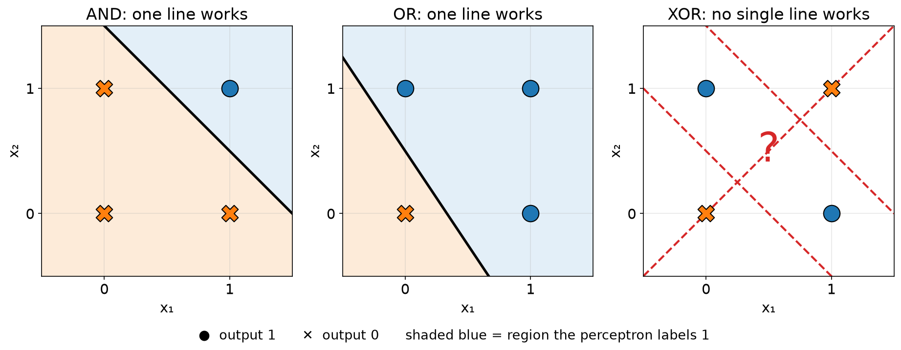
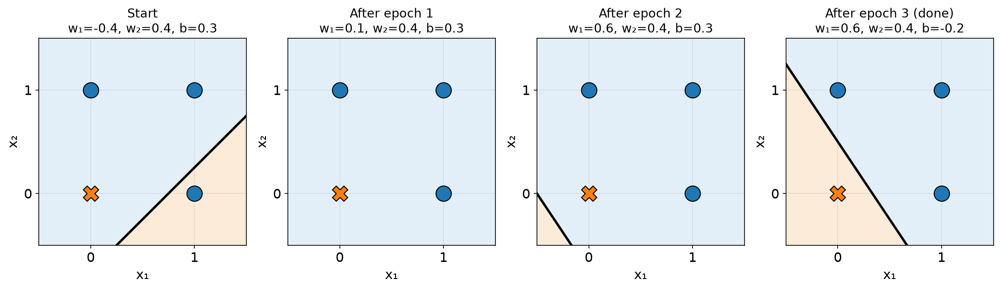

# 3.2 The Perceptron

A **perceptron** is the simplest artificial neuron. It takes a few numbers, gives each one a weight, adds them up with a bias, and answers yes or no.

## Learning outcomes

- Work out a perceptron's answer from its inputs, weights and bias.
- Say in one sentence what the weights and the bias do.
- Explain what training does and why one perceptron cannot learn XOR.

## How it decides

Three steps:

1. Multiply each input by its weight.
2. Add the results, then add the bias `b`. Call the total `z`.
3. Answer 1 if `z` is zero or more, otherwise 0.

```
z = w₁x₁ + w₂x₂ + b
```


*Two inputs, two weights, one bias, then the answer becomes 1 or 0.*

A **weight** says how much an input counts. A **bias** says how much evidence is needed before the answer turns into 1.

Take a cinema decision. Input `x₁` is 1 if a friend is coming, input `x₂` is 1 if the reviews are good. Give the friend weight 2, the reviews weight 1, and use a bias of −2.5, because you rarely go out.

- No friend, bad reviews: `z = 0 + 0 − 2.5 = −2.5`. Answer 0.
- Friend, bad reviews: `z = 2 + 0 − 2.5 = −0.5`. Answer 0.
- No friend, good reviews: `z = 0 + 1 − 2.5 = −1.5`. Answer 0.
- Friend and good reviews: `z = 2 + 1 − 2.5 = 0.5`. Answer 1.

A negative bias makes the neuron reluctant, so one reason is not enough and several are needed together. A bias near zero makes it eager.

## It draws a line

The answer flips exactly where `z = 0`. Read `x₁` and `x₂` as coordinates on a page and that equation is a straight line: one side answers 1 and the other answers 0.

The weights tilt the line and the bias slides it. With `w₁ = w₂ = 1` and `b = −1.5` the line is `x₁ + x₂ = 1.5`, and one active input gives −0.5, which is not enough to fire. Lower the bias to −0.5 and the line moves closer to the corner, so (1,0) now fires.


*AND and OR can each be split by one line. For XOR, every line puts a point on the wrong side.*

## AND, OR and XOR

- **AND** is 1 only when both inputs are 1. Two friends must both agree.
- **OR** is 1 when at least one input is 1. One friend is enough.
- **XOR** is 1 when exactly one input is 1.

| x₁  | x₂  | AND | OR  | XOR |
| --- | --- | --- | --- | --- |
| 0   | 0   | 0   | 0   | 0   |
| 0   | 1   | 0   | 1   | 1   |
| 1   | 0   | 0   | 1   | 1   |
| 1   | 1   | 1   | 1   | 0   |

AND works with `w₁ = w₂ = 1` and `b = −1.5`: one input adds 1 and stays below zero, two inputs add 2 and fire. OR works with the same weights and `b = −0.5`, so even one input is enough.

## Training: adjust after mistakes

A **training example** is an input together with the correct answer, called the **target**. Training is one rule: if the answer was right, change nothing; if it was wrong, nudge the numbers towards the right answer.

- We answered 0 and the target is 1: raise the weights of the inputs that were on, and raise the bias.
- We answered 1 and the target is 0: lower them.

The size of the nudge is the **learning rate**, a small number we choose. One pass through all the examples is an **epoch**, and training repeats epochs until a pass has no mistakes.

Here is one correction. Weights 0.5 and 0.5, bias −1, learning rate 0.5, and the example (1, 0) whose target is 1. The total is −0.5, so the answer is 0 and we were wrong. Only the first input was on, so only its weight is raised, from 0.5 to 1, and the bias rises from −1 to −0.5. The new total is 0.5, and the answer is now 1.

Started from nothing, the same rule learns OR in three passes and settles on weights 0.6 and 0.4 with a bias of −0.2.


*The line after each epoch. Early on it is in the wrong place and everything is labelled 1. By the third epoch it sits between (0,0) and the other three points.*

## Why one perceptron cannot do XOR

Look at the four points for XOR. The two 1s, (0,1) and (1,0), sit on one diagonal, and the two 0s sit on the other. A single line has to keep the 1s together, and any line that does that also catches a 0. Draw it and see.

Since the weights can only tilt and slide a line, there is no line to find. Training does not fail for lack of time, it fails because the answer is not something one straight line can describe. Data like AND and OR is **linearly separable**; XOR is not.

The fix is to use more than one neuron: one asks "at least one on", another asks "both on", and a third combines the two answers. That is [3.3](3.3-multilayer-networks.md).

## Activity

Find weights and a bias for OR and check all four inputs. Then try the same for XOR.

**Expected outcome:** one answer for OR is weights 1 and 1 with bias −0.5, giving totals −0.5, 0.5, 0.5, 1.5. For XOR no answer exists, because the four points cannot be split by one line.

## Check your understanding

**Q1.** A perceptron with two inputs always draws a straight-line decision boundary. True or false?

**Q2.** If an input is 0, its weight does not change on that example. True or false?

**Q3.** A perceptron has `w₁ = 2`, `w₂ = −1` and `b = −0.5`. What is the output for (1, 1)?

A) 0 B) 1 C) 0.5 D) −0.5

**Q4.** Which of these can a single perceptron not compute? A) AND B) OR C) NAND D) XOR

## Answers

**A1.** True. The answer changes where `w₁x₁ + w₂x₂ + b = 0`, which is a straight line.

**A2.** True. A weight only moves by an amount that includes its own input, so a zero input leaves it alone.

**A3.** B. `z = 2 − 1 − 0.5 = 0.5`, which is not negative, so the output is 1.

**A4.** D. No straight line separates the two 1s of XOR from the two 0s.

## Connections

- Training is an algorithm that repeats until nothing is wrong ([1.1](../part1-algorithms/1.1-what-is-an-algorithm.md)).
- Many perceptrons in layers make a network ([3.3](3.3-multilayer-networks.md)).
- Gradient descent applies the same idea of reducing error ([3.4](3.4-learning.md)).

## References

- Rosenblatt, F. (1958). The perceptron. *Psychological Review*, 65(6), 386–408.
- Minsky, M., & Papert, S. (1969). *Perceptrons*. MIT Press.
- Nielsen, M. (2015). *Neural Networks and Deep Learning*, chapter 1. http://neuralnetworksanddeeplearning.com/
- 3Blue1Brown (2017). *But what is a neural network?* https://www.3blue1brown.com/topics/neural-networks
