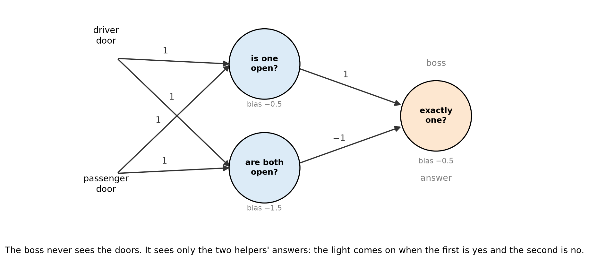

# 3.3 Multi-layer Networks

A car has a warning light that comes on when **exactly one of its two doors is open**. It stays off when both are closed and also when both are open. One neuron cannot produce that rule. Three neurons can.

## Learning outcomes

- Say what rule the light follows.
- Explain why one neuron cannot produce it.
- Follow the answers through a network of three neurons.

## The light

The same car light as in [3.2](3.2-perceptron.md). It comes on when exactly one of the two doors is open, and it stays off when both are closed and also when both are open. Closed is 0 and open is 1, so the four states total 0, 1, 1 and 2, and only the totals of 1 should light it.

A rule like that is called **XOR**.

## Why one neuron is not enough

[3.2](3.2-perceptron.md) showed why one neuron fails: a threshold can only switch on from some total upwards, and this light has to switch off again at the top.

So the rule needs two comparisons instead of one. Give each condition to its own neuron, and let a third neuron compare the two answers.

## Two helpers and one boss

Split the rule into its two conditions and give each one to a neuron.

**Helper 1 asks "is at least one door open?"** Its weights are 1 and 1 with bias −0.5, so it says yes once the total reaches 1. That covers one door open and both doors open.

**Helper 2 asks "are both doors open?"** Its weights are 1 and 1 with bias −1.5, so it says yes only once the total reaches 2.

**The boss combines them.** Its weights are 1 and −1 with bias −0.5, which means it takes the first answer and subtracts the second. It says yes only when helper 1 said yes and helper 2 said no.

| Doors | Helper 1: is one open? | Helper 2: are both open? | Light |
| --- | --- | --- | --- |
| 0, 0 | no | no | off |
| 0, 1 | yes | no | on |
| 1, 0 | yes | no | on |
| 1, 1 | yes | yes | off |

The last row is the one that matters. Both helpers say yes, the boss subtracts them, and the light stays off. That is what "not both" means in practice.

*Each helper answers one question, and the boss keeps only the case where the first says yes and the second says no.*

## What the boss sees

The boss never looks at the doors. It sees two answers.

- Both doors closed gives the pair (no, no).
- Either single door open gives the pair (yes, no).
- Both doors open gives the pair (yes, yes).

The two single-door cases are different situations at the doors, but they arrive as the same pair. That is why the last decision is easy: the boss turns the light on for (yes, no) and for nothing else.

A hidden layer does not solve the problem. It rewrites the problem in terms the next neuron can handle.

## The layers

- The **input layer** holds the two door switches.
- The **hidden layer** holds the two helpers. Their answers are never shown to the driver.
- The **output layer** holds the boss, which switches the light.

Computing the helpers first and the boss second is called a **forward pass**. It cannot run the other way round, because the boss needs both answers before it can decide.

## Activity

Suppose the car maker changes the rule: the light should come on whenever at least one door is open. Which neurons are needed now?

**Expected outcome:** helper 1 alone. It already says yes at 1 and at 2 and no at 0, which is exactly "at least one door open". Helper 2 and the boss can be removed, and the light is now an OR.

## Check your understanding

**Q1.** In which door states does the light come on?

**Q2.** Why can no single threshold produce this rule?

**Q3.** Which helper is responsible for the light being off when both doors are open, and how?

**Q4.** What does the boss receive, and what does it do with it?

## Answers

**A1.** Exactly one door open, in the states (0,1) and (1,0).

**A2.** A threshold turns on at some total and stays on above it, but the light has to switch off again at a total of 2, which is the highest total there is. No single cutoff can do that.

**A3.** Helper 2, "are both doors open". It says yes only in that case, and the boss subtracts its answer, which turns the light off.

**A4.** Two answers rather than two doors. It turns the light on only when the first is yes and the second is no.

## Connections

- The helper and boss rules are the perceptrons of [3.2](3.2-perceptron.md).
- Training finds the weights of every layer at once ([3.4](3.4-learning.md)).
- A network is a weighted graph, like the ones in [2.5](../part2-data-structures/2.5-graphs.md).

## References

- Nielsen, M. (2015). *Neural Networks and Deep Learning*, chapter 1. http://neuralnetworksanddeeplearning.com/
- Goodfellow, I., Bengio, Y., & Courville, A. (2016). *Deep Learning*, chapter 6. MIT Press. https://www.deeplearningbook.org/
- 3Blue1Brown (2017). *But what is a neural network?* https://www.3blue1brown.com/topics/neural-networks
