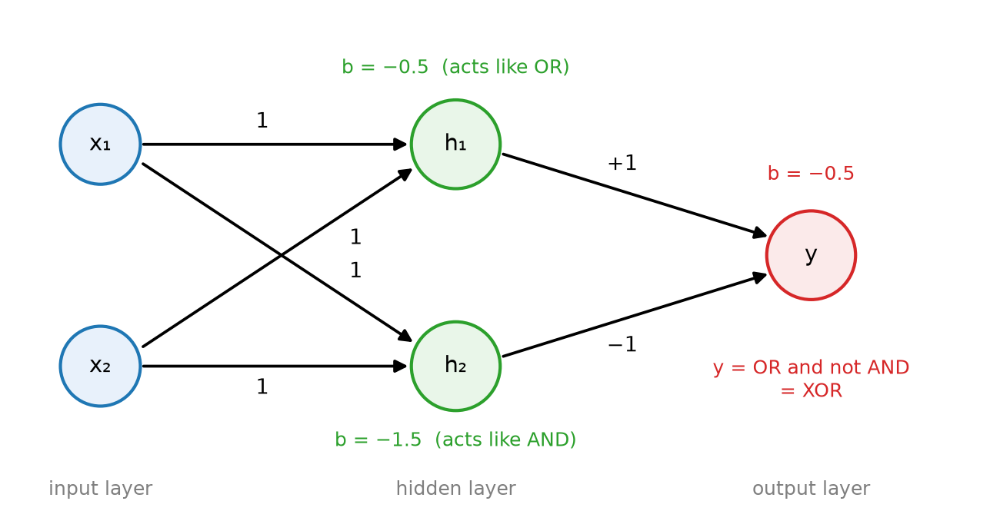
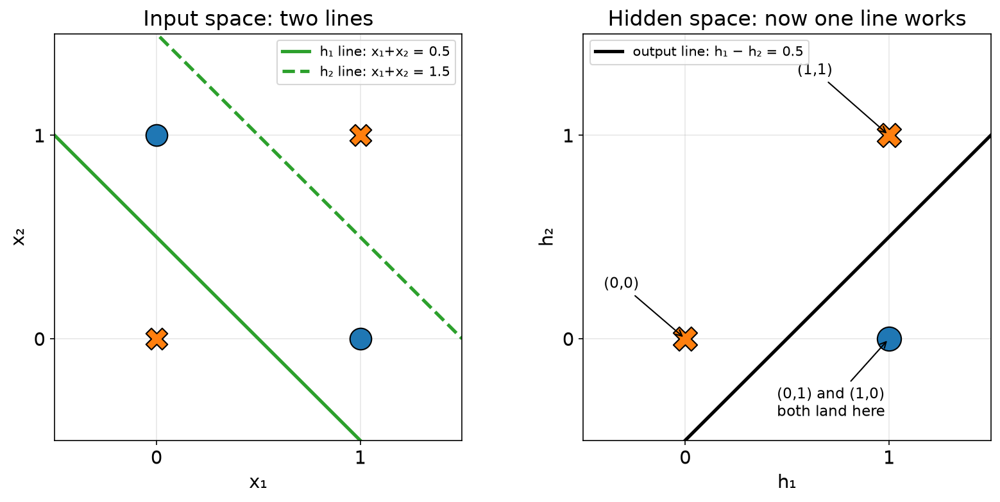
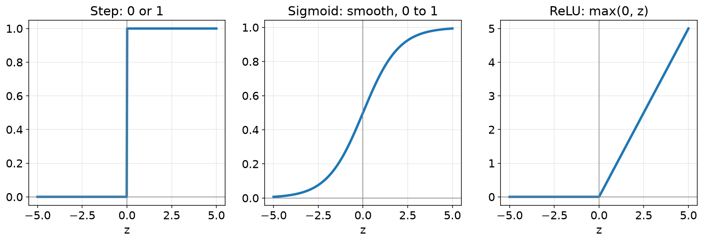

# 3.3 Multi-layer Networks

One perceptron draws one straight line. A **network** joins many perceptrons together, so it can combine several lines into a shape that no single line can draw.

## Learning outcomes

- Name the input, hidden and output layers and say what each one does.
- Work through a small network by hand, layer by layer.
- Explain how one hidden layer lets a network learn XOR.

## Why one neuron is not enough

XOR puts its two 1s on one diagonal and its two 0s on the other, so no single line separates them ([3.2](3.2-perceptron.md)). Two lines can do it, though. One line can ask "is at least one input on". The other can ask "are both inputs on". A third neuron then combines those two answers.

That is the whole idea of a network: neurons answer simple questions, and other neurons combine the answers.

## XOR built from three neurons

Two neurons in a first group, and one in a second group.

- **h₁ asks "at least one on".** Weights 1 and 1, bias −0.5, so it fires when `x₁ + x₂ ≥ 0.5`.
- **h₂ asks "both on".** Weights 1 and 1, bias −1.5, so it fires when `x₁ + x₂ ≥ 1.5`.
- **The output combines them.** Weights 1 and −1, bias −0.5, so it fires when `h₁ − h₂ ≥ 0.5`, which means h₁ fired and h₂ did not.

Read the four inputs through the network:

| x₁  | x₂  | h₁  | h₂  | y   |
| --- | --- | --- | --- | --- |
| 0   | 0   | 0   | 0   | 0   |
| 0   | 1   | 1   | 0   | 1   |
| 1   | 0   | 1   | 0   | 1   |
| 1   | 1   | 1   | 1   | 0   |

The last row is the interesting one. Both neurons fire, and the output cancels them, so the answer is 0. That cancellation is exactly what XOR asks for.

*The weights sit on the arrows and the biases next to each neuron. h₁ acts as OR, h₂ as AND, and the output keeps only the case where h₁ fires and h₂ does not.*

Something useful happened along the way. The output neuron never sees `x₁` and `x₂`. It sees only two numbers, `h₁` and `h₂`. In that new pair, the two 1s of XOR have both become (1, 0), so they are no longer on a diagonal and one line now separates them.

*On the left no single line separates XOR. On the right, after the hidden layer, the two 1s have become the same point and one line is enough.*

## The three layers

- The **input layer** holds the input numbers. It does no work.
- The **hidden layer** does the work. Its answers are never shown directly.
- The **output layer** gives the final answer.

A **forward pass** is computing the layers in order, from input to output. For the XOR network that means computing h₁ and h₂ first, then the output.

## Activation functions

The comparison with zero is called an **activation function**. The step function is the simplest one: 0 below zero, 1 at or above it. Two smoother ones are used in real networks.

- **Sigmoid** squeezes any number into the range 0 to 1, so it reads as a probability. Values near zero come out near 0.5.
- **ReLU** passes positive numbers through unchanged and turns negative ones into 0.

*Step jumps. Sigmoid is a smooth S. ReLU is flat for negatives and straight for positives.*

The reason real networks avoid the step function is training, in [3.4](3.4-learning.md). Training nudges each weight by asking which direction makes the error smaller, which needs a slope to read. The step function is flat everywhere, so it gives no slope. Sigmoid and ReLU do. For the hand-built examples in this section, the step function is fine.

## Activity

Change the output bias from −0.5 to 0 in the XOR network and check the four inputs again.

**Expected outcome:** the row (1,1) still gives 0, but (0,0) now gives `h₁ = 0`, `h₂ = 0` and an output total of 0, which counts as firing. The answer for (0,0) becomes 1, which is wrong. The output bias is what keeps the quiet case quietly below zero.

## Check your understanding

**Q1.** In a 2-2-1 network, how many neurons are in the hidden layer, and what do they receive?

**Q2.** In the XOR network, which neurons fire for the input (0, 1)?

A) h₁ only B) h₂ only C) both D) neither

**Q3.** Why do real networks use sigmoid or ReLU instead of the step function?

**Q4.** The hidden layer turns XOR into a problem one line can solve. State the hidden answers for (0,1) and (1,0).

## Answers

**A1.** Two. Each one receives both inputs.

**A2.** A. The total is 0.5, so h₁ fires, and −0.5, so h₂ does not.

**A3.** Training needs a slope to know which way to nudge a weight, and the step function is flat everywhere. Sigmoid and ReLU have a slope.

**A4.** Both become `(h₁, h₂) = (1, 0)`, so the two 1s of XOR are now one point and a line can separate them from (0,0) and (1,1).

## Connections

- Layers are built from the perceptron of [3.2](3.2-perceptron.md).
- Training finds the weights of every layer at once ([3.4](3.4-learning.md)).
- A network is a weighted graph, like the ones in [2.5](../part2-data-structures/2.5-graphs.md).

## References

- Nielsen, M. (2015). *Neural Networks and Deep Learning*, chapter 1. http://neuralnetworksanddeeplearning.com/
- Goodfellow, I., Bengio, Y., & Courville, A. (2016). *Deep Learning*, chapter 6. MIT Press. https://www.deeplearningbook.org/
- 3Blue1Brown (2017). *But what is a neural network?* https://www.3blue1brown.com/topics/neural-networks
