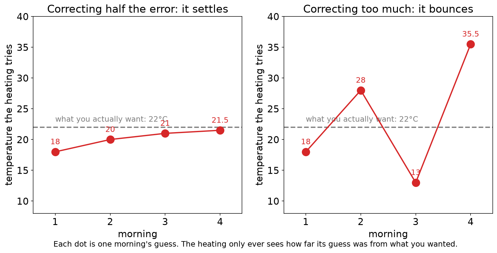

# 3.4 How Networks Learn

A smart thermostat has to learn the temperature you like. Every morning it guesses, it is told how far off it was, and it adjusts. That loop, repeated, is how a network learns.

## Learning outcomes

- Say what the loss measures.
- Describe one correction step.
- Explain what a correction that is too small or too large does.

## The thermostat

The heating tries a temperature for 7 am each morning. On the first morning it tries 18°C, and what you actually want is 22°C. Nobody tells it 22. It is only told how far off it was.

Each morning it does three things: measure the error, work out which way to move, and move part of the way.

## First, how wrong was it

The **loss** is a single number saying how wrong the guess was. Lower is better, and 0 means perfect.

The usual choice squares the error. A guess of 18 against a target of 22 is off by 4, so the loss is 4 × 4 = 16. A guess of 20 is off by 2, so the loss is 4. A guess of 12 is off by 10, so the loss is 100.

Squaring does two useful things. A guess that is too high and a guess that is too low both count as errors, and a big miss costs far more than a small one, 100 against 4.

## Second, which way to move

The error carries its own direction. With a target of 22:

- A guess of 18 is 4 below, so next time the heating should go up.
- A guess of 28 is 6 above, so next time it should go down.

The size of the error also says how far off it is, so the heating can use the error itself as its guide.

## Third, how far to move

The **learning rate** is the fraction of the error that is corrected each time, and it is the setting that most often goes wrong.

Correcting half of it each morning looks like this. The guess is 18, which is 4 low, so it moves up 2 to 20. Now it is 2 low, so it moves to 21, then to 21.5. Each morning halves the gap, and the heating settles without ever overshooting.

*The dashed line is what you actually want. On the left the guesses close in on it. On the right each guess lands further away than the last.*

- Correcting too little: the guesses creep, 18 then 18.4 then 18.8, and it takes a very long time to arrive.
- Correcting too much: the heating overshoots, then overshoots back. Correcting two and a half times the error gives 18, then 28, then 13, then 35.5, worse every morning.
- Correcting about the right amount: the guesses close in steadily.

The general name for this procedure, adjusting a model a little in the direction that reduces the error, is **gradient descent**.

## What about thousands of knobs

The thermostat has one number to adjust. A network has thousands, and each one affects the error only through the layers after it, so working out which way each should move is not obvious.

Think of a restaurant complaint. A customer says the dish is too salty. The chef passes the blame back to whoever seasoned the sauce, and they pass it on to whoever supplied the stock. Each person's share depends on how much they affected the next person in the chain.

**Backpropagation** does the same with numbers. It starts at the output error and works backwards, layer by layer, giving every weight its share of the blame. One backward pass produces a correction for every weight at about the cost of one forward pass, which is what makes large networks trainable.

## Activity

The heating corrects half the error each morning, with guesses 18, 20, 21 and 21.5. Work out the next two guesses. Then say what would happen if it corrected the whole error every morning.

**Expected outcome:** the gap after 21.5 is 0.5, so the next guess is 21.75, then 21.875. Correcting the whole error takes 18 straight to 22 in a single morning.

## Check your understanding

**Q1.** A guess is off by 3. What is the loss, if the loss squares the error?

**Q2.** The heating is at 26 and the target is 22. Which way should the next guess move?

**Q3.** What happens, in words, if the correction is far too large?

**Q4.** What does the loss measure, and what does the learning rate control?

## Answers

**A1.** 9. Squaring 3 gives 9.

**A2.** Down, because the guess is above the target.

**A3.** Each correction overshoots past the target and lands further away than the last, so the guesses swing wildly and the loss grows.

**A4.** The loss measures how wrong the current guess is. The learning rate controls what fraction of that error is corrected at each step.

## Connections

- The perceptron rule in [3.2](3.2-perceptron.md) follows the same instinct: adjust after a mistake.
- The weights being trained belong to the layers of [3.3](3.3-multilayer-networks.md).
- A model with loss 0 on its examples can still fail on new ones ([3.5](3.5-training-practice.md)).

## References

- Rumelhart, D. E., Hinton, G. E., & Williams, R. J. (1986). Learning representations by back-propagating errors. *Nature*, 323, 533–536.
- Nielsen, M. (2015). *Neural Networks and Deep Learning*, chapters 1 and 2. http://neuralnetworksanddeeplearning.com/
- 3Blue1Brown (2017). *Gradient descent, how neural networks learn*. https://www.3blue1brown.com/topics/neural-networks
