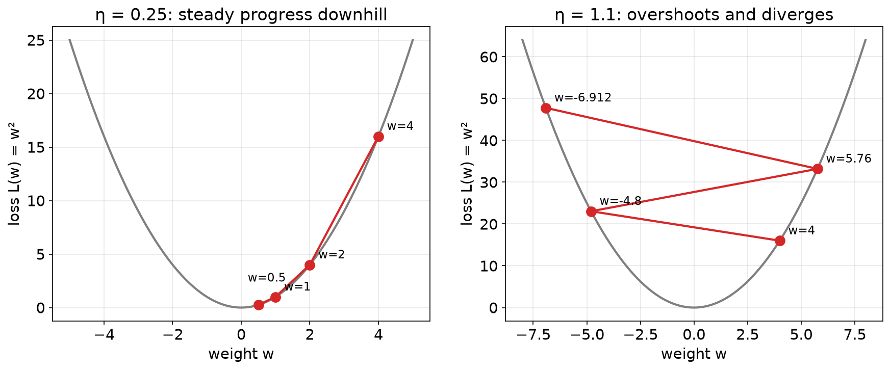
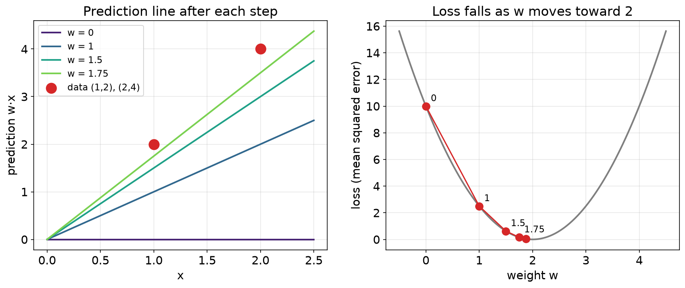

# 3.4 How Networks Learn

In [3.3](3.3-multilayer-networks.md) we picked the weights by hand. Real networks have thousands of them, so nobody picks by hand. They are found by repeating one process: measure how wrong the answer is, find which way is downhill, and take a small step that way.

## Learning outcomes

- Explain what a loss function measures.
- Take a step of gradient descent by hand.
- Predict what happens when the learning rate is too small or too large.
- Describe backpropagation in one sentence.

## Step 1: measure how wrong we are

A **loss function** turns the mistakes into a single number. Lower is better, and 0 means perfect.

The usual choice is **squared error**: subtract the target from the prediction, then square the result. Squaring makes every error positive, so overshooting and undershooting do not cancel, and it punishes a large error much harder than a small one. An error of 2 costs 4, but an error of 10 costs 100. Averaged over a whole dataset this is the **mean squared error**.

## Step 2: find which way is downhill

Picture the loss as a landscape. Each possible weight is a position on the ground, and the loss is the height. Training means walking downhill to the lowest point, in fog, feeling only the slope under your feet.

The **slope** tells you how fast the loss changes when the weight moves a little. You can measure it without calculus. For `L(w) = w²` at `w = 4` the loss is 16, and at `w = 4.01` it is about 16.08. The loss rose by 0.08 for a step of 0.01, so the slope is about 8. In general the slope of `w²` is `2w`.

- Positive slope: increasing the weight increases the loss, so decrease it.
- Negative slope: increasing the weight decreases the loss, so increase it.
- Zero slope: you are at the bottom.

## Step 3: take a step

**Gradient descent** moves each weight against its slope: `w ← w − (learning rate) × slope`. The **learning rate** sets the step size, and it is the setting that most often goes wrong.

- Too small: the walk is correct but painfully slow.
- Too large: the step overshoots the valley and lands higher on the far side. The loss grows and training **diverges**.
- Just right: the loss falls steadily.

## Worked example: down a simple curve

Take `L(w) = w²`, whose bottom is at `w = 0`. Start at `w = 4` with a learning rate of 0.25. The slope is 8, so the step is 2 and the weight becomes 2. Then the slope is 4, the step is 1, and the weight becomes 1. Then 0.5, then 0.25. The loss goes 16, 4, 1, 0.25. Each step halves the distance to the bottom.

Change the learning rate and the character changes. With 1.1 the weight goes 4, then −4.8, then 5.76, and the loss climbs 16, 23, 33. Each step lands further from the bottom than the last. With 0.01 the direction is right every time, but the weight moves 4, 3.92, 3.84, 3.76, which is almost standing still.

*On the left, with a learning rate of 0.25, each step moves downhill. On the right, with 1.1, the steps overshoot and climb.*

## Worked example: fitting a line to data

A model with one weight predicts `w × x`. The data are (1, 2) and (2, 4), so the perfect weight is 2. Start at `w = 0` with a learning rate of 0.1. For this model the slope is the average of `2 × error × x` over the two points.

At `w = 0` both predictions are 0, so the errors are −2 and −4, the loss is 10, and the slope is −10. The step is 1, so the weight becomes 1. At `w = 1` the errors are −1 and −2, the loss is 2.5, the slope is −5, and the weight becomes 1.5. Then 1.75, then 1.875. The negative slope is the signal to keep increasing the weight, and the loss falls by a factor of four each step.

*Left: the prediction line turns towards the data. Right: the loss falls as the weight moves towards 2.*

## Where the slopes come from

In a deep network a weight in an early layer affects the answer only through the layers after it, so its slope is not obvious.

Think of a restaurant complaint. A customer says the dish is too salty. The chef passes the blame back to whoever seasoned the sauce, and they pass it back to whoever supplied the stock. Each person's share depends on how much they affected the next person in the chain.

**Backpropagation** does that with numbers. It starts at the output error and works backwards, layer by layer, giving every weight its share of the blame. One backward pass produces the slope of every weight at about the cost of one forward pass, which is why large networks can be trained at all.

## Activity

Run three steps of gradient descent on `L(w) = w²` from `w = 3`, once with a learning rate of 0.5 and once with 1.5.

**Expected outcome:** with 0.5 the weights go 3, 0, 0, and the first step lands exactly on the bottom. With 1.5 they go 3, −6, 12, and the loss climbs 9, 36, 144. A learning rate above 1 makes each step land further from zero than the last, so training diverges.

## Check your understanding

**Q1.** If the slope of the loss is positive, gradient descent decreases the weight. True or false?

**Q2.** Backpropagation starts at the output error and moves backwards. True or false?

**Q3.** During training the loss grows every step and the weights swing from large positive to large negative. What is the likely cause?

A) the learning rate is too small B) the learning rate is too large C) there is too much data D) the activation is ReLU

**Q4.** For `L(w) = w²`, take one step from `w = 3` with a learning rate of 0.1. What is the new weight?

## Answers

**A1.** True. Subtracting a positive slope makes the weight smaller, which moves it downhill.

**A2.** True. That backwards direction is where the name comes from.

**A3.** B. The steps overshoot the bottom and land higher each time.

**A4.** The slope is 6, so the step is 0.6 and the new weight is 2.4.

## Connections

- The perceptron rule in [3.2](3.2-perceptron.md) is the same instinct: nudge the numbers after a mistake.
- The weights being trained belong to the layers of [3.3](3.3-multilayer-networks.md).
- Training is an algorithm that repeats until a stopping condition is met ([1.1](../part1-algorithms/1.1-what-is-an-algorithm.md)).

## References

- Rumelhart, D. E., Hinton, G. E., & Williams, R. J. (1986). Learning representations by back-propagating errors. *Nature*, 323, 533–536.
- Nielsen, M. (2015). *Neural Networks and Deep Learning*, chapters 1 and 2. http://neuralnetworksanddeeplearning.com/
- 3Blue1Brown (2017). *Gradient descent, how neural networks learn*. https://www.3blue1brown.com/topics/neural-networks
