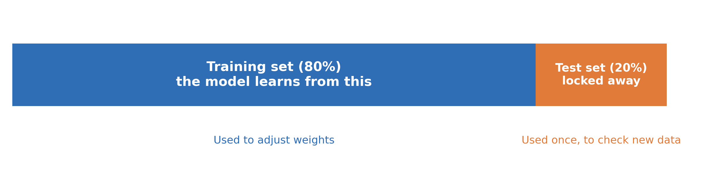
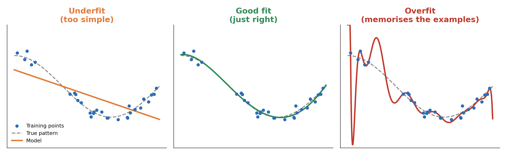
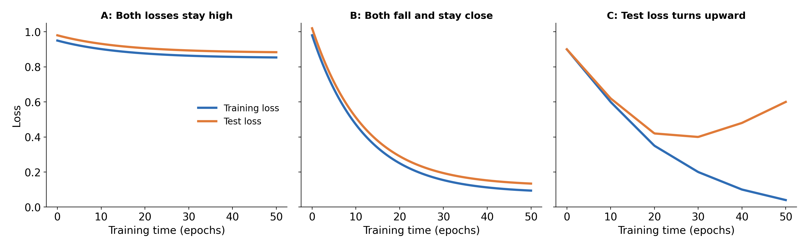
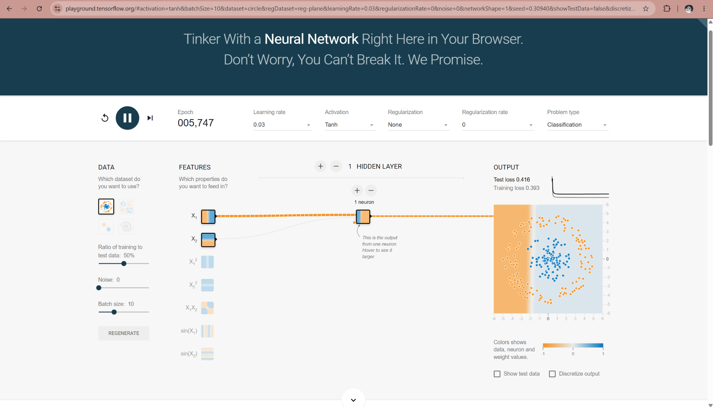
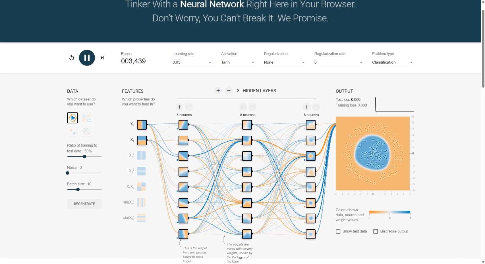

# 3.5 Training in Practice: Data and Overfitting

## Learning outcomes

- Explain why data is split into a training set and a test set.
- Describe overfitting and underfitting in simple words.
- Recognise overfitting and underfitting from a loss curve.
- Choose a sensible fix for a model that overfits or underfits.

## Why we must test a model on new data

Imagine a spam filter that gets 100% of its training emails right. Is it a good filter? Not necessarily. It may have memorised those exact emails, like a student who memorises last year's exam answers and then fails this year's exam.

What we really want is a filter that works on **new** emails it has never seen. So we keep some emails hidden during training and use them later as a fair test.

### Training set and test set

**Definition.** A **dataset** is the whole collection of labelled examples. Before training, we split it into two parts:

- The **training set**: the examples the model learns from. Only these are used to adjust the weights.
- The **test set**: examples kept aside. They are used only to check how the model does on data it has not seen.

|                                   | Training set                 | Test set           |
| --------------------------------- | ---------------------------- | ------------------ |
| Used for                          | Learning (adjusting weights) | Checking the model |
| Seen by the model while learning? | Yes                          | No                 |
| Typical share of the data         | About 80%                    | About 20%          |

  

*The data is split before training starts. 80/20 is a common choice, not a fixed rule.*
 
> **Important:** never train the model on the test set. If the model has already seen the test examples, the test no longer shows how it handles new data.
 
### Generalisation
 
**Definition.** **Generalisation** means working well on new data, not only on the examples used for training. It is the real goal of machine learning. A model that generalises well has learned the pattern. A model that does not has only memorised.
 
## Overfitting and underfitting
 
**Definition.** **Overfitting** means the model fits the training data too closely. It copies even the accidental, random details of the training examples instead of the general pattern. It does very well on the training set and badly on new data.
 
**Definition.** **Underfitting** means the model is too simple to learn the pattern. It does badly on both the training set and new data.
 
A good model sits between the two.
 

  

_The same training points, three models. Left: a straight line is too simple. Middle: a smooth curve follows the pattern. Right: a very wiggly line goes through every point, including the random ones._

|                    | Underfitting         | Good fit            | Overfitting                      |
| ------------------ | -------------------- | ------------------- | -------------------------------- |
| The model is       | Too simple           | About right         | Too complex, or trained too long |
| On training data   | Poor                 | Good                | Excellent                        |
| On new (test) data | Poor                 | Good                | Much worse than on training data |
| In plain words     | Did not learn enough | Learned the pattern | Memorised the examples           |

### Reading a loss curve

In topic 3.4 we use a number called the **loss**. It tells us how wrong the model's predictions are. A lower loss is better.

A **loss curve** is a graph of the loss while the model trains. We draw two lines: one for the training set and one for the test set.

  

_A: both lines stay high, so the model underfits. B: both fall and stay close, so it is a good fit. C: the training line keeps falling but the test line turns upward, so the model overfits._

| What the lines look like                                    | What it means |
| ----------------------------------------------------------- | ------------- |
| Both stay high and flat                                     | Underfitting  |
| Both fall and stay close together                           | Good fit      |
| Training line keeps falling, test line falls and then rises | Overfitting   |

The moment the test line starts to rise is the moment overfitting begins. Training longer after that makes the model better at the training examples and worse on new data.

## How do we fix it?

Overfitting usually happens for one of two reasons: the model is too complex for the amount of data, or the training data does not show the real world well (for example, too few examples, or all from one source).

| Problem      | Fix                                               | Why it helps                                                  |
| ------------ | ------------------------------------------------- | ------------------------------------------------------------- |
| Overfitting  | Collect more and more varied data                 | It is harder to memorise, and easier to find the real pattern |
| Overfitting  | Use a simpler model (fewer neurons or layers)     | Less room to memorise                                         |
| Overfitting  | Stop training earlier (called **early stopping**) | Stops before the test line starts to rise                     |
| Underfitting | Use a more complex model                          | It can learn more of the pattern                              |
| Underfitting | Train for longer                                  | It gets more chances to learn                                 |

## Worked example: three spam filters

**Problem.** A team trains three spam filters on the same 1,000 emails. They use 800 emails for training and keep 200 for testing. **Accuracy** means the share of emails the model gets right.

| Model                 | Accuracy on training set | Accuracy on test set | Difference | Verdict                                |
| --------------------- | ------------------------ | -------------------- | ---------- | -------------------------------------- |
| A: one tiny neuron    | 70%                      | 69%                  | 1 point    | Underfit: poor on both                 |
| B: small network      | 93%                      | 91%                  | 2 points   | Good fit                               |
| C: very large network | 100%                     | 68%                  | 32 points  | Overfit: memorised the training emails |

_These numbers are made up to show the idea._

Model C looks perfect on its own training emails, but it gets about one in three new emails wrong. If the team had only checked the training set, they would have picked the worst model. **The test set showed the problem.**

### Where should we stop training?

Model C was trained for 50 rounds. Each full pass through the training set is called an **epoch**. The team wrote down both losses every 10 epochs.

| Epoch | Training loss | Test loss | What happened to the test loss? |
| ----- | ------------- | --------- | ------------------------------- |
| 10    | 0.60          | 0.62      | Start                           |
| 20    | 0.35          | 0.42      | Fell                            |
| 30    | 0.20          | 0.40      | Fell (lowest)                   |
| 40    | 0.10          | 0.48      | Rose                            |
| 50    | 0.04          | 0.60      | Rose                            |

The training loss keeps falling, but the test loss is lowest at **epoch 30** and then rises. The best moment to stop is epoch 30. This is early stopping.

### Try it yourself: TensorFlow Playground

TensorFlow Playground (https://playground.tensorflow.org) is a free website where you can watch a small neural network learn. Train a very small network and a large network on the same data. Then compare the training loss and the test loss shown on the screen.

<table align="center">
  <tr>
    <th>Small network</th>
    <th>Large network</th>
  </tr>
  <tr>
    <td align="center"></td>
    <td align="center"></td>
  </tr>
</table>

_Screenshots from TensorFlow Playground. The large network has a lower training loss but a higher test loss._

## Activity: good fit, overfit or underfit?

For each case, decide if the model is a good fit, overfit or underfit. Explain why, and say what you would try next.

1. Accuracy on training data 62%, on test data 60%.
2. Accuracy on training data 99%, on test data 65%.
3. Accuracy on training data 90%, on test data 88%.
4. The loss curves in panel C of the figure above.

**Expected outcome:**

1. Underfit. Both are low and close. Try a more complex model or train for longer.
2. Overfit. The model is much better on training data. Try more data, a simpler model or earlier stopping.
3. Good fit. Both are high and close together.
4. Overfit. The test line rises while the training line keeps falling. Stop where the test loss is lowest.

## Check your understanding

**Q1 (True/False).** A model with 100% accuracy on its training data is always a good model.

**Q2 (True/False).** We can use the test set to adjust the model's weights.

**Q3 (Multiple choice).** A model gets 98% on the training set but only 70% on the test set. What is the most likely problem?
A. Underfitting B. Overfitting C. A good fit D. The test set is too small

**Q4 (Multiple choice).** Which one is a sensible fix for overfitting?
A. Train for much longer B. Use fewer training examples C. Collect more varied data D. Test on the training set

**Q5 (Trace).** The test loss at epochs 10, 20, 30, 40 is 0.55, 0.38, 0.45, 0.60. The training loss is 0.50, 0.30, 0.20, 0.10. At which epoch should you stop, and why?

**Q6 (Problem).** A spam model learned from 20 emails that all came from one company. It works well on those emails and badly on new ones. Why did this happen, and what would you do?

**Q7 (Analysis).** A classmate says: "The training loss is the lowest it has ever been, so training is going great." What else do you need to check?

## Answers

**A1.** False. Perfect results on training data may only mean the model memorised the examples. We must also check the test set.

**A2.** False. The test set must stay hidden. If it is used for training, it can no longer show how the model handles new data.

**A3.** B. The model is much better on training data than on test data, so it memorised the training examples.

**A4.** C. More varied data makes memorising harder. Training longer or using fewer examples makes overfitting worse, and testing on the training set hides the problem.

**A5.** Epoch 20. The test loss is lowest there (0.38) and rises afterwards, while the training loss keeps falling. This is early stopping.

**A6.** The training data was too small and came from one source, so it did not show real emails well. The model memorised those 20 emails. Collect more emails from many different sources.

**A7.** The test loss. If it is also low, the model is learning well. If it has started to rise, the model is overfitting.

## Connections

- The spam filter, labels and supervised learning come from [3.1 From Rules to Learning](3.1-rules-to-learning.md).
- The loss that we read from the loss curves is explained in [3.4 How Networks Learn](3.4-learning.md).
- Big modern models need a lot of data, so overfitting matters even more in [3.6 Deep Learning Today](3.6-deep-learning-today.md).

## References

1. Google for Developers. _Machine Learning Crash Course: Overfitting._ https://developers.google.com/machine-learning/crash-course/overfitting/overfitting
2. Google for Developers. _Machine Learning Crash Course: Overfitting: Interpreting loss curves._ https://developers.google.com/machine-learning/crash-course/overfitting/interpreting-loss-curves
3. scikit-learn developers. _Underfitting vs. Overfitting._ https://scikit-learn.org/stable/auto_examples/model_selection/plot_underfitting_overfitting.html
4. TensorFlow Playground. https://playground.tensorflow.org
5. Goodfellow, Bengio, and Courville. _Deep Learning_, Ch. 5, section on capacity, overfitting and underfitting. https://www.deeplearningbook.org/contents/ml.html
