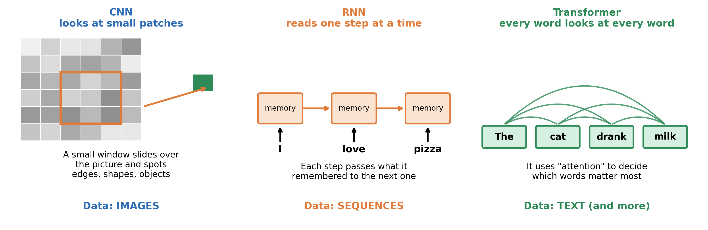
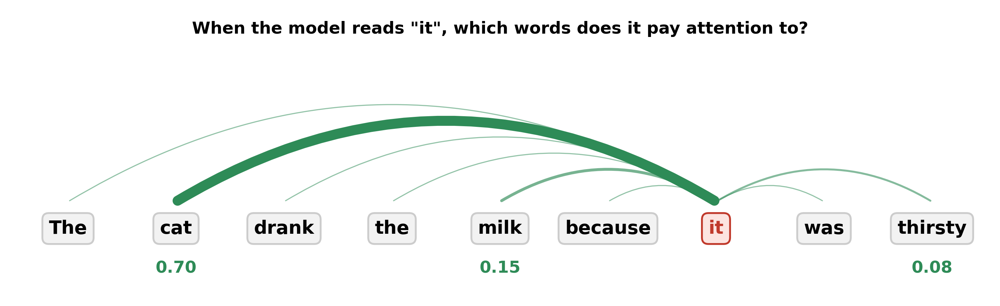

# 3.6 Deep Learning Today: CNNs, RNNs, Transformers

> **Status:** outline only · **Owner:** Irada · **Reviewer:** Elinna

> v0.1 research draft · AI-assisted (Claude, 2026-11-02) · Not yet verified by the team
 
## Learning outcomes
 
- Explain what "deep learning" means.
- Match an architecture (CNN, RNN or Transformer) to a type of data: images, sequences or text.
- Describe in one sentence what each architecture does.
- Name two limitations of deep learning.

## Key ideas
 
- Deep learning uses neural networks with many layers.
- CNNs detect local patterns in images.
- RNNs and Transformers handle sequences. Transformers are behind modern chatbots.
- Limitations: need a lot of data, hard to explain their decisions, can inherit bias from data.

## What is deep learning?
 
**Definition.** **Deep learning** is machine learning that uses neural networks with many layers. The word "deep" refers to the number of layers: more layers let the network learn more complicated patterns.
 
All the ideas you already know still apply. The network has neurons with weights, it learns from data, and we test it on new data to check that it does not overfit.
 
An **architecture** is the way the layers and connections of a network are arranged. Different tasks need different arrangements. This section covers three popular ones.
 
## Three architectures
 

  

*Each architecture is built for a different kind of data.*
 
### CNN: for images
 
**Definition.** A **CNN** (convolutional neural network) is a network for data laid out like a picture. Instead of looking at the whole image at once, it slides a small window over it and looks at one small patch at a time.
 
Properties:
 
- Early layers find simple things, such as edges and corners.
- Later layers combine them into shapes, and then into objects, such as a face or a cat.
- The same small window is reused across the whole image, so the network can spot a pattern wherever it appears.
Where you meet it: unlocking a phone with your face, tagging friends in photos, and helping doctors look at X-ray images.
 
The AlexNet result from 2012 in topic 3.1 was a CNN.
 
### RNN: for sequences
 
**Definition.** An **RNN** (recurrent neural network) is a network for data that comes in order, such as speech, text or a series of measurements over time. It reads one step at a time and keeps a small **memory** of what it has seen, so earlier steps can affect later ones.
 
Properties:
 
- It processes the sequence in order, step by step.
- The memory is passed from one step to the next.
- It can forget things from far back in a long sequence, and reading step by step is slow.
Where you meet it: older speech recognition, predicting the next value in a series (for example, tomorrow's temperature from the last days).
 
### Transformer: for text and more
 
**Definition.** A **Transformer** is a network that uses **attention**: for each word, it decides which other words in the text matter most. It looks at all the words at the same time instead of one by one.
 
Properties:
 
- It handles long texts well, because every word can look directly at every other word.
- It can be trained faster than an RNN, because it does not have to go step by step.
- It was introduced in 2017 and is the basis of most modern chatbots (ChatGPT, Claude, Gemini) and translation tools.
- It can also be adapted to images and sound, not only text.

### Attention: a small example
 
Take the sentence: "The cat drank the milk because **it** was thirsty." Who is "it"? A person knows it is the cat. To understand "it", the Transformer gives each earlier word a score for how much attention to pay.
 

  

*The thick line shows that the model pays most attention to "cat" when reading "it".*
 
| Word the model looks at | Attention score |
|---|---|
| cat | 0.70 |
| milk | 0.15 |
| thirsty | 0.08 |
| all other words together | 0.07 |
 
*These scores are made up to show the idea. In a real model the scores are learned during training.*
 
The scores add up to 1.00. "Cat" gets the most, so the model links "it" to the cat.
 
### The three architectures compared
 
| | CNN | RNN | Transformer |
|---|---|---|---|
| Built for | Images | Sequences | Text (and more) |
| How it reads | Small patches, window slides | One step at a time | All words at once, using attention |
| Strength | Finds patterns in pictures | Uses earlier steps as memory | Handles long text, powers chatbots |
| Weakness | Mainly for grid-like data | Slow, forgets far-back steps | Needs a lot of data and computing power |
| Example | Face unlock | Predicting a time series | Chatbot, translation |
 
## Worked example: a day with deep learning
 
Here is one ordinary day. Each step uses a different kind of data, so each uses a different architecture.
 
| Moment | Data | Architecture | Why it fits |
|---|---|---|---|
| Phone unlocks with your face | Image | CNN | Finds shapes in a picture |
| You ask a chatbot for homework help | Text | Transformer | Understands which words matter |
| A translation app reads a menu | Text | Transformer | Looks at the whole sentence at once |
| A weather app predicts tomorrow's temperature | Sequence of numbers | RNN | Uses the last days as memory |
| A hospital program checks an X-ray | Image | CNN | Finds small patterns in a picture |
 
*Real products often combine several architectures, so this table shows the typical choice, not the only one.*
 
## What deep learning cannot do well
 
Deep learning is powerful, but it has limits. It is important to know them.
 
| Limitation | What it means | Example |
|---|---|---|
| Needs a lot of data and computing power | Training a large network takes huge amounts of examples and electricity | A small school project cannot train a chatbot from scratch |
| Hard to explain | We often cannot say why the network gave a certain answer | A model rejects a loan and nobody can say exactly why |
| Can inherit bias | If the training data is unfair or one-sided, the model copies that | A face-unlock model trained mostly on one group of people works worse for others |
| Can be wrong and sound sure | A model may give a wrong answer in a confident way | A chatbot invents a fact that sounds true |
 
**Definition.** **Bias** here means that a model gives unfair or one-sided results because the data it learned from was unfair or one-sided. The model is not "deciding" to be unfair. It copies the patterns it was shown.
 
This links back to topics 3.1 and 3.5. A model can only learn from the data we give it, and it must be tested on new, varied data.
 
> **Important:** a deep-learning model can be very good at a task and still make mistakes. People must check its results, especially for important decisions.
 
## Activity: which architecture?
 
For each application, choose the best match: CNN, RNN or Transformer. Explain your choice in one sentence.
 
1. A phone unlocks when it recognises your face.
2. A chatbot answers a question you type.
3. An app translates a paragraph from English to Chinese.
4. A program predicts tomorrow's temperature from the last 30 days.
5. A program looks for signs of illness in an X-ray.

**Expected outcome:**
 
1. CNN. The input is an image, and the network looks for shapes.
2. Transformer. The input is text, and attention finds the words that matter.
3. Transformer. It reads the whole sentence at once. (Older tools used RNNs.)
4. RNN. The input is a sequence of numbers over time, and earlier days matter.
5. CNN. The input is an image, and the network looks for small patterns.
Some tasks can use more than one architecture. For example, Transformers can also be used for images. The best choice depends on the data and the goal.
 
## Check your understanding
 
**Q1 (True/False).** "Deep" in deep learning means the network has many layers.
 
**Q2 (True/False).** A CNN reads a sentence one word at a time and keeps a memory.
 
**Q3 (Multiple choice).** Which architecture is the basis of modern chatbots?
A. CNN  B. RNN  C. Transformer  D. A single perceptron
 
**Q4 (Multiple choice).** Which kind of data is an RNN designed for?
A. A single photo  B. A series of values over time  C. A table of names  D. A map
 
**Q5 (Match).** Match each task to CNN, RNN or Transformer: (a) tagging friends in photos, (b) predicting the next value in a time series, (c) writing a summary of an article.
 
**Q6 (Problem).** A face-unlock model was trained mostly on photos of one group of people. What problem might happen, and what would you do?
 
**Q7 (Analysis).** Name two limitations of deep learning and give one example of each.
 
## Answers
 
**A1.** True. "Deep" refers to the number of layers.
 
**A2.** False. A CNN looks at small patches of an image. Reading step by step with a memory is what an RNN does.
 
**A3.** C. Chatbots such as ChatGPT, Claude and Gemini are built on the Transformer.
 
**A4.** B. An RNN is designed for data in order, such as a series of values over time.
 
**A5.** (a) CNN, because the data is images. (b) RNN, because the data is a sequence over time. (c) Transformer, because the data is text.
 
**A6.** The model may work well for that group and badly for others, because the data did not show everyone. Collect more varied photos and test the model on all groups (see topic 3.5).
 
**A7.** For example: it needs a lot of data (a school project cannot train a chatbot from scratch), and it is hard to explain (a model rejects a loan and nobody knows why). Bias and confident wrong answers are other correct limitations.
 
## Connections
 
- The layers and weights that make a network "deep" come from [3.3 Multi-layer Networks and the Forward Pass](3.3-multilayer-networks.md).
- Why big models need a lot of varied data, and how to test them, is in [3.5 Training in Practice](3.5-training-practice.md).
- The AlexNet result in the timeline of [3.1 From Rules to Learning](3.1-rules-to-learning.md) was a CNN.

## References
 
1. IBM. *What is a recurrent neural network (RNN)?* https://www.ibm.com/topics/recurrent-neural-networks
2. IBM. *What is a transformer model?* https://www.ibm.com/topics/transformer-model
3. IBM. *What is an attention mechanism?* https://www.ibm.com/topics/attention-mechanism
4. IBM. *What are convolutional neural networks?* https://www.ibm.com/topics/convolutional-neural-networks
5. Vaswani, A., et al. (2017). *Attention Is All You Need.* https://arxiv.org/abs/1706.03762
6. 3Blue1Brown. *Neural networks* video series (chapters on transformers and GPT). https://www.youtube.com/@3blue1brown